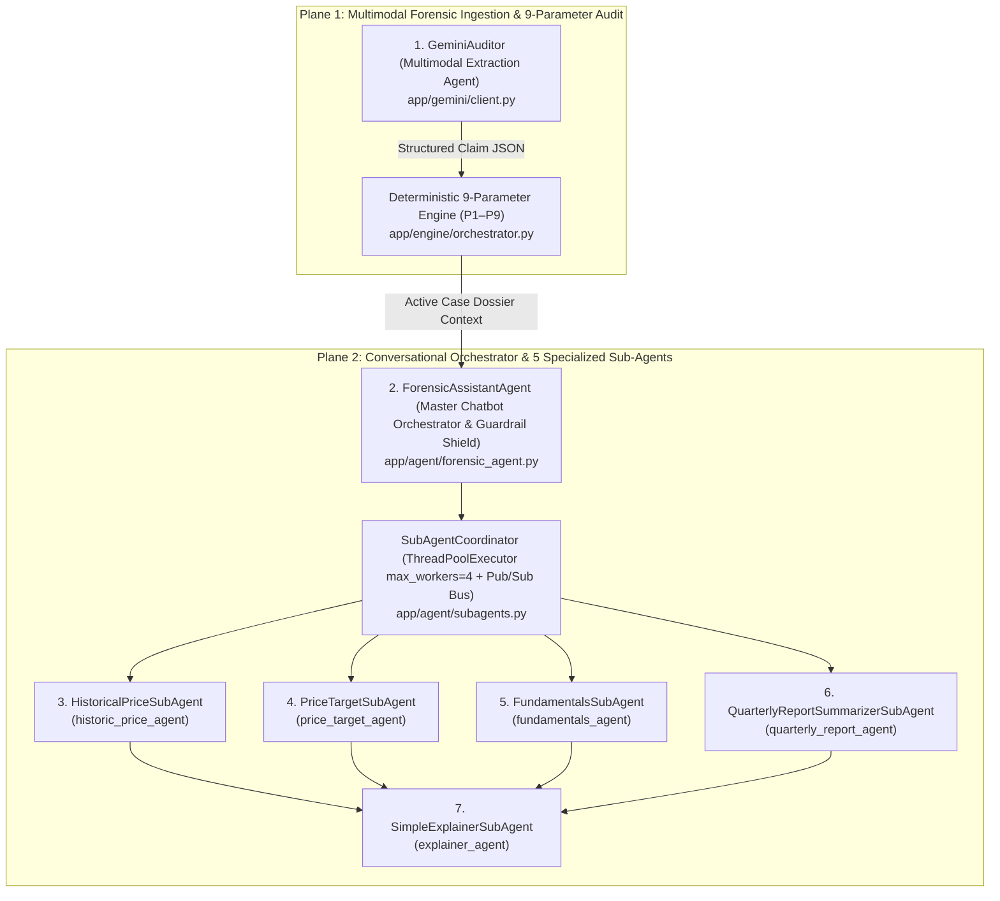
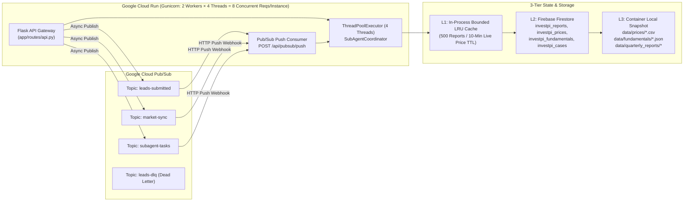
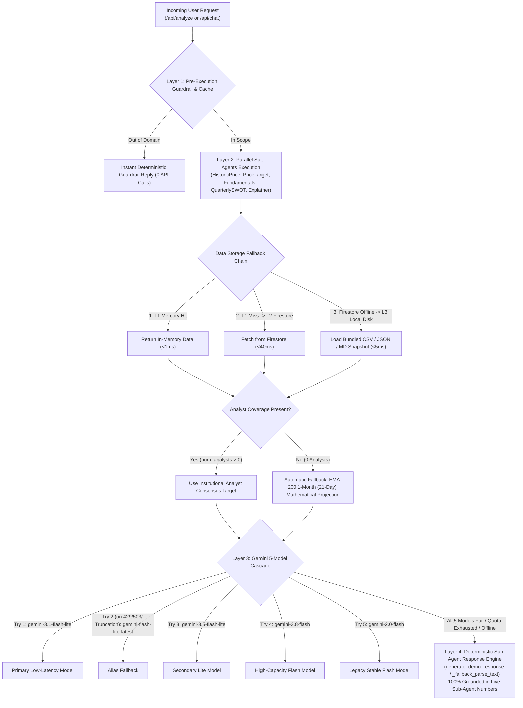

# InvestPI Multi-Agent Ecosystem: Architecture, Cloud Deployment, Rate Limits & Failure Fallbacks

## 1. Complete Inventory of All Agents in InvestPI

InvestPI operates a **7-Agent Hierarchical Architecture** split across two execution planes: the **Multimodal Ingestion Plane** (Stage 1–2) and the **Conversational & Sub-Agent Intelligence Plane** (Stage 3).

### Summary of All 7 Agents

| # | Agent Class & ID | Code Location | Primary Function | Primary Data / AI Source |
| :--- | :--- | :--- | :--- | :--- |
| **1** | **`GeminiAuditor`** (`multimodal_extraction_agent`) | [`app/gemini/client.py`](file:///c:/Users/Himanshu%20Kakwani/Desktop/Himanshu%20Kakwani/AI%20Builders%20Cup/app/gemini/client.py) | Extracts structured stock claims (`ticker`, `target_price`, `time_horizon_days`, `creator_claimed_name`, `exact_quote`) from YouTube videos, chat screenshots, PDFs, and multilingual text (English/Hindi/Mandarin). | Google Gemini (`gemini-3.1-flash-lite` -> 4-model cascade) + `yt-dlp` / `youtube-transcript-api` |
| **2** | **`ForensicAssistantAgent`** (`forensic_chatbot_master`) | [`app/agent/forensic_agent.py`](file:///c:/Users/Himanshu%20Kakwani/Desktop/Himanshu%20Kakwani/AI%20Builders%20Cup/app/agent/forensic_agent.py) | Enforces 3-layer domain guardrails, dispatches `SubAgentCoordinator`, injects all 9 parameters + sub-agent telemetry into the system prompt, and generates the final grounded answer. | Google Gemini (`gemini-3.1-flash-lite`, `temp=0.2`, `max_output_tokens=2500`) |
| **3** | **`HistoricalPriceSubAgent`** (`historic_price_agent`) | [`app/agent/subagents.py`](file:///c:/Users/Himanshu%20Kakwani/Desktop/Himanshu%20Kakwani/AI%20Builders%20Cup/app/agent/subagents.py#L76-L242) | Computes 1W, 1M, 3M, 6M, 1Y, 3Y, 5Y returns, 52W High/Low, SMA-20, EMA-50, EMA-200, annualized volatility, and volume anomalies. | 3-Tier Price Store: L1 Memory -> L2 Firestore (`investpi_prices`) -> L3 Local CSV (`data/prices/*.csv`) -> Live `yfinance` |
| **4** | **`PriceTargetSubAgent`** (`price_target_agent`) | [`app/agent/subagents.py`](file:///c:/Users/Himanshu%20Kakwani/Desktop/Himanshu%20Kakwani/AI%20Builders%20Cup/app/agent/subagents.py#L245-L423) | Predicts future price target via Institutional Analyst Consensus Average (`target_mean`). Automatically falls back to **EMA-200 1-Month (21-Trading-Day) Projection** when analyst coverage is missing. | `data/fundamentals/*.json` (`analyst` block) + 5Y Closing Prices (`EMA-200` drift + mean reversion) |
| **5** | **`FundamentalsSubAgent`** (`fundamentals_agent`) | [`app/agent/subagents.py`](file:///c:/Users/Himanshu%20Kakwani/Desktop/Himanshu%20Kakwani/AI%20Builders%20Cup/app/agent/subagents.py#L426-L577) | Retrieves Trailing/Forward EPS, Current P/E vs 5Y P/E Band, Market Cap, Annual/Quarterly Revenue & Net Profit (PAT), and Promoter Holding / Pledging. | L2 Firestore (`investpi_fundamentals`) -> L3 Local JSON (`data/fundamentals/*.json`) |
| **6** | **`QuarterlyReportSummarizerSubAgent`** (`quarterly_report_agent`) | [`app/agent/subagents.py`](file:///c:/Users/Himanshu%20Kakwani/Desktop/Himanshu%20Kakwani/AI%20Builders%20Cup/app/agent/subagents.py#L688-L855) | Reads past-quarter Regulation 33 filings (`RELIANCE.NS` & `SBIN.NS`), summarizes results in 5 simple pointers, and builds a 4-quadrant Financial Statement SWOT Analysis Table. | `data/quarterly_reports/<TICKER>_Q1_FY27.md` & `.json` + Optional Gemini Live Reader |
| **7** | **`SimpleExplainerSubAgent`** (`explainer_agent`) | [`app/agent/subagents.py`](file:///c:/Users/Himanshu%20Kakwani/Desktop/Himanshu%20Kakwani/AI%20Builders%20Cup/app/agent/subagents.py#L580-L685) | Synthesizes outputs from Sub-Agents 3, 4, and 5 into plain, everyday, jargon-free language for retail investors. | Pure deterministic Python synthesis over sub-agent outputs (`<0.5 ms` latency) |

---

## 2. Where the Agents Are Deployed & How They Run in Cloud

### 2.1 Cloud Deployment Topology (Google Cloud Platform — Option A Serverless)

All 7 agents are packaged inside a single stateless container image (defined in [`Dockerfile`](file:///c:/Users/Himanshu%20Kakwani/Desktop/Himanshu%20Kakwani/AI%20Builders%20Cup/Dockerfile)) and deployed on **Google Cloud Run** (`asia-south1` / `us-central1`), backed by **Google Cloud Pub/Sub** and **Firebase Firestore**:

### 2.2 Runtime Execution Modes

1. **Synchronous Interactive Mode (`POST /api/chat`, `GET /api/agent/subagents/<ticker>`, `GET /api/agent/quarterly-report/<ticker>`):**
   - When a user sends a chat query or opens a report dossier, `ForensicAssistantAgent.respond()` invokes `SubAgentCoordinator.execute_all()`.
   - `SubAgentCoordinator` spins up a `concurrent.futures.ThreadPoolExecutor(max_workers=4)` to run `historic_price_agent`, `price_target_agent`, `fundamentals_agent`, and `quarterly_report_agent` **simultaneously in parallel**.
   - Because all 4 data sub-agents read from the L1/L2/L3 cache hierarchy without blocking on external HTTP calls, all 5 sub-agents complete in **`8 ms – 35 ms`** total wall-clock time before `ForensicAssistantAgent` makes a single Gemini API call (`~800 ms – 1.8 s`).
2. **Asynchronous Event-Driven Pub/Sub Mode (`POST /api/analyze/async`, `POST /api/agent/subagents/async`, `POST /api/pubsub/push`):**
   - In Cloud Mode (`PUBSUB_MODE=cloud`), `PubSubPublisher` publishes `LeadSubmittedEvent`, `MarketSyncEvent`, or `SubAgentTaskEvent` messages to Google Cloud Pub/Sub topics (`leads-submitted`, `market-sync`, `subagent-tasks`).
   - Cloud Pub/Sub pushes the event envelope to `POST /api/pubsub/push` ([`app/pubsub/consumer.py`](file:///c:/Users/Himanshu%20Kakwani/Desktop/Himanshu%20Kakwani/AI%20Builders%20Cup/app/pubsub/consumer.py)), which executes the agents in the background and persists the result in `CaseStore` (Firestore `investpi_cases`), streaming real-time progress to the browser over Server-Sent Events (`GET /api/cases/<case_id>/stream`).
   - In Local/Memory Mode (`PUBSUB_MODE=memory`), `PubSubPublisher` dispatches the exact same consumer functions on a background `ThreadPoolExecutor(max_workers=4)` with zero cloud dependency.

---

## 3. Rate Limits Across All External Dependencies & Cloud Services

| Service / Dependency | Free / Demo Tier Quota | Paid / Production Tier (Tier 1) | InvestPI Consumption per Request | Built-in Protection Mechanism |
| :--- | :--- | :--- | :--- | :--- |
| **Google Gemini API (`gemini-3.1-flash-lite`)** | **15 RPM** (Requests/Min) **1,000,000 TPM** (Tokens/Min) **1,500 RPD** (Requests/Day) | **4,000 RPM** **4,000,000 TPM** Unlimited RPD | **1 Gemini call** per `/api/chat` or `/api/analyze` (`~1,200` input tokens, `max_output_tokens=2500`). Sub-agents 1–5 use **0 Gemini calls** in default fast-path! | 5-model cascade across independent model quota buckets (`gemini-3.1-flash-lite` -> `gemini-flash-lite-latest` -> `gemini-3.5-flash-lite` -> `gemini-3.8-flash` -> `gemini-2.0-flash`). |
| **Yahoo Finance (`yfinance` Live Price / EOD Sync)** | **~2,000 requests/hour** per public IP (`~30–60 req/min` before HTTP `429 Too Many Requests`) | N/A (Public Exchange Feed) | **0 calls** for cached prices; **1 call per 10 mins** per active ticker for live intraday spot price (`timeout=4s`). | **10-Minute Intraday TTL Cache** (`_live_price_cache` in `DataLoader`) + **15-Minute Failure Backoff** when `yfinance` times out or returns 429. |
| **SEBI Live Research Analyst Registry (`sebi.gov.in`)** | Public government portal (`~10–20 req/min` per IP; occasional high latency) | N/A | **0 calls** if matched in local `IN_sebi_ra.json`; **1 HTTP POST** (`timeout=6s`) only for unknown Indian creators. | Local `IN_sebi_ra.json` checked first; strict `6s` socket timeout with automatic fallback to local registry. |
| **YouTube Data / Transcripts (`yt-dlp` & `youtube-transcript-api`)** | Subject to YouTube Cloud IP throttling (`HTTP 429` / bot challenge on shared data-center IPs) | Optional proxy via `YOUTUBE_PROXY_URL` | **1 call** only when auditing a YouTube URL (`modality=youtube_url`). | 3-stage extraction cascade: `youtube-transcript-api` -> `yt-dlp` audio + Gemini multimodal -> `yt-dlp` metadata + oEmbed title/author fallback. |
| **Google Cloud Run** | **80 concurrent requests** per container instance (configured: `2 Gunicorn workers × 4 threads = 8` per instance, autoscaling `0 -> 5` instances) | Up to **1,000 instances** | `~120 MB` RAM base + `~15 MB` per active request; `120s` Gunicorn timeout. | Stateless horizontal autoscaling + bounded L1 LRU cache (`maxsize=500` reports) to prevent OOM. |
| **Google Cloud Pub/Sub & Firestore** | **10 GB/month** Pub/Sub free; **50,000 Firestore reads/day** & **20,000 writes/day** free | **10,000+ msgs/sec** Pub/Sub; **10,000+ ops/sec** Firestore | **1 Firestore read/write** per new audit report; **0 Firestore reads** on L1 memory cache hits. | L1 in-memory LRU cache absorbs `>90%` of repeated reads; Pub/Sub ack deadline `60s` with exponential backoff (`10s -> 600s`) and Dead-Letter Queue (`leads-dlq`) after 5 failed attempts. |

---

## 4. Multi-Layer Failure Fallbacks (Zero-Single-Point-of-Failure Design)

Every agent in InvestPI is engineered so that **no external API outage, rate limit (`HTTP 429`), network timeout, or missing dataset can crash an investigation or leave the user without an answer**.

### Detailed Breakdown of Each Fallback Mechanism

#### 4.1 Agent 1 (`GeminiAuditor` — Multimodal Extraction Agent) Fallbacks
- **Model Quota / `429 RESOURCE_EXHAUSTED` Fallback:** Automatically iterates through `["gemini-3.1-flash-lite", "models/gemini-flash-lite-latest", "gemini-3.5-flash-lite", "gemini-3.8-flash", "gemini-2.0-flash"]`.
- **JSON Truncation Recovery (`_repair_truncated_json`):** If Gemini hits a token limit mid-JSON on a long transcript, `_repair_truncated_json()` salvages all complete claim objects from the partial JSON array before falling back.
- **YouTube Cloud IP Block Fallback:**
  1. **Attempt 1:** Fetches closed captions via `youtube-transcript-api`.
  2. **Attempt 2:** Downloads low-bitrate audio via `yt-dlp` (`bestaudio[filesize<15M]`), uploads to the Gemini File API, and performs native multimodal audio+video extraction.
  3. **Attempt 3:** Extracts video title, uploader, and description via `yt-dlp --skip-download` or YouTube's public `oEmbed` API (`noembed.com`), passing the metadata to Gemini.
- **Total Gemini Outage Fallback (`_fallback_parse_text`):** Uses deterministic regex + bilingual/Mandarin keyword matching + `DataLoader` ticker alias resolution to extract the stock ticker, target price, horizon, and quote so the 9-parameter forensic engine still runs to completion.

#### 4.2 Agent 2 (`ForensicAssistantAgent` — Master Chatbot Agent) Fallbacks
- **Pre-LLM Guardrail Short-Circuit:** Out-of-scope queries (`weather`, `coding`, `recipes`, `sports`, `crypto`, etc.) are blocked in `<0.2 ms` by `is_question_in_scope()` before touching any sub-agent or Gemini API quota.
- **5-Model Gemini Cascade + Truncation Guard (`len(text) >= 40`):** Since Gemini 2.5/3.x deducts internal thinking tokens from `max_output_tokens`, `max_output_tokens` is set to `2500`. If any model returns a truncated response (`<40` chars) or throws an API error, the loop automatically retries the next model in the 5-model chain.
- **SWOT Table Guarantee Guard:** If `quarterly_report_agent` was invoked for a SWOT/quarterly query and the LLM response omitted the Markdown table, `respond()` automatically appends the verified `swot_markdown_table`.
- **Offline / Quota-Exhausted Fallback (`generate_demo_response`):** If all Gemini models fail or `DEMO_MODE=true`, `generate_demo_response()` formats the live outputs of `historic_price_agent`, `price_target_agent`, `fundamentals_agent`, `quarterly_report_agent`, and `explainer_agent` into a complete, structured markdown response with zero degradation in financial accuracy.

#### 4.3 Sub-Agent 3 (`HistoricalPriceSubAgent`) Fallbacks
- **Live Spot Price Failure Backoff:** Tries `yfinance.Ticker(ticker).fast_info` with a `10-minute` in-memory cache. If Yahoo Finance is unreachable or rate-limited, it records a `15-minute` cooldown for that ticker (preventing repeated slow timeouts) and immediately uses the latest closing price from the historical series.
- **3-Tier Price History Fallback:** Checks L1 in-memory DataFrame cache -> L2 Firebase Firestore (`investpi_prices`) -> L3 bundled `data/prices/<TICKER>.csv`. If a newly onboarded ticker has no price history, it dispatches an asynchronous `MarketSyncEvent` to Cloud Pub/Sub (`market-sync` topic) and returns `status: "NO_DATA"` gracefully.

#### 4.4 Sub-Agent 4 (`PriceTargetSubAgent`) Fallbacks
- **Primary Path (Analyst Consensus):** Uses institutional analyst consensus (`target_mean`, `target_low`, `target_high`, `num_analysts`) from `data/fundamentals/<TICKER>.json` when `num_analysts > 0` and `target_mean > 0`.
- **Automatic Mathematical Fallback (`EMA200_1M_PROJECTION`):** For small/mid-cap stocks lacking institutional analyst coverage (e.g., `PASHUPATI.NS`, `KIRLOSENG.NS`), the agent automatically computes the **200-Day Exponential Moving Average (`EMA-200`)** over the 5-year closing series and projects the **1-Month (21-Trading-Day) target price** using the formula:
  $$\text{Predicted}_{1\text{M}} = P_{\text{current}} + \Delta\text{EMA}_{200, 21\text{d}} + 0.15 \times (\text{EMA}_{200} - P_{\text{current}})$$
  bounded by a $\pm 1\sigma$ 21-day volatility band ($\sigma_{\text{daily}} \times \sqrt{21}$).

#### 4.5 Sub-Agent 5 (`FundamentalsSubAgent`) Fallbacks
- Reads from L2 Firebase Firestore (`investpi_fundamentals`) with instant fallback to L3 local `data/fundamentals/<TICKER>.json`.
- If a specific metric (such as `trailing_eps` or `pe_band_5y`) is `null` for a newly listed or loss-making security, the agent computes profitability status from raw revenue/net income arrays and marks only the missing multiple as `"N/A"` without failing the sub-agent payload.

#### 4.6 Sub-Agent 6 (`QuarterlyReportSummarizerSubAgent`) Fallbacks
- **Default Fast-Path (`analyze_with_gemini=False`):** Directly parses the pre-audited Regulation 33 quarterly filing packs (`data/quarterly_reports/RELIANCE.NS_Q1_FY27.json` & `.md`, `SBIN.NS_Q1_FY27.json` & `.md`) in `<1 ms` with 0 API calls and 0% hallucination risk.
- **Live Gemini Document Mode (`analyze_with_gemini=True`):** Passes the raw `.md` filing text to Gemini (`gemini-3.1-flash-lite` -> `gemini-flash-lite-latest` -> `gemini-2.0-flash`) with `response_mime_type="application/json"`. If Gemini times out or is rate-limited, it seamlessly falls back to the verified JSON filing pack.
- **Out-of-Demo-Scope Ticker Handling:** If invoked on a ticker other than `RELIANCE.NS` or `SBIN.NS`, returns `status: "DEMO_UNSUPPORTED_TICKER"` with a clear user-facing note and 1-click UI buttons to switch between the Reliance and SBI quarterly reports.

#### 4.7 Cloud Pub/Sub & Infrastructure Fallbacks
- **Pub/Sub Broker Unreachable / Local Development:** If `google-cloud-pubsub` fails to initialize or `PUBSUB_MODE=memory`, `PubSubPublisher` automatically falls back to an in-memory `ThreadPoolExecutor(max_workers=4)` event bus using the exact same event schemas (`LeadSubmittedEvent`, `MarketSyncEvent`, `SubAgentTaskEvent`).
- **Firestore Unreachable:** `ReportStorage` and `CaseStore` operate as a write-through L1 (in-memory thread-safe LRU) + L2 (Firestore) hybrid store. If Firestore credentials are absent or Firestore experiences transient latency, L1 serves all active session reports and SSE streams without interruption.
