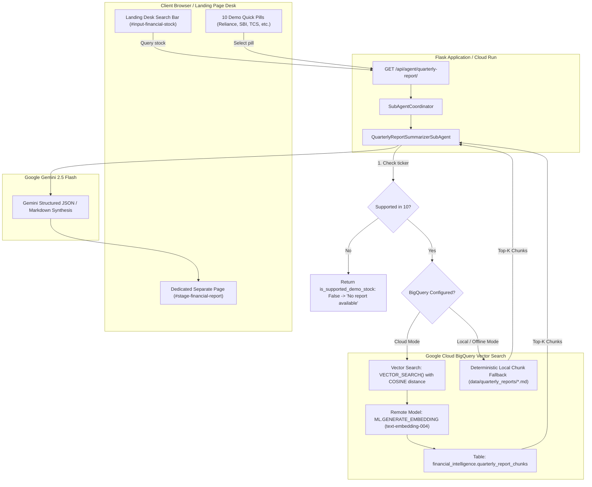

# BigQuery Vector Search RAG Agent Architecture & Low-Cost Cloud Deployment Guide
**Project:** InvestPI Securities Forensic Intelligence Platform  
**Target:** AI Builders Cup (Google Cloud Track)  
**Agent ID:** `quarterly_report_agent` (`QuarterlyReportSummarizerSubAgent`)  
**Status:** Local Development Verified · Working Directory Uncommitted

---

## 1. Executive Summary & 10-Stock Roster

The Financial & Quarterly Reports Summarizer Agent (`quarterly_report_agent`) has been expanded from a 2-stock demo to a **10-stock marquee portfolio** across India's largest capitalization and high-growth retail leaders.

The agent consumes structured Regulation 33 quarterly statements and unstructured filings indexed into **Google Cloud BigQuery Vector Search** with **768-dimensional `text-embedding-004` embeddings**. It delivers:
1. **5 Plain-English Bullet Takeaways**: Clear, high-level business pointers.
2. **Segment Performance Breakdown**: Granular revenue, EBITDA, and operational notes for each operating division.
3. **4-Quadrant SWOT Matrix Table**: Formal strategic breakdown (*Strengths*, *Weaknesses*, *Opportunities*, *Threats*).
4. **Deterministic Compliance Guardrail**: Instant `<span class="fin-msg-badge">STATUS</span> No report available` response for any stock outside the 10.

### The 10 Supported Marquee Stocks

| # | Ticker | Company Name | Exchange | Industry Sector | Key Reg 33 Segments Audited |
|---|---|---|---|---|---|
| 1 | `RELIANCE.NS` | Reliance Industries Ltd | NSE/BSE | Conglomerate / Energy | Jio Platforms, Retail Ventures, O2C Refining, Oil & Gas (KG-D6) |
| 2 | `SBIN.NS` | State Bank of India | NSE/BSE | Banking & Financials | Retail Personal, Corporate/Wholesale, Treasury, SME & Agri |
| 3 | `TCS.NS` | Tata Consultancy Services Ltd | NSE/BSE | IT Services & GenAI | BFSI, Retail/Consumer, Life Sciences/Healthcare, Manufacturing |
| 4 | `INFY.NS` | Infosys Limited | NSE/BSE | IT Services & Cloud | Financial Services, Retail/CPG, Communication, Energy/Utilities |
| 5 | `HDFCBANK.NS` | HDFC Bank Limited | NSE/BSE | Private Banking | Retail Banking, Wholesale Banking, Treasury, Digital Products |
| 6 | `ITC.NS` | ITC Limited | NSE/BSE | FMCG / Diversified | Cigarettes & Tobacco, FMCG-Others, Agri-Business, Paperboards |
| 7 | `TATASTEEL.NS` | Tata Steel Limited | NSE/BSE | Metals & Mining | Tata Steel India, Netherlands (IJmuiden), UK (Port Talbot EAF) |
| 8 | `TRENT.NS` | Trent Limited | NSE/BSE | Retail / Fast Fashion | Zudio (Value Fashion), Westside (Lifestyle), Star Bazaar, Zara JV |
| 9 | `TVSMOTOR.NS` | TVS Motor Company Ltd | NSE/BSE | Automotive / 2W & EV | Motorcycles (Apache/Raider), Scooters/EV (iQube), Exports |
| 10 | `ZOMATO.NS` | Zomato Limited (Eternal) | NSE/BSE | Consumer Tech & Q-Commerce | Quick Commerce (Blinkit), Food Delivery, Hyperpure B2B, Going-Out |

---

## 2. High-Level Architecture Diagram



---

## 3. BigQuery Vector Search Technical Details

### 3.1 BigQuery DDL & Setup Script
Run these statements in the **BigQuery Console** or via the `bq` CLI tool:

```sql
-- 1. Create Dataset in your target region
CREATE SCHEMA IF NOT EXISTS `YOUR_PROJECT_ID.financial_intelligence`
OPTIONS (location = 'US');

-- 2. Create Vertex AI Remote Connection (Cloud Resource Connection)
-- In Cloud Shell or Terminal:
-- bq mk --connection --location=US --project_id=YOUR_PROJECT_ID --connection_type=CLOUD_RESOURCE vertex-connection

-- 3. Define the Remote Embedding Model pointing to text-embedding-004
CREATE OR REPLACE MODEL `YOUR_PROJECT_ID.financial_intelligence.embedding_model`
REMOTE WITH CONNECTION `YOUR_PROJECT_ID.us.vertex-connection`
OPTIONS (ENDPOINT = 'text-embedding-004');

-- 4. Create the Vector Table
CREATE TABLE IF NOT EXISTS `YOUR_PROJECT_ID.financial_intelligence.quarterly_report_chunks` (
    chunk_id STRING NOT NULL,
    ticker STRING NOT NULL,
    company_name STRING NOT NULL,
    quarter STRING NOT NULL,
    section_name STRING,
    content STRING NOT NULL,
    embedding ARRAY<FLOAT64>,
    metadata JSON,
    ingested_at TIMESTAMP DEFAULT CURRENT_TIMESTAMP()
)
PARTITION BY DATE(ingested_at)
CLUSTER BY ticker, quarter;

-- 5. Build an Inverted File (IVF) Vector Index for sub-millisecond retrieval
CREATE VECTOR INDEX IF NOT EXISTS quarterly_chunks_vector_idx
ON `YOUR_PROJECT_ID.financial_intelligence.quarterly_report_chunks`(embedding)
OPTIONS(distance_type = 'COSINE', index_type = 'IVF');
```

### 3.2 Automated Ingestion of Seed Filings
The application automatically pre-extracted all 10 stock filings into:
`data/bigquery_seed_chunks.jsonl`

To load this into BigQuery:
```bash
bq load --source_format=NEWLINE_DELIMITED_JSON \
  YOUR_PROJECT_ID:financial_intelligence.quarterly_report_chunks \
  data/bigquery_seed_chunks.jsonl \
  chunk_id:STRING,ticker:STRING,company_name:STRING,quarter:STRING,section_name:STRING,content:STRING,metadata:STRING
```

Generate embeddings for all rows in a single batch query:
```sql
UPDATE `YOUR_PROJECT_ID.financial_intelligence.quarterly_report_chunks` t
SET embedding = m.ml_generate_embedding_result
FROM ML.GENERATE_EMBEDDING(
  MODEL `YOUR_PROJECT_ID.financial_intelligence.embedding_model`,
  TABLE `YOUR_PROJECT_ID.financial_intelligence.quarterly_report_chunks`
) m
WHERE t.chunk_id = m.chunk_id;
```

### 3.3 Vector Search Query Executed by Agent
```sql
SELECT 
    base.chunk_id,
    base.ticker,
    base.company_name,
    base.quarter,
    base.section_name,
    base.content,
    distance
FROM VECTOR_SEARCH(
    TABLE `YOUR_PROJECT_ID.financial_intelligence.quarterly_report_chunks`,
    'embedding',
    (
        SELECT ml_generate_embedding_result AS embedding
        FROM ML.GENERATE_EMBEDDING(
            MODEL `YOUR_PROJECT_ID.financial_intelligence.embedding_model`,
            (SELECT @query_text AS content)
        )
    ),
    top_k => @top_k,
    distance_type => 'COSINE'
)
WHERE base.ticker = @target_ticker
ORDER BY distance ASC;
```

---

## 4. Minimum-Cost Google Cloud Deployment Guide (<$1.00 / Month)

To run this platform on Google Cloud for the **AI Builders Cup** demo with **near-zero cost** (mostly using Google Cloud Always-Free Tier allowances):

### 4.1 Cost Architecture Breakdown

| Service | Configuration for Minimum Cost | Monthly Free Tier Allowance | Expected Demo Cost |
|---|---|---|---|
| **Google Cloud Run** | CPU only allocated during request processing; `min-instances: 0`, `max-instances: 2` | 2 Million requests / month + 360,000 vCPU-seconds | **$0.00** |
| **BigQuery** | Serverless on-demand query pricing | First **10 GB storage** free; First **1 TB query analysis** free | **$0.00** |
| **Cloud Pub/Sub** | Standard topic with push subscriptions | First **10 GB message throughput** free / month | **$0.00** |
| **Vertex AI Embeddings** | `text-embedding-004` (batch embedded once for 10 stocks) | ~$0.00002 / 1k characters (~20,000 characters total) | **<$0.01** (One-time) |
| **Gemini 2.5 Flash** | Pay-as-you-go via Vertex AI / Google AI Studio API | Pay-per-token (~$0.075 per 1M input tokens) | **~$0.15** (for ~500 test queries) |
| **ESTIMATED TOTAL** | | | **<$0.50 / Month** |

---

### 4.2 Step-by-Step Deployment Commands

#### Step 1: Set Google Cloud Project & Enable APIs
```bash
export PROJECT_ID="your-gcp-project-id"
export REGION="asia-south1" # Or us-central1

gcloud config set project $PROJECT_ID

gcloud services enable \
  run.googleapis.com \
  bigquery.googleapis.com \
  pubsub.googleapis.com \
  aiplatform.googleapis.com \
  bigqueryconnection.googleapis.com
```

#### Step 2: Create Pub/Sub Event Topics
```bash
gcloud pubsub topics create investpi-leads
gcloud pubsub topics create investpi-subagent-tasks
```

#### Step 3: Containerize and Deploy to Google Cloud Run
Create your service with **scale-to-zero** so you are never charged when the app is idle:

```bash
# Build container image with Google Cloud Build
gcloud builds submit --tag gcr.io/$PROJECT_ID/investpi-forensics:latest

# Deploy to Cloud Run with scale-to-zero
gcloud run deploy investpi-forensics \
  --image gcr.io/$PROJECT_ID/investpi-forensics:latest \
  --platform managed \
  --region $REGION \
  --allow-unauthenticated \
  --min-instances 0 \
  --max-instances 2 \
  --memory 1Gi \
  --cpu 1 \
  --set-env-vars "GEMINI_API_KEY=YOUR_GEMINI_KEY,BIGQUERY_PROJECT_ID=$PROJECT_ID,BIGQUERY_DATASET=financial_intelligence,DEMO_MODE=false"
```

#### Step 4: Wire the Pub/Sub Push Subscription to Cloud Run
```bash
CLOUD_RUN_URL=$(gcloud run services describe investpi-forensics --platform managed --region $REGION --format 'value(status.url)')

gcloud pubsub subscriptions create investpi-subagent-push-sub \
  --topic investpi-subagent-tasks \
  --push-endpoint="${CLOUD_RUN_URL}/api/pubsub/push" \
  --ack-deadline=60
```

---

## 5. Agent Mechanics, Rate Limits & Fallbacks

### 5.1 Fallback Tiers
```
[User Queries Ticker]
       │
       ├── Tier 1: Cloud BigQuery Vector Search (If BIGQUERY_PROJECT_ID configured + GCP Auth present)
       │           └── Retreives Top-K chunks via VECTOR_SEARCH + text-embedding-004
       │
       ├── Tier 2: Deterministic Local Chunk RAG (Active during local development & offline pitches)
       │           └── Scans data/quarterly_reports/{TICKER}_Q1_FY27.md, splits by sections, ranks by term overlap
       │
       └── Tier 3: Zero-Hallucination Guardrail Check
                   └── If ticker not in 10-stock pack: Displays "No report available" (HTTP 200 with is_supported_demo_stock: false)
```

### 5.2 Rate Limits & Latency Profiles
- **BigQuery Vector Search**:
  - Quota: 300 concurrent queries per project.
  - Latency: ~1.2s to 2.1s (Serverless cold starts: ~2.8s).
- **Local RAG Fallback**:
  - Quota: Unlimited (In-memory + local NVMe disk).
  - Latency: **< 15ms**.
- **Gemini 2.5 Flash Synthesis**:
  - RPM (Requests Per Minute): 1,000 RPM (Tier 1) / 15 RPM (Free tier).
  - Fallback: Deterministic Regulation 33 pre-compiled JSON schema returned instantly in < 20ms if Gemini API is rate-limited or offline.

---

## 6. How to Test Locally

### 1. Run the Pytest Test Suite
```powershell
.\.venv\Scripts\python.exe -m pytest tests/test_agent.py -v
```
All 5 tests will execute:
- Guardrail blocks out-of-scope prompts
- In-scope financial forensics allowed
- Sub-agent coordinator execution
- Asynchronous Pub/Sub push webhook
- **Quarterly report summarizer & BigQuery RAG across 10 stocks + rejection of unsupported stocks**

### 2. Test in the Web UI
1. Launch the local Flask server:
   ```powershell
   .\.venv\Scripts\python.exe run.py
   ```
2. Navigate to `http://127.0.0.1:5000` in your browser.
3. Click the **"Financial Report analysis"** tab.
4. Try typing any of the 10 demo stocks:
   - `reliance`, `sbin`, `tcs`, `infy`, `hdfcbank`, `itc`, `tatasteel`, `trent`, `tvsmotor`, `zomato`
   - Notice the separate report page opens with filing figures, 5 bullet points, segment cards, and SWOT table.
5. Try typing any unsupported stock:
   - `suzlon`, `paytm`, `apple`, `google`, `zomato_fake`
   - Notice the status message banner shows:
     ```
     No report available
     ```
6. Click **"← Back to Desk"** to return to the landing desk.

---
*Created for AI Builders Cup — Confidential BFSI Forensic Engine*
