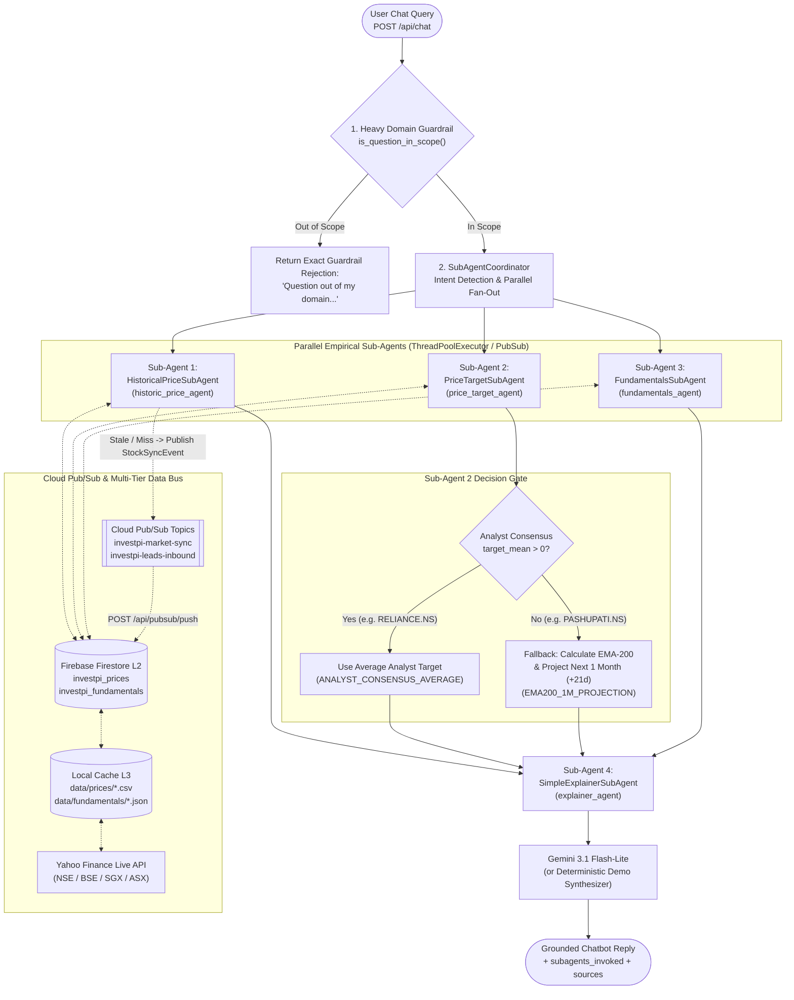

# InvestPI Chatbot Sub-Agents Architecture & Cloud Pub/Sub Integration

> **Module:** `app/agent/subagents.py` · `app/agent/forensic_agent.py` · `app/pubsub/`  
> **Runtime:** Google Cloud Run + Google Cloud Pub/Sub + Firebase Firestore + Gemini 3.1 Flash-Lite  
> **Architecture Pattern:** Coordinator–Sub-Agent Fan-Out with Asynchronous Pub/Sub Event Bus Compliance

---

## 1. Analysis of the Deployed Cloud Pub/Sub Architecture

InvestPI runs on a serverless, event-driven architecture on **Google Cloud Platform (GCP)** combining **Cloud Run**, **Cloud Pub/Sub**, and **Firebase Firestore**:

### 1.1. Existing Cloud Pub/Sub Pipeline
1. **Topics & Subscriptions:**
   - **`investpi-leads-inbound`:** Receives incoming multimodal audit requests (`LeadSubmittedEvent`) and asynchronous worker tasks (`SubAgentTaskEvent`).
   - **`investpi-worker-sub` (Push Subscription):** Pushes base64-encoded event envelopes over HTTPS with Google-signed OIDC authentication to `POST /api/pubsub/push`.
   - **`investpi-market-sync`:** Handles per-stock (`StockSyncEvent`) and market-wide fan-out (`MarketSyncEvent`) price and fundamental synchronization jobs.
   - **`investpi-audits-completed`:** Broadcasts completed forensic verdicts (`AuditCompletedEvent`) to downstream consumers.
   - **`investpi-leads-dlq` (Dead-Letter Queue):** Isolates poison-pill messages after 5 failed delivery attempts.
2. **Two-Tier Hybrid State Persistence (`L1 Memory` + `L2 Firebase Firestore`):**
   - Because Cloud Run scales horizontally across multiple stateless container instances (`0` to `N`), in-memory caches alone cannot share state across instances.
   - InvestPI solves this with a **Two-Tier Hybrid Cache** (`app/data/storage.py` & `app/pubsub/store.py`):
     - **L1 Cache:** Thread-safe bounded in-memory LRU cache (`BoundedReportCache` & `DataLoader` caches) for sub-millisecond reads within the same container.
     - **L2 Cache (Firebase Firestore):** Shared cloud collections (`investpi_cases`, `investpi_reports`, `investpi_prices`, `investpi_fundamentals`, `investpi_registries`) ensuring any Cloud Run instance handling a `/api/chat` or `/api/pubsub/push` request has immediate access to the latest 5-year price candles, fundamentals, and audit reports.
3. **Dual-Mode Local Fallback:**
   - When `GCP_PROJECT_ID` is unset (e.g., local testing or CI), `PubSubPublisher` (`app/pubsub/publisher.py`) transparently dispatches events to an internal `ThreadPoolExecutor` (`pubsub-fallback`), guaranteeing 100% parity between cloud and local execution.

---

## 2. How the Chatbot Sub-Agents Are Wired

Inside the InvestPI Forensic Assistant Chatbot (`ForensicAssistantAgent`), user questions are orchestrated through **`SubAgentCoordinator`** (`app/agent/subagents.py`), which manages **4 specialized sub-agents**:



---

## 3. Detailed Breakdown of Each Sub-Agent

### 3.1. Sub-Agent 1: `HistoricalPriceSubAgent` (`historic_price_agent`)
* **File:** [`app/agent/subagents.py`](file:///c:/Users/Himanshu%20Kakwani/Desktop/Himanshu%20Kakwani/AI%20Builders%20Cup/app/agent/subagents.py)
* **Purpose:** Fetches and analyzes 5-year historical daily OHLCV (Open, High, Low, Close, Volume) exchange data for the audited stock.
* **What It Computes:**
  1. **Current Market Price & Last Settled Close:** Real-time tick price (10-minute intraday cache) and latest settled exchange closing price.
  2. **Multi-Horizon Empirical Percentage Returns:**
     - **1-Week Return** ($5$ trading days)
     - **1-Month Return** ($21$ trading days)
     - **3-Month Return** ($63$ trading days)
     - **6-Month Return** ($126$ trading days)
     - **1-Year Return** ($252$ trading days)
     - **3-Year & 5-Year Returns** ($756$ and $1,260$ trading days)
  3. **Price Extremes:** 52-Week High & Low and 5-Year High & Low.
  4. **Technical Moving Averages:**
     - `SMA-20` (20-day Simple Moving Average)
     - `SMA-50` (50-day Simple Moving Average)
     - `EMA-50` (50-day Exponential Moving Average)
     - `EMA-200` (200-day Exponential Moving Average)
  5. **Empirical Volatility ($\sigma$):**
     - Daily return standard deviation ($\sigma_{\text{daily}}$)
     - 1-Month ($21$-day) $1\sigma$ expected move: $\sigma_{\text{1M}} = \sigma_{\text{daily}} \times \sqrt{21}$
     - Annualized volatility: $\sigma_{\text{annual}} = \sigma_{\text{daily}} \times \sqrt{252}$
  6. **Volume Surge Ratio:** Latest trading volume divided by the 30-day average volume.
* **Pub/Sub Integration:** If historical price data is missing on a Cloud Run worker, it automatically emits a non-blocking `StockSyncEvent` to Google Cloud Pub/Sub so `investpi_prices` in Firestore is populated asynchronously.

---

### 3.2. Sub-Agent 2: `PriceTargetSubAgent` (`price_target_agent`)
* **File:** [`app/agent/subagents.py`](file:///c:/Users/Himanshu%20Kakwani/Desktop/Himanshu%20Kakwani/AI%20Builders%20Cup/app/agent/subagents.py)
* **Purpose:** Provides an objective, empirical **predicted future price target** and compares it against the finfluencer's claimed target price.
* **Two-Tier Decision Logic:**

#### Path A — Institutional Analyst Consensus Present (`ANALYST_CONSENSUS_AVERAGE`)
When institutional brokerage analysts cover the security (`analyst.target_mean > 0` and `num_analysts > 0`, e.g., `RELIANCE.NS`, `TCS.NS`, `INFY.NS`):
- **Predicted Target Price:** Equal to the institutional **Analyst Consensus Mean Target** (`target_mean`).
- **Supporting Metrics:** Reports the number of covering analysts (`num_analysts`), the lowest analyst target (`target_low`), the highest analyst target (`target_high`), the consensus rating (`STRONG_BUY`, `BUY`, `HOLD`, `SELL`), and the implied upside/downside percentage from the current market price.
- **Secondary Cross-Check:** Also computes and includes the `EMA-200` baseline for technical context.

#### Path B — Analyst Consensus Not Present $\rightarrow$ `EMA-200` 1-Month Projection (`EMA200_1M_PROJECTION`)
Many small-cap, micro-cap, or heavily hyped retail stocks (such as `PASHUPATI.NS`) have **zero institutional analyst coverage** (`target_mean = null`, `num_analysts = 0`). When analyst targets are absent, `PriceTargetSubAgent` automatically switches to its **EMA-200 1-Month Technical Projection**:
1. **Compute the 200-Day Exponential Moving Average ($\text{EMA}_{200}$):**
   $$\text{EMA}_{200, t} = \text{Close}_t \times \alpha + \text{EMA}_{200, t-1} \times (1 - \alpha), \quad \text{where } \alpha = \frac{2}{200 + 1} = \frac{2}{201}$$
2. **Calculate the 1-Month ($21$ Trading Days) EMA-200 Trajectory Slope ($\Delta_{21\text{d}}\text{EMA}_{200}$):**
   $$\Delta_{21\text{d}}\text{EMA}_{200} = \text{EMA}_{200, t} - \text{EMA}_{200, t-21}$$
3. **Project the Next 1-Month Price Target ($\text{Target}_{\text{EMA200, +1M}}$):**
   $$\text{Target}_{\text{EMA200, +1M}} = \text{EMA}_{200, t} + \Delta_{21\text{d}}\text{EMA}_{200}$$
4. **Compute the 1-Month $1\sigma$ Volatility Envelope:**
   $$\text{Band}_{\text{1M}} = \left[\text{Target}_{\text{EMA200, +1M}} \times (1 - \sigma_{21\text{d}}),\; \text{Target}_{\text{EMA200, +1M}} \times (1 + \sigma_{21\text{d}})\right]$$
   *(For example, on `PASHUPATI.NS`, where 0 analysts cover the stock, `PriceTargetSubAgent` computes the current `EMA-200` of ₹80.83, a 1-month EMA-200 drift of +₹0.63, and outputs a 1-month predicted target price of **₹81.46**).*

---

### 3.3. Sub-Agent 3: `FundamentalsSubAgent` (`fundamentals_agent`)
* **File:** [`app/agent/subagents.py`](file:///c:/Users/Himanshu%20Kakwani/Desktop/Himanshu%20Kakwani/AI%20Builders%20Cup/app/agent/subagents.py)
* **Purpose:** Retrieves and evaluates the company's underlying financial health, valuation multiples, earnings growth, and insider governance.
* **What It Retrieves & Computes:**
  1. **Company Profile & Size:** Sector classification, trading currency (`₹`, `S$`, `A$`), and Market Capitalization formatted in Indian Crores (`₹ Cr` / `Lakh Cr`) or Billions/Millions (`S$B` / `A$B`).
  2. **Earnings & Valuation Multiples:**
     - **Trailing 12-Month EPS (`trailing_eps`)** & **Forward EPS (`forward_eps`)**
     - **Current P/E Ratio** ($\text{Price} / \text{Trailing EPS}$) & **Forward P/E Ratio**
  3. **5-Year Historical P/E Valuation Envelope (`pe_band_5y`):**
     - Compares the current P/E against the stock's own 5-year daily P/E distribution:
       - **5th Percentile (`min`)** — Historically discounted floor
       - **50th Percentile (`median`)** — 5-year fair-value midpoint
       - **95th Percentile (`max`)** — Historically overheated ceiling
  4. **Annual & Quarterly Income Trajectory:**
     - Latest full-year **Revenue** and **Net Profit (PAT)** with **Year-over-Year (YoY) growth rates**.
     - Latest quarterly **Revenue** and **Net Profit** with **Profitability Classification** (`Profitable` vs `Loss-Making`).
  5. **Ownership & Governance:**
     - **Promoter / Insider Shareholding Percentage (`promoter_pct`)**
     - **Pledged Shares Percentage (`pledged_pct`)** to flag collateral liquidation risks.

---

### 3.4. Sub-Agent 4: `SimpleExplainerSubAgent` (`explainer_agent`) & Chatbot Synthesizer
* **File:** [`app/agent/subagents.py`](file:///c:/Users/Himanshu%20Kakwani/Desktop/Himanshu%20Kakwani/AI%20Builders%20Cup/app/agent/subagents.py) & [`app/agent/forensic_agent.py`](file:///c:/Users/Himanshu%20Kakwani/Desktop/Himanshu%20Kakwani/AI%20Builders%20Cup/app/agent/forensic_agent.py)
* **Purpose:** Translates the quantitative outputs from `HistoricalPriceSubAgent`, `PriceTargetSubAgent`, and `FundamentalsSubAgent` into clear, plain, everyday language for retail investors.
* **How It Works:**
  1. Generates three structured plain-English digests (`historic_price_explained`, `future_target_explained`, `fundamentals_explained`) free of dense Wall Street jargon.
  2. Injects both the raw quantitative metrics and the plain-language digests into `ForensicAssistantAgent`'s system prompt for **Gemini 3.1 Flash-Lite** (and serves them directly in deterministic offline/demo mode if the LLM API is unreachable).

---

## 4. Sources of Information & Data Provenance

Every metric produced by the 4 sub-agents is grounded in verifiable empirical sources across a **4-layer storage hierarchy**:

| Sub-Agent | Primary Data Points | Cloud / Local Storage Layer | Upstream Authoritative Source |
|---|---|---|---|
| **1. `HistoricalPriceSubAgent`**<br>(`historic_price_agent`) | • 5-Year Daily OHLCV Candles<br>• 1W, 1M, 3M, 6M, 1Y, 5Y Returns<br>• 52-Week High/Low<br>• SMA-20, SMA-50, EMA-50, EMA-200<br>• Annualized & 1M Volatility ($\sigma$) | • **L1:** `DataLoader._prices_cache`<br>• **L2 (Cloud):** Firebase Firestore `investpi_prices`<br>• **L3 (Local):** `data/prices/<TICKER>.csv` | • **National Stock Exchange (NSE) / BSE** (`.NS`, `.BO`)<br>• **Singapore Exchange (SGX)** (`.SI`)<br>• **Australian Securities Exchange (ASX)** (`.AX`)<br>• Ingested via **Yahoo Finance (`yfinance` OHLCV Feed)** |
| **2. `PriceTargetSubAgent`**<br>(`price_target_agent`) | • Institutional Analyst Mean, High, Low Targets & Analyst Count<br>• 200-Day EMA (`EMA-200`)<br>• 21-Trading-Day EMA-200 Drift & 1-Month Target Projection | • **L1:** `DataLoader._fundamentals_cache` & `_prices_cache`<br>• **L2 (Cloud):** Firestore `investpi_fundamentals` & `investpi_prices`<br>• **L3 (Local):** `data/fundamentals/<TICKER>.json` | • **S&P Capital IQ / Refinitiv Institutional Consensus** aggregated via Yahoo Finance (`targetMeanPrice`, `targetHighPrice`, `targetLowPrice`, `numberOfAnalystOpinions`)<br>• **Deterministic EMA-200 Engine** over 5-year exchange closing prices |
| **3. `FundamentalsSubAgent`**<br>(`fundamentals_agent`) | • Trailing & Forward EPS, P/E Ratio<br>• 5-Year P/E Band (5th, 50th, 95th pct)<br>• Annual & Quarterly Revenue & Net Profit (PAT)<br>• Market Cap, Promoter Holding %, Pledged % | • **L1:** `DataLoader._fundamentals_cache`<br>• **L2 (Cloud):** Firebase Firestore `investpi_fundamentals`<br>• **L3 (Local):** `data/fundamentals/<TICKER>.json` | • **Audited Exchange Filings** via Yahoo Finance (`Ticker.income_stmt`, `Ticker.quarterly_income_stmt`, `Ticker.info`)<br>• **SEBI / MAS / ASIC Regulatory Registries** (`data/registries/` & Firestore `investpi_registries`) |
| **4. `SimpleExplainerSubAgent`**<br>(`explainer_agent`) | • Plain-English synthesis of price history, analyst/EMA-200 targets, and fundamentals | • Computed in-memory per turn and cached on `ForensicAssistantAgent.last_subagent_bundle` | • Synthesized deterministically from Sub-Agents 1, 2, and 3 + **Google Gemini 3.1 Flash-Lite** |

---

## 5. Pub/Sub Event Contracts & API Endpoints

### 5.1. Pub/Sub Event Contract: `SubAgentTaskEvent`
Defined in [`app/pubsub/events.py`](file:///c:/Users/Himanshu%20Kakwani/Desktop/Himanshu%20Kakwani/AI%20Builders%20Cup/app/pubsub/events.py):
```json
{
  "task_id": "subagent-8f91a2c4b012",
  "ticker": "PASHUPATI.NS",
  "case_id": null,
  "market": "IN",
  "query": "Predict future price target and explain fundamentals simply",
  "claimed_target": 140.0,
  "agents_requested": [
    "historic_price_agent",
    "price_target_agent",
    "fundamentals_agent",
    "explainer_agent"
  ],
  "triggered_at": 1760617200.0,
  "event_type": "subagent_task"
}
```
When published via `publisher.publish_subagent_task(event)`:
1. **On Google Cloud Run:** Published to Pub/Sub with `event_type="subagent_task"`, pushed to `POST /api/pubsub/push`, routed by `handle_push_message()` to `process_subagent_task_event()`, and saved to `CaseStore` (L1 Memory + L2 Firestore `investpi_cases`).
2. **On Localhost:** Executed asynchronously by `_fallback_executor` (`ThreadPoolExecutor`) and saved to `CaseStore`.

---

### 5.2. REST & Pub/Sub API Endpoints

#### 1. Chatbot Conversational Endpoint (`POST /api/chat`)
Automatically invokes the sub-agents, enforces domain guardrails, and returns the assistant reply along with `subagents_invoked` and `sources`:
```bash
curl -X POST http://localhost:8050/api/chat \
  -H "Content-Type: application/json" \
  -d '{
    "message": "What is the predicted future price target for this stock and explain in simple terms?",
    "context": {
      "resolved_stock": {"ticker": "PASHUPATI.NS", "company_name": "Pashupati Cotspin Limited"},
      "current_price": 85.09,
      "claim": {"target_price": 140.0}
    }
  }'
```

#### 2. Direct Synchronous Sub-Agent Inspection (`GET /api/agent/subagents/<ticker>`)
Returns the complete structured JSON output from all 4 sub-agents immediately:
```bash
curl "http://localhost:8050/api/agent/subagents/PASHUPATI.NS?claimed_target=140"
```

#### 3. Asynchronous Pub/Sub Sub-Agent Dispatch (`POST /api/agent/subagents/async`)
Publishes a `SubAgentTaskEvent` to the Pub/Sub bus and returns `202 Accepted` with polling and SSE stream URLs:
```bash
curl -X POST http://localhost:8050/api/agent/subagents/async \
  -H "Content-Type: application/json" \
  -d '{"ticker": "RELIANCE.NS", "market": "IN", "query": "Explain everything simply"}'
```
