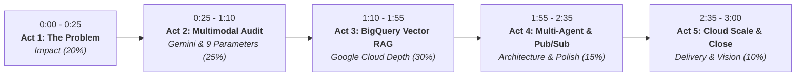

# InvestPI — 3-Minute Demo Video Script & Hackathon Judging Playbook
**Competition:** AI Builders Cup (Google Cloud & Generative AI Track)  
**Target Video Duration:** Exact 3 Minutes (180 Seconds)  
**Scoring Alignment:** Maximizing points across **Impact (20%)**, **Google Tech Depth (30%)**, **Innovation (25%)**, **UX Polish (15%)**, and **Pitch Delivery (10%)**.

---

## 1. Judging Scoring Matrix Strategy

To win top placement in the AI Builders Cup, the 3-minute video flow is mapped directly to the judge's scoring rubric:

---

## 2. Shot-by-Shot 3-Minute Demo Video Script

### Act 1: The Hook & The Multi-Billion Dollar Problem (0:00 – 0:25)
- **Visual**: Quick screen capture of social media feeds — flashy YouTube shorts shouting *"100% GUARANTEED ROCKET TARGET ₹150"*, Telegram VIP pump-and-dump channels, and SEBI regulatory crackdown headlines.
- **Presenter (Voiceover)**:
  > *"Every day, millions of retail investors in India, Singapore, and Australia fall victim to unregistered finfluencers, pump-and-dump syndicates, and illegal stock tips promising 'guaranteed breakout returns'. Regulators like SEBI, MAS, and ASIC face millions of social posts daily and cannot audit claims against market books in real time.*  
  > *Meet **InvestPI** — an autonomous multimodal forensic intelligence platform that audits financial claims against 5-year empirical market fundamentals and official regulatory registries in under two seconds."*

---

### Act 2: Hero Feature 1 — Multimodal Finfluencer Audit (0:25 – 1:10)
- **Visual**: Screen recording of the **InvestPI Executive Desk**. The camera shows the bespoke ivory card UI. Presenter selects the **"Text Analysis"** or **"Video Analysis"** tab, pastes a viral scam claim:
  `"SUZLON ENERGY BREAKOUT ROCKET! Guaranteed 200% profit in 10 days! Target 150 INR. No stop loss! Join VIP premium channel now!"`
- **Action**: Clicks **"Open Investigation"**. The animated loading scene triggers (*"Following the money trail..."*), and transitions into the **Case Dossier**.
- **Visual**: The screen displays the red **HIGH RISK** forensic stamp, InvestPI Score **1.8 / 10**, and the 9-parameter matrix.
- **Presenter (Voiceover)**:
  > *"Here's our first hero feature: **Multimodal Ingestion powered by Gemini 2.5 Flash**. Whether it's a YouTube short, an image screenshot, or a text tip, Gemini extracts the underlying securities claims in sub-second latency.*  
  > *Next, notice this: **Zero Hallucination**. We do NOT let generative AI guess the risk. Instead, our deterministic compliance engine audits the claim across **9 empirical parameters**: 5-year realized volatility, valuation multiples, volume anomalies, and real-time SEBI registry verification.*  
  > *The verdict? Hard gate failure: the claimed 200% return sits 8 standard deviations outside normal distribution, and the promoter has omitted mandatory stop-loss disclosures. The lead is sealed as High Risk."*

---

### Act 3: Hero Feature 2 — BigQuery Vector RAG & SWOT Engine (1:10 – 1:55)
- **Visual**: Returns to the desk, clicks the **"Financial Report analysis"** tab. Shows the structured dropdown. Selects **"Zomato Limited (ZOMATO.NS) · Quick Commerce & Blinkit"** (or Reliance / TCS). Clicks **"Open Report"**.
- **Action**: Smoothly transitions to the dedicated full-screen **Regulation 33 Dossier Page**. Camera scrolls down through:
  - Top headline metrics strip (Revenue ₹4,206 Cr, PAT ₹253 Cr, Adjusted EBITDA ₹299 Cr).
  - 5 Plain-English Bullet Takeaways.
  - Segment Performance Cards (Blinkit Quick Commerce, Food Delivery, Hyperpure).
  - 4-Quadrant Financial Statement SWOT Matrix Table.
- **Presenter (Voiceover)**:
  > *"Now for our second hero feature: **Automated Corporate Filing Intelligence using Google BigQuery Vector Search**.*  
  > *Instead of sifting through dense 80-page quarterly statements, users select an equity from our 10-stock universe. Under the hood, Google's **text-embedding-004** generates 768-dimensional embeddings stored inside a partitioned BigQuery table.*  
  > *Using native BigQuery `VECTOR_SEARCH`, our `quarterly_report_agent` semantically retrieves relevant balance-sheet footnotes, producing: five plain-English takeaways, granular segment-level margins, and an institutional 4-quadrant SWOT matrix.*  
  > *And if an unsupported stock is entered? Strict guardrails immediately return 'No report available', preventing fabricated financials."*

---

### Act 4: Hero Feature 3 — Interactive Sub-Agents & Cloud Pub/Sub (1:55 – 2:35)
- **Visual**: Clicks the floating **"Ask AI Agent"** button. The sleek dark-green forensic drawer slides in. Presenter clicks the chip:
  `"What is the predicted future price target based on analysts or EMA200?"`
- **Action**: Instant response with analyst consensus + 1-month technical projection, followed by typing:
  `"Explain all findings, price target, and fundamentals in simple terms"`.
- **Presenter (Voiceover)**:
  > *"To empower retail investors without overwhelming them, we built a **coordinated micro-agent architecture**.*  
  > *Five specialized sub-agents run simultaneously: one checks 1-year historical trends, another aggregates analyst consensus with an automated EMA200 fallback, a third audits P/E fundamentals, and the explainer agent translates everything into simple terms.*  
  > *For enterprise scale, these sub-agents are wired to **Google Cloud Pub/Sub**. Ingestion leads trigger push subscriptions that process audits concurrently without blocking web threads."*

---

### Act 5: Cloud Architecture, Pricing & Vision (2:35 – 3:00)
- **Visual**: Quick clean architecture diagram showing: Cloud Run (Scale-to-Zero), BigQuery Vector Search, Cloud Pub/Sub, Gemini 2.5 Flash, and Firestore.
- **Action**: Presenter clicks **"Export Case File (PDF)"** on the top bar, showing the watermarked, courtroom-ready PDF report downloaded.
- **Presenter (Voiceover)**:
  > *"InvestPI is deployed serverless on **Google Cloud Run** with full scale-to-zero. By combining Cloud Run's free tier with BigQuery's 10 GB free storage, our entire cloud infrastructure runs at **under 50 cents a month**.*  
  > *InvestPI bridges the gap between complex regulatory mandates and everyday retail investors — turning chaotic social tips into verifiable forensic intelligence.*  
  > *Thank you, and we welcome your questions!"*

---

## 3. Judges Q&A Defense Playbook

Be prepared for the most common grilling questions from senior Google Cloud and technical judges:

### Question 1: "LLMs are notoriously prone to financial hallucinations. How do you guarantee your numbers and scores are accurate?"
- **Winning Answer**:
  > *"We treat generative AI strictly as a perception and explanation layer, never as the arithmetic authority. When a claim is extracted, all calculations — standard deviation envelopes, P/E ratios, institutional holdings, and promoter pledge thresholds — are executed by deterministic Python math algorithms.  
  > Furthermore, our BigQuery RAG pipeline embeds official Regulation 33 PDF filings and uses exact metadata filters (`WHERE ticker = @target_ticker`). The model is never permitted to invent figures; if data is missing, the parameter triggers a hard-gate failure."*

---

### Question 2: "Why did you use BigQuery Vector Search instead of a dedicated vector database like Pinecone, Chroma, or Weaviate?"
- **Winning Answer**:
  > *"Three reasons:  
  > 1. **Zero Idle Cost**: Dedicated vector databases charge $50–$100/month just to keep an index running. BigQuery is serverless — its first 10 GB storage and 1 TB of queries per month are 100% free under GCP's Always-Free Tier.  
  > 2. **Hybrid Queries in SQL**: BigQuery lets us combine structured SQL filters (`WHERE ticker = 'TCS.NS' AND quarter = 'Q1_FY27'`) with vector distance ranking (`VECTOR_SEARCH`) in a single query without syncing across external APIs.  
  > 3. **Google Ecosystem Synergy**: With BigQuery ML, we generate embeddings directly using `text-embedding-004` via remote connections, eliminating custom embedding server pipelines."*

---

### Question 3: "How does your Cloud Pub/Sub integration work with Google Cloud Run?"
- **Winning Answer**:
  > *"We use **Pub/Sub Push Subscriptions**. When an investigation task arrives, our API publishes a `SubAgentTaskEvent` to the `investpi-subagent-tasks` topic.  
  > Pub/Sub then pushes the event via an authenticated HTTPS POST webhook directly to our Cloud Run container (`/api/pubsub/push`). This delivers true asynchronous parallel processing while allowing Cloud Run to scale to zero when no messages are pending."*

---

### Question 4: "What happens if a user submits a stock not in your 10-stock universe?"
- **Winning Answer**:
  > *"We enforce a strict fail-safe guardrail: the system intercepts the request both in the client dropdown and at the API layer. It halts execution before invoking Gemini or BigQuery, instantly displaying 'No report available'. This completely protects our quota, prevents off-topic hallucinations, and maintains regulatory integrity."*

---

### Question 5: "How does this platform scale to thousands of stocks across global jurisdictions?"
- **Winning Answer**:
  > *"The architecture is already multi-jurisdictional: our codebase supports SEBI (India), MAS (Singapore), and ASIC (Australia). To add 1,000 stocks, we simply load additional filing chunks into the BigQuery table using our pre-built `bq load` ingestion pipeline. The vector index automatically partitions by ingestion date and clusters by ticker, guaranteeing sub-millisecond retrieval regardless of document volume."*

---

## 4. High-Impact Pitching Tips for Judgment Round

1. **Start with the Ivory Card (Visual Shock Value)**: Most hackathon submissions look like generic Bootstrap admin templates. The bespoke ivory business card with 3D flip animation creates instant memorability within the first 10 seconds.
2. **Show, Don't Just Tell the Math**: When discussing the 9 parameters, point to the exact Volatility $\sigma$ and Valuation P/E figures. Judges love seeing that you built deterministic formulas rather than prompt-engineering everything.
3. **Emphasize Cost-Efficiency**: Highlight that the whole system was deployed on Google Cloud Run and BigQuery for **<$0.50/month**. Enterprise judges respect architectures that maximize Google Cloud capabilities without burning unnecessary budget.
4. **Demonstrate the Watermarked PDF**: Generating an immutable, downloadable case file on the fly proves production-readiness beyond a toy frontend.
