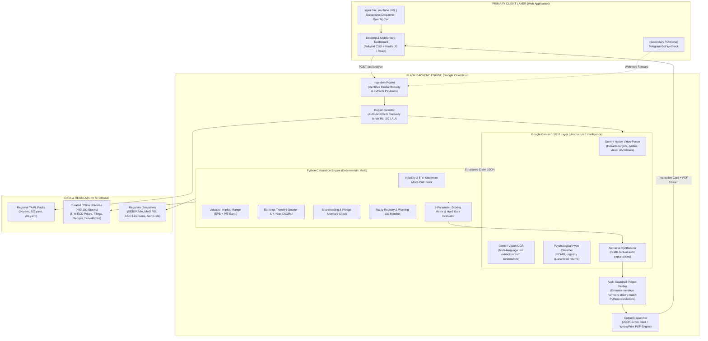
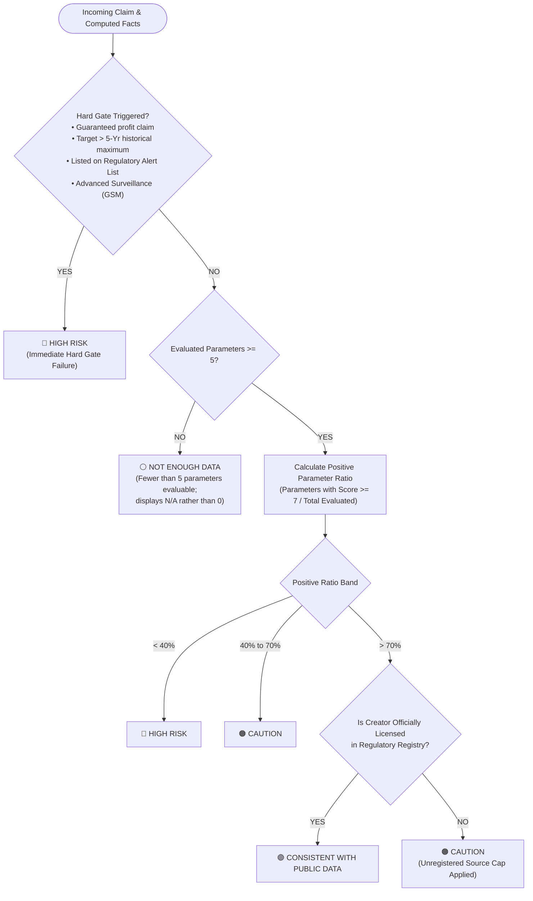
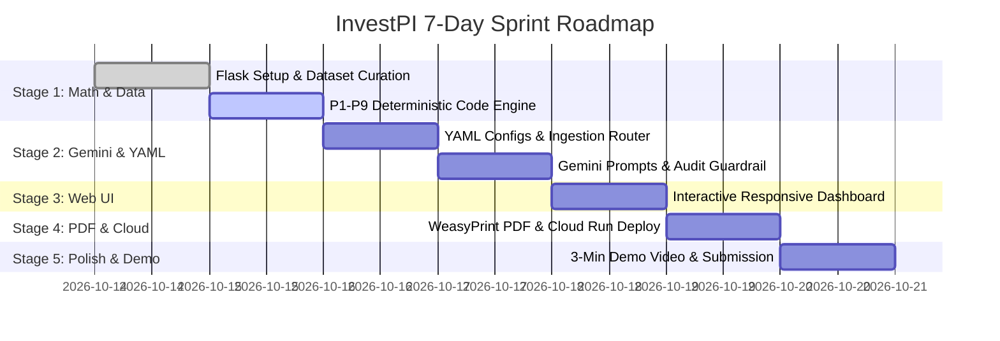

# InvestPI — Master Planning & Implementation Specification
### AI Builder Cup 2026 (JAPAC) · Theme: BFSI – Intelligent Risk, Fraud & Financial Experiences

> **Platform Summary:** InvestPI is a web-first forensic due-diligence platform that protects retail investors against deceptive social media hype, finfluencer pump-and-dump claims, and unlicensed financial advice. Users paste a **YouTube URL**, upload a **chat screenshot** (Telegram, WhatsApp, etc.), or input **tip text**. InvestPI extracts the precise claims using Gemini multimodal models, audits them against 5-year empirical market fundamentals and local regulatory registries (India 🇮🇳, Singapore 🇸🇬, Australia 🇦🇺) via a deterministic Python engine, and renders an auditable score card with a downloadable PDF report.
>
> *(Note: The Web Application is the primary hero product for the prototype and demo; a lightweight Telegram bot is treated as an optional secondary ingestion webhook).*

---

## Table of Contents
1. [Core Philosophy & Strategic Narrative](#1-core-philosophy--strategic-narrative)
2. [Product Architecture (Web-Centric)](#2-product-architecture-web-centric)
3. [Input Channels & Modalities](#3-input-channels--modalities)
4. [Modular Market Packs (YAML Configuration)](#4-modular-market-packs-yaml-configuration)
5. [The 9-Parameter Forensic Assessment Matrix](#5-the-9-parameter-forensic-assessment-matrix)
6. [Deterministic Scoring & Hard Gate Engine](#6-deterministic-scoring--hard-gate-engine)
7. [Gen AI Layer: Gemini Roles, Prompts & Audit Guardrails](#7-gen-ai-layer-gemini-roles-prompts--audit-guardrails)
8. [Data Architecture & Offline Universe Strategy](#8-data-architecture--offline-universe-strategy)
9. [Web UI & Report UX Design](#9-web-ui--report-ux-design)
10. [REST API Specification](#10-rest-api-specification)
11. [Codebase Directory Structure](#11-codebase-directory-structure)
12. [Implementation Roadmap (Coding Sprints)](#12-implementation-roadmap-coding-sprints)
13. [Demo & Submission Playbook](#13-demo--submission-playbook)
14. [Compliance, Defamation & Safety Guardrails](#14-compliance-defamation--safety-guardrails)

---

## 1. Core Philosophy & Strategic Narrative

### 1.1 The "Rate the Claim, Not the Stock" Doctrine
- **Regulatory Immunity:** Providing price targets or buy/sell opinions requires regulatory licensing (e.g., SEBI Research Analyst regulations in India). InvestPI **strictly refrains** from issuing stock ratings, buy/sell calls, or price predictions.
- **Forensic Objective:** InvestPI assesses whether a **specific influencer claim** is supported by, or directly contradicts, verifiable public facts and regulatory disclosures.
- **Neutral Terminology:**
  - 🟢 **Consistent with Public Data** *(Claim aligns with historical limits & source is verified licensed)*
  - 🟠 **Caution** *(Claim is only partially supported, or source is unregistered)*
  - 🔴 **High Risk** *(Hard red flag triggered: impossible move, guaranteed returns, warning list match)*
  - ⚪ **Not Enough Data** *(Fewer than 5 parameters evaluable; displays `N/A`, avoids penalizing small caps)*

### 1.2 Retail Companion to Regulatory Surveillance
- Regulators deploy institutional surveillance engines (e.g., SEBI's *Sudarshan*).
- Retail investors, however, receive unchecked investment calls across social platforms. InvestPI acts as the **first-line retail shield** that operationalizes institutional-grade forensic checks in seconds.

---

## 2. Product Architecture (Web-Centric)



---

## 3. Input Channels & Modalities

The web interface is the centerpiece of the application, featuring three specialized ingestion handlers:

### 3.1 YouTube URL Ingestion
- **Native Video Processing:** Eliminates third-party scraper bloat by submitting the YouTube link directly via `google-genai` using the native video URI capability.
- **Multimodal Evaluation:** Transcribes spoken dialogue while visually auditing on-screen charts, fine-print text, mandatory disclaimer slides, and luxury props.
- **Timestamped Claim Extraction:** Maps extracted targets to precise video timestamps (e.g., `01:42 - "Guaranteed 50% jump by next week"`).

### 3.2 Chat Screenshot Upload (Drag-and-Drop)
- Accepts screenshots from Telegram channels, WhatsApp chats, Instagram DMs, or forum threads.
- Handled via Gemini Vision OCR, parsing mixed linguistic formats including English, Hindi/Hinglish, and Mandarin scripts.
- Extracts channel handles, claimed tickers, return figures, entry prices, and promotional affiliate links.

### 3.3 Text-Based Tip Verification
- Accepts pasted text tips directly into the web dashboard search console.
- Ingested via Gemini structured text processing to normalize informal syntax into the standard Claim JSON schema.

### 3.4 (Optional) Telegram Bot Companion
- Provided as a supporting feature via `/telegram/webhook`.
- Enables users to forward tips into an automated verification bot that hits the exact same Flask backend endpoints and returns formatted summary cards.

---

## 4. Modular Market Packs (YAML Configuration)

Each supported jurisdiction is governed by a declarative configuration pack. New markets are added by dropping a new `.yaml` file into `/markets` without modifying the core calculation engine.

```
                          ┌───────────────────────────┐
                          │    CORE INVESTPI ENGINE   │
                          │   (Calculations & Logic)  │
                          └─────────────┬─────────────┘
                                        │
                 ┌──────────────────────┼──────────────────────┐
                 ▼                      ▼                      ▼
          ┌─────────────┐        ┌─────────────┐        ┌─────────────┐
          │   IN.yaml   │        │   SG.yaml   │        │   AU.yaml   │
          │ (India/SEBI)│        │(Singapore/MAS)       │(Australia/ASIC)
          └─────────────┘        └─────────────┘        └─────────────┘
```

### 4.1 Comparative Jurisdictional Matrix
| Feature / Rule | 🇮🇳 India (`IN.yaml`) | 🇸🇬 Singapore (`SG.yaml`) | 🇦🇺 Australia (`AU.yaml`) |
|---|---|---|---|
| **Regulator** | SEBI | MAS | ASIC |
| **Regulatory Framework** | Research Analyst / Investment Adviser Rules; prohibition on fixed returns | Securities & Futures Act (SFA); Financial Advisers Act (FAA) | Corporations Act 2001; ASIC INFO 269 Finfluencer Guidelines |
| **Licensing Registry** | SEBI RA/IA Registered Database | MAS Financial Institutions Directory (FID) | ASIC Register (AFS Licensee / Authorised Reps) |
| **Official Alert Lists** | SEBI Debarred Entities & Interim Orders | MAS Investor Alert List (IAL) | ASIC Moneysmart Investor Alert List |
| **Exchange Connectors** | NSE (`.NS`), BSE (`.BO`) | SGX (`.SI`) | ASX (`.AX`) |
| **Surveillance Framework** | NSE ASM (Additional) / GSM (Graded) Measures | SGX Watch-list (Financial / MCap criteria) | ASX Price Queries & Aware Letters |
| **Scam Lexicon** | *"Sure-shot", "Jackpot call", "Operator stock", "Multibagger", "Pakka"* | *"Guaranteed payout", "Capital guaranteed", "Exclusive syndicate", "稳赚不赔", "内部消息"* | *"Next 10-bagger", "Lithium moonshot", "Not financial advice (DYOR)", "DM for signals"* |
| **Official Reporting** | Cybercrime Portal (`cybercrime.gov.in` / 1930) | Singapore Police Force ScamShield | Scamwatch / ReportCyber |
| **Supported Languages** | English, Hindi, Hinglish | English, Simplified Chinese (Mandarin) | English |

---

## 5. The 9-Parameter Forensic Assessment Matrix

The evaluation matrix divides investigative parameters across three analytical vectors:

| ID | Analytical Vector | Parameter Name | Evaluation Methodology | Source / Standard |
|---|---|---|---|---|
| **P1** | **A. Claim Realism** | **Price-Move Plausibility** | Evaluates claimed move against the stock's 5-year rolling distribution over identical horizons. | 5-Year EOD Price History |
| **P2** | **A. Claim Realism** | **Valuation-Implied Range** | Projects implied valuation against historical 5-year P/E and EV/EBITDA valuation envelopes. | Quarterly & Annual Filings |
| **P3** | **A. Claim Realism** | **Earnings Trajectory** | Compares claimed growth against actual 4-quarter and 4-year financial performance trends. | Financial Results Data |
| **P4** | **A. Claim Realism** | **Consensus Analyst Alignment** | Cross-references target price with institutional consensus targets using Google Search grounding. | Public Financial Media |
| **P5** | **B. Company Risk** | **Promoter / Insider Activity** | Tracks insider selling, promoter dilution, and share pledging trends over previous 4 quarters. | Exchange Shareholding Records |
| **P6** | **B. Company Risk** | **Litigation & Regulatory Orders** | Scans for active SEBI/MAS/ASIC sanctions, director bans, or serious auditor resignations. | Regulatory Orders & News |
| **P7** | **B. Company Risk** | **Surveillance & Abnormal Volume** | Flags inclusion in ASM/GSM lists and identifies abnormal volume spikes lacking news catalysts. | Exchange Daily Bhavcopy |
| **P8** | **C. Source Credibility** | **Regulatory Licensing Check** | Fuzzy-matches source handle or legal name against official registries (SEBI RA/IA, MAS FID, ASIC). | Regulatory License Registries |
| **P9** | **C. Source Credibility** | **Hype & Manipulative Language** | Classifies language patterns for FOMO, guaranteed return claims, and paid VIP channel funnels. | Regional Scam Lexicon |

---

## 6. Deterministic Scoring & Hard Gate Engine

To eliminate hallucination risks, all arithmetic computations, thresholds, and flag designations are handled by deterministic Python code.

### 6.1 Hard Gates (Instant 🔴 High Risk Rejection)
Regardless of the cumulative score, a claim receives an immediate **🔴 High Risk** flag if any of the following occur:
1. **Guaranteed Return Language:** Use of terms promising fixed or certain profit (e.g., "100% guarantee", "sure-shot", "稳赚不赔").
2. **Statistically Impossible Target:** Claimed price move exceeds the stock's largest historical move over the specified horizon across a 5-year empirical window.
3. **Active Regulatory Enforcement:** Creator or company promoters appear on active warning or debarred entity lists (SEBI Debarred List, MAS IAL, ASIC Moneysmart).
4. **Severe Surveillance Stage:** Target company is categorized under advanced exchange surveillance (e.g., NSE GSM Stage 2+).

### 6.2 Decision Flow Diagram



### 6.3 Missing Data Policy
If corporate data is incomplete or unavailable for small-cap equities:
- Unavailable metrics receive `status: "N/A"` and are excluded from the denominator.
- Metrics are **never scored as 0**, preventing unfair bias against smaller firms.
- If fewer than 5 of the 9 parameters can be calculated, the platform issues a **⚪ Not Enough Data** verdict.

---

## 7. Gen AI Layer: Gemini Roles, Prompts & Audit Guardrails

### 7.1 Separation of Responsibilities
- **Gemini is strictly restricted to:** Ingestion, multimodal OCR, video transcription, structured entity extraction, and drafting human-readable narrative explanations.
- **Python is strictly responsible for:** Price move comparisons, valuation bounds, registry matching, final scoring, and flag assignments.

### 7.2 Core Gemini System Prompts

#### Prompt A: YouTube Forensic Extraction
```text
You are a senior forensic auditor specializing in securities market compliance.
Analyze the provided video (both audio dialogue and visual frames).
Extract any investment claims made by the creator.

Output a valid JSON object matching this schema:
{
  "ticker": string or null,
  "company_name": string or null,
  "direction": "BUY" | "SELL" | "HOLD" | null,
  "target_price": number or null,
  "claimed_percentage_move": number or null,
  "time_horizon_days": number or null,
  "exact_quote": string,
  "quote_timestamp": string,
  "creator_claimed_name": string or null,
  "regulatory_license_disclosed": string or null,
  "guaranteed_return_language_detected": boolean,
  "manipulative_phrases": [
    {"phrase": string, "category": "FOMO" | "URGENCY" | "GUARANTEE" | "PAID_GROUP", "timestamp": string}
  ],
  "visual_credibility_props": [string]
}
Do not calculate financial probabilities. Only extract observable claims.
```

#### Prompt B: Chat Screenshot OCR
```text
You are an OCR extraction engine specializing in social media financial tip chats.
Analyze this image (which may contain English, Hindi, Hinglish, or Mandarin text).
Extract the following information as strict JSON:
{
  "sender_or_channel_name": string or null,
  "ticker_or_company": string or null,
  "entry_price": number or null,
  "target_price": number or null,
  "stop_loss": number or null,
  "time_horizon_description": string or null,
  "estimated_days": number or null,
  "exact_text": string,
  "detected_language": string,
  "red_flag_terms": [string],
  "invitation_links": [string]
}
If information is missing, use null. Do not infer unstated values.
```

### 7.3 Programmatic Audit Step
Before presenting Gemini's generated narrative or printing the PDF report:
1. A Python regular expression extracts all numerical figures (percentages, currencies, multipliers) from the AI-written summary.
2. Every number is matched against the verified output dictionary from the Python calculation engine.
3. If an unverified number appears in the narrative, the system discards the text and falls back to a deterministic template string, ensuring 0% hallucination in published audit reports.

---

## 8. Data Architecture & Offline Universe Strategy

To ensure zero live demo failures, rate limits, or paywall issues during judging, the prototype uses an **offline-first data design** with an initial curated universe of 60 stocks across three jurisdictions.

```
data/
├── universe/
│   ├── IN_stocks.json       # 25 Indian Equities (Nifty 50 + High-Beta Small Caps)
│   ├── SG_stocks.json       # 15 Singapore Equities (STI Large Caps + Catalist Small Caps)
│   └── AU_stocks.json       # 20 Australian Equities (ASX 200 + Speculative Mining/Lithium)
├── prices/                  # 5-Year EOD Parquet/JSON files for each stock in universe
├── fundamentals/            # 4-Quarter and 4-Year revenue, net profit, and P/E historical bands
├── registries/              # Snapshots of SEBI RA/IA, MAS FID, and ASIC registers
└── alerts/                  # MAS Investor Alert List, SEBI Debarred Entities, ASIC Moneysmart
```

### 8.1 Curated Stock Representation Examples
- **India (IN):** `RELIANCE.NS`, `TCS.NS`, `HDFCBANK.NS` (stable baselines) + `SUZLON.NS`, `IDEA.NS`, `RPOWER.NS` (high retail activity).
- **Singapore (SG):** `D05.SI` (DBS), `Z74.SI` (Singtel) + speculative Catalist counters.
- **Australia (AU):** `BHP.AX`, `CBA.AX` + high-volatility lithium/uranium speculative stocks.

---

## 9. Web UI & Report UX Design

The user interface is engineered as a responsive, high-contrast web dashboard optimized for both desktop analysis and mobile review.

```
+-----------------------------------------------------------------------------------+
|  InvestPI  |  Forensic Shield for Retail Investors          [ Region: India (IN) v ]|
+-----------------------------------------------------------------------------------+
|                                                                                   |
|  [ Analyze Investment Tip                                                       ] |
|  +-----------------------------------------------------------------------------+  |
|  | [ YouTube URL ]   [ Upload Screenshot ]   [ Paste Tip Text ]                |  |
|  | --------------------------------------------------------------------------- |  |
|  | Enter YouTube link (e.g., https://youtu.be/...):                           |  |
|  | [ https://www.youtube.com/watch?v=demo_sample                     ] [DETECT] |  |
|  +-----------------------------------------------------------------------------+  |
|                                                                                   |
|  FORENSIC AUDIT SUMMARY                                                           |
|  +-----------------------------------------------------------------------------+  |
|  |  FLAG: [ 🔴 HIGH RISK ]        SCORE: 2.2 / 10       TARGET: RELIANCE.NS    |  |
|  |  Claim: "+80% in 14 days" (Spoken at 01:24) | Source: @WealthGuru_Unverified|  |
|  |  Hard Gate Failure: Claimed move (+80%) exceeds 5-Yr historical max (+31%)  |  |
|  +-----------------------------------------------------------------------------+  |
|                                                                                   |
|  9-PARAMETER BREAKDOWN TABLE                                                      |
|  +-----------------------------------------------------------------------------+  |
|  | Metric                  | Score | Findings Summary                   | Status|  |
|  |-------------------------+-------+------------------------------------+-------|  |
|  | 1. Price-Move Realism   | 0/10  | Exceeds 5-Yr empirical ceiling     | 🔴    |  |
|  | 2. Valuation Envelope   | 3/10  | Implies P/E > 65x (Historical <38x)| 🔴    |  |
|  | 3. Earnings Trajectory  | 6/10  | Modest 8% YoY revenue growth       | 🟠    |  |
|  | 4. Analyst Consensus    | 4/10  | Target is 45% above consensus avg  | 🟠    |  |
|  | 5. Promoter Holding     | 2/10  | Promoter pledged shares up 4.2%    | 🔴    |  |
|  | 6. Regulatory Orders    | 7/10  | No active regulatory bans found    | 🟢    |  |
|  | 7. Surveillance (ASM)   | 1/10  | Abnormal volume spike (4.8x avg)   | 🔴    |  |
|  | 8. License Registry     | 0/10  | Creator not found in SEBI registry | 🔴    |  |
|  | 9. Scam/Hype Language   | 0/10  | "Guaranteed" & "Sure-shot" used    | 🔴    |  |
|  +-----------------------------------------------------------------------------+  |
|                                                                                   |
|  [ 📄 Download Verified PDF Report ]    [ ⚠️ Report Claim to Regulator ]          |
+-----------------------------------------------------------------------------------+
```

### 9.1 Downloadable PDF Audit Report
Generated on-the-fly via **WeasyPrint** directly from an HTML/CSS template:
- Embedded historical price chart with target line overlay (generated by `matplotlib`).
- Full tabular breakdown of the 9 forensic parameters with verifiable data citations.
- Formal legal disclaimer highlighting that the report rates claim validity and does not constitute financial advice.

---

## 10. REST API Specification

### `POST /api/analyze`
Main unified forensic inspection endpoint.

#### Request Body
```json
{
  "modality": "youtube_url | screenshot | text",
  "payload": "https://youtu.be/... | base64_image_string | raw tip text",
  "region": "IN | SG | AU"
}
```

#### Response (200 OK)
```json
{
  "report_id": "rep_98124a",
  "timestamp": "2026-10-13T18:45:00Z",
  "region": "IN",
  "overall_verdict": {
    "flag": "HIGH_RISK",
    "flag_label": "High Risk",
    "score": 2.2,
    "hard_gate_triggered": true,
    "hard_gate_reasons": ["Target move (+80%) exceeds 5-Yr historical maximum (+31%)"]
  },
  "claim_extracted": {
    "ticker": "RELIANCE.NS",
    "company_name": "Reliance Industries Ltd",
    "target_pct": 80.0,
    "horizon_days": 14,
    "timestamp": "01:24",
    "quote": "Guaranteed 80% breakout within 2 weeks"
  },
  "source_verification": {
    "claimed_handle": "@WealthGuru",
    "is_registered": false,
    "registry_searched": "SEBI RA/IA Database",
    "alert_list_status": "CLEAN"
  },
  "parameters": [
    {
      "id": "price_move_realism",
      "name": "Price-Move Realism",
      "score": 0.0,
      "status": "FAIL",
      "explanation": "Claimed 80.0% move over 14 days exceeds the largest 14-day historical move (31.2%) recorded in the last 5 years.",
      "citation": "NSE EOD Price Archive"
    }
  ],
  "pdf_download_url": "/api/report/rep_98124a.pdf"
}
```

---

## 11. Codebase Directory Structure

```
investpi/
├── app/
│   ├── __init__.py                # Flask Application Factory
│   ├── routes/
│   │   ├── api.py                 # Core REST Endpoints (/api/analyze, /api/report)
│   │   ├── web.py                 # Web UI Page Serving
│   │   └── telegram_webhook.py    # Optional Telegram Bot Webhook Handler
│   ├── ingestion/
│   │   ├── router.py              # Payload Normalizer (YouTube, Vision, Text)
│   │   └── region_detector.py     # Jurisdiction Binding & Override
│   ├── gemini/
│   │   ├── client.py              # Google GenAI SDK Wrapper
│   │   ├── prompts.py             # System Prompts for Modalities
│   │   └── schemas.py             # Structured JSON Schemas
│   ├── engine/
│   │   ├── parameters/            # P1 through P9 Modular Python Checkers
│   │   │   ├── p1_price_move.py
│   │   │   ├── p2_valuation.py
│   │   │   ├── p3_earnings.py
│   │   │   ├── p4_analyst.py
│   │   │   ├── p5_promoter.py
│   │   │   ├── p6_regulatory.py
│   │   │   ├── p7_surveillance.py
│   │   │   ├── p8_licensing.py
│   │   │   └── p9_hype_language.py
│   │   ├── scoring.py             # Scoring Matrix & Hard Gate Logic
│   │   └── audit_guardrail.py     # Regex Numerical Validation
│   ├── data/
│   │   ├── loader.py              # Access Layer for Datasets & Registries
│   │   └── matcher.py             # RapidFuzz String & Registry Search
│   ├── reporting/
│   │   ├── chart_generator.py     # Matplotlib Verification Plots
│   │   ├── pdf_generator.py       # WeasyPrint PDF Pipeline
│   │   └── templates/
│   │       └── report_template.html
│   └── static/
│       ├── css/style.css
│       └── js/app.js              # Frontend Fetch & State Management
│   └── templates/
│       └── index.html             # Main Responsive Web Dashboard
├── markets/                       # Regional YAML Market Packs
│   ├── IN.yaml
│   ├── SG.yaml
│   └── AU.yaml
├── data/                          # Pre-Indexed Stock & Registry Datasets
├── Dockerfile                     # Cloud Run Container with Pango/WeasyPrint
├── requirements.txt               # Locked Dependencies
└── run.py                         # Local Development Entrypoint
```

---

## 12. Implementation Roadmap (Coding Sprints)



### Stage 1: Core Mathematical Engine & Data Layer (Days 1–2)
- Set up Python virtual environment and dependencies (`google-genai`, `flask`, `pandas`, `weasyprint`, `matplotlib`, `rapidfuzz`, `pyyaml`).
- Assemble the curated dataset of 60 stocks across India, Singapore, and Australia.
- Implement the 9 modular parameter calculators in Python and build unit tests verifying hard gate behavior.

### Stage 2: Gemini Multimodal & YAML Integration (Days 3–4)
- Define `IN.yaml`, `SG.yaml`, and `AU.yaml` with localized lexicons and regulatory registries.
- Construct Gemini wrappers using `google-genai` for YouTube processing, Vision OCR, and text parsing.
- Implement the programmatic audit guardrail to guarantee zero hallucinated numbers in reports.

### Stage 3: Responsive Web Dashboard (Day 5)
- Build the web UI featuring the YouTube URL analyzer, screenshot dropzone, and text box.
- Create dynamic UI components rendering the Traffic Light Flag, score cards, and parameter tables.
- *(Optional bonus)* Connect the Telegram bot webhook for dual-interface demonstrations.

### Stage 4: PDF Generation & Google Cloud Run Deployment (Day 6)
- Develop the Jinja2 HTML report template and connect WeasyPrint for PDF downloads.
- Author the Dockerfile with necessary font rendering packages (`fonts-noto`, `fonts-noto-cjk`, `libpango`).
- Deploy containerized service to Google Cloud Run and configure environment variables.

### Stage 5: Verification & 3-Minute Demo Video (Day 7)
- Rehearse the 3-minute video flow showcasing YouTube debunking, screenshot verification, and PDF auditing.
- Finalize submission pitch deck highlighting regional scalability and consumer protection impact.

---

## 13. Demo & Submission Playbook

### 13.1 3-Minute Pitch Video Script
- **[0:00 - 0:30] The Challenge:** Display the surge in predatory finfluencer advice and pump-and-dump schemes across social channels. Introduce InvestPI as an AI-powered retail defense shield.
- **[0:30 - 1:30] Web Dashboard Demo:**
  1. Paste a YouTube URL of an influencer claiming "+80% in 2 weeks" on an Indian stock → Instant **🔴 High Risk** verdict (exceeds 5-year maximum volatility; unlicensed creator).
  2. Upload an Australian stock screenshot claiming a "lithium moonshot" → **🟠 Caution** flag (unlicensed under ASIC INFO 269).
  3. Analyze a Singapore chat screenshot with "稳赚不赔" → **🔴 High Risk** (guaranteed return term trigger).
- **[1:30 - 2:15] Audit Trail & PDF Report:** Review the 9-parameter breakdown table, show verifiable data sources, and download the verified PDF report.
- **[2:15 - 3:00] Scalability & Impact:** Highlight the YAML-driven JAPAC expansion model and future integration into digital banking and broker applications.

---

## 14. Compliance, Defamation & Safety Guardrails

1. **Defamation Safeguard:** The application evaluates *claims*, not individuals. Outputs read "Claim not supported by verifiable filings" rather than labeling individuals as scammers.
2. **Regulatory Safe Harbor:** Disclaimers state clearly: *"InvestPI is a factual research audit tool that evaluates claims against public records. It does not provide financial or investment advice."*
3. **Data Privacy:** Uploaded screenshots are processed in memory and never permanently stored or shared with external parties.
