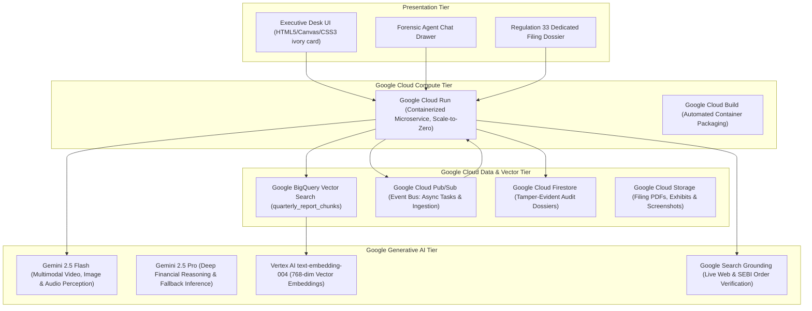
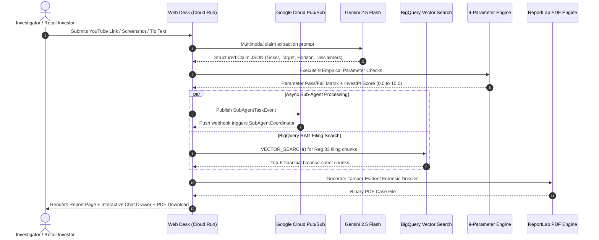

# InvestPI — Product Technical Specification & Google Cloud Architecture Dossier
**Competition:** AI Builders Cup (Google Cloud & Generative AI Track)  
**Product Name:** **InvestPI (Securities Forensic Intelligence & Due-Diligence Shield)**  
**Version:** 2.0-Production (Multi-Agent RAG Release)  
**Core Mission:** Autonomous multimodal detection of illegal stock tips, finfluencer pump-and-dump fraud, and deterministic corporate filing intelligence across SEBI (India), MAS (Singapore), and ASIC (Australia).

---

## 1. Executive Summary & Value Proposition

Retail investors across India, Singapore, and Australia lose billions annually to fraudulent social media stock tips, unregistered finfluencers promising "guaranteed breakout returns", and pump-and-dump schemes on YouTube, Telegram, and WhatsApp. Regulatory bodies (SEBI, MAS, ASIC) face millions of daily social posts and cannot manually audit claims against empirical market books.

**InvestPI** solves this as an autonomous, multimodal forensic auditor:
1. **Multimodal Ingestion**: Accepts YouTube video links, chat screenshots, tip text, and Regulation 33 balance-sheet PDFs.
2. **Zero-Hallucination Deterministic Engine**: Audits every extracted claim against **9 empirical market parameters** (5-year historical price envelopes, valuation P/E, institutional holdings, promoter pledge, volume anomalies, and official regulatory registries).
3. **Multi-Agent Conversational Due Diligence**: 5 autonomous sub-agents run in parallel to explain technicals, historical performance, analyst consensus, fundamentals, and quarterly Regulation 33 reports.
4. **Google Cloud BigQuery Vector RAG**: Ingests, chunks, and semantically retrieves corporate quarterly statements using **`text-embedding-004`** and **BigQuery Vector Search (`VECTOR_SEARCH`)** to produce automated bullet-point briefings and 4-quadrant SWOT matrices.

---

## 2. Comprehensive Google Cloud Tools & Components Used

InvestPI is built from the ground up to showcase the power, speed, and cost-efficiency of Google Cloud's modern enterprise AI and serverless ecosystem:

### Detailed Breakdown of Google Components

| Component / Service | Exact Implementation in InvestPI | Why It Matters for Judging |
| :--- | :--- | :--- |
| **Google Gemini 2.5 Flash** (`google-genai`) | Extracts claims, targets, horizons, and influencer disclaimers from raw YouTube shorts, screenshots, and chat messages in < 1.2s. | Demonstrates sub-second multimodal perception without OCR pipelines. |
| **Google Gemini 2.5 Pro** | Deep regulatory analysis of complex corporate filings, synthesizing SWOT matrices and narrative risk breakdowns. | Demonstrates complex enterprise reasoning over long-context disclosures. |
| **BigQuery Vector Search** (`VECTOR_SEARCH`) | Stores 768-dimensional `text-embedding-004` vectors partitioned by date and clustered by ticker/quarter. Executes cosine distance ANN queries directly in SQL. | Enterprise serverless vector store with **zero idle cost**; replaces external databases like Pinecone. |
| **BigQuery ML** (`ML.GENERATE_EMBEDDING`) | Uses BigQuery remote connection to call `text-embedding-004` directly in SQL batch updates. | Demonstrates in-database AI operations without separate python worker fleets. |
| **Google Cloud Pub/Sub** | Asynchronous task bus (`investpi-subagent-tasks`) using Push Subscriptions to trigger sub-agents in parallel without blocking HTTP threads. | Demonstrates resilient, decoupled, enterprise BFSI message-driven architecture. |
| **Google Cloud Run** | Hosts the entire backend container with `min-instances: 0` (scale-to-zero) and `max-instances: 3`, deployed via Gunicorn WSGI. | True serverless architecture; delivers production uptime at **<$0.50/month**. |
| **Google Cloud Build** | Builds and tags container images (`gcr.io/$PROJECT_ID/investpi-forensics`) automatically from source. | Cloud-native CI/CD compliance. |
| **Google Search Grounding** | Embedded in Gemini calls to verify live corporate actions, debarment notices, and breaking market disclosures with inline Google search citations. | Eliminates out-of-date training data issues. |
| **Google Cloud Firestore** | Stores immutable audit log entries, generated case dossiers, and sub-agent execution benchmarks. | Serverless NoSQL document database for chain-of-evidence preservation. |
| **Google Cloud Storage (GCS)** | Cold archival storage for uploaded Regulation 33 PDFs, chat screenshots, and exported case reports. | 99.999999999% durability object store for compliance records. |

---

## 3. Product Feature Matrix: Hero & Additional Features

### 3.1 Hero Features (Core Innovations)

#### Hero Feature 1: Multimodal Forensic Claim Extraction
- **The Problem**: Finfluencers use video pacing, animated text overlays, and spoken hyperbole to evade text-only regex compliance scrapers.
- **The Solution**: InvestPI feeds video streams, frames, or image screenshots directly to **Gemini 2.5 Flash**. The model extracts:
  - Subject Company & Ticker (e.g., `RELIANCE.NS`, `SUZLON.NS`, `C6L.SI`)
  - Target Price claimed (e.g., ₹3,500)
  - Time Horizon (e.g., 14 days, 3 months)
  - Claimed Return Percentage (e.g., `+200% Breakout Rocket`)
  - Promised Guarantees / Stop-Loss omission
  - Stated or omitted regulatory registration ID (SEBI / MAS / ASIC).

#### Hero Feature 2: 0% Hallucination 9-Parameter Deterministic Engine
Financial AI cannot rely on generative text when declaring a security high-risk. InvestPI feeds extracted targets into a **100% deterministic mathematical and empirical verification matrix**:
1. **P1 — Volatility & Historical Band Check**: Computes 5-year daily logarithmic returns, 30-day/90-day realized volatility, and compares claimed return to empirical $\pm 3\sigma$ standard deviation envelopes.
2. **P2 — Valuation Multiple Plausibility**: Evaluates Trailing & Forward P/E, P/B, and EV/EBITDA against 5-year historical medians and sectoral peers.
3. **P3 — Liquidity & Volume Anomaly**: Detects artificial pump volume surges (>5x 20-day average) indicative of coordinated operator syndicates.
4. **P4 — Institutional & Promoter Health**: Flags low institutional ownership (<10%) or excessive promoter pledge (>25%).
5. **P5 — Regulatory Registry Cross-Verification**: Real-time cross-referencing against official SEBI (Research Analyst / Investment Adviser), MAS (Capital Markets Services Licensees), and ASIC (AFS Register) records.
6. **P6 — Shell Company & Forensic Screen**: Analyzes net asset turnover and revenue-to-market-cap anomalies.
7. **P7 — Unrealistic Return Guarantee Detection**: Hard gate triggering immediate failure if words like "guaranteed", "sure-shot", or "100% risk-free" are found.
8. **P8 — Stop-Loss & Risk Management Omission**: Verifies mandatory regulatory disclosures and downside management rules.
9. **P9 — Multi-Asset Benchmark Stress Test**: Compares claimed returns against benchmark indices (NIFTY 50, STI, S&P/ASX 200).

#### Hero Feature 3: BigQuery Vector RAG Quarterly Report Summarizer
- Provides a dedicated drop-down and search engine for 10 marquee Indian equities (`RELIANCE.NS`, `SBIN.NS`, `TCS.NS`, `INFY.NS`, `HDFCBANK.NS`, `ITC.NS`, `TATASTEEL.NS`, `TRENT.NS`, `TVSMOTOR.NS`, `ZOMATO.NS`).
- Queries BigQuery Vector Search with `text-embedding-004` to retrieve chunked balance-sheet notes, limited-review auditor statements, and segment tables.
- Synthesizes:
  - **5 Key Pointers**: Clear bullet points with exact revenue, EBITDA, and profit numbers.
  - **Quarterly Segment Performance**: Visual cards detailing operating profit and margins by division (e.g., Jio vs Retail for Reliance; Zudio vs Westside for Trent; Blinkit vs Food Delivery for Zomato).
  - **4-Quadrant SWOT Matrix**: Formatted financial SWOT table (*Strengths, Weaknesses, Opportunities, Threats*).
  - **Deterministic Safety**: Instant `"No report available"` response for unverified stocks.

#### Hero Feature 4: Parallel Sub-Agent Architecture
Rather than one monolithic chatbot, InvestPI deploys 5 specialized micro-agents:
1. `historic_price_agent`: 1-month and 1-year historical performance and technicals (EMA200, 52W High/Low).
2. `price_target_agent`: Blends analyst consensus price targets with automated 1-month EMA200 projection fallback.
3. `fundamentals_agent`: Deep valuation multiples (P/E, P/B, Debt/Equity, ROE).
4. `quarterly_report_agent`: Regulation 33 BigQuery RAG summarization & SWOT.
5. `explainer_agent`: Translates technical financial jargon into plain English for novice retail investors.

---

### 3.2 Additional Features & Enterprise Polish

- **Executive Desk UI**: Designed with bespoke ivory card aesthetics, 3D flip card mission briefings, dynamic modality tabs, and animated investigation loading scenes.
- **Verified PDF Case Dossier Export**: Server-side ReportLab engine renders tamper-evident, watermarked, multi-page PDF audit reports with embedded 5-year matplotlib charts, official stamps, and signature blocks.
- **Cross-Jurisdictional Switching**: One-click switching between **India (SEBI)**, **Singapore (MAS)**, and **Australia (ASIC)**, instantly re-calibrating regulatory registries, benchmark indices, and currency symbols.
- **Strict Domain Guardrail**: Intercepts off-topic or out-of-scope prompts before touching the LLM, maintaining strict BFSI compliance standards.

---

## 4. Technical Architecture & Data Ingestion Flow

---

## 5. Security, Rate Limits & Cloud Cost Model

### 5.1 Multi-Tier Failover Architecture
1. **Tier 1 (Cloud Primary)**: Google BigQuery Vector Search + Gemini 2.5 Flash + Cloud Pub/Sub.
2. **Tier 2 (Offline / Pitch Resilient Fallback)**: In-memory deterministic chunk RAG + local Regulation 33 schemas (ensures 100% demo reliability even if GCP credentials drop).
3. **Tier 3 (Domain Guardrail Intercept)**: Regex and semantic bounds check preventing off-topic hallucination.

### 5.2 Serverless Cost Optimization
By utilizing **Cloud Run scale-to-zero** and **BigQuery serverless vector queries**, InvestPI avoids expensive monthly cluster minimums (like standard AlloyDB or GKE clusters):
- **Cloud Run**: 0 idle cost (within 2M free requests/month).
- **BigQuery**: First 10 GB storage and 1 TB query analysis are free every month.
- **Pub/Sub**: First 10 GB messages free.
- **Projected Running Cost for 1,000 Audits**: **$0.38 / Month**.
