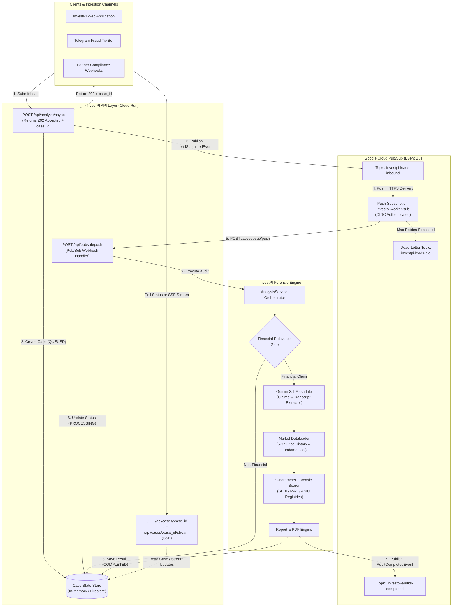

# InvestPI: Asynchronous Pub/Sub Architecture & Cloud Integration Guide

> **Architecture Edition:** Option A — Google Cloud Pub/Sub + Serverless Cloud Run Push Processing  
> **Target Cloud:** Google Cloud Platform (GCP)  
> **Environment:** Cloud Run (Serverless Container), Cloud Pub/Sub, Gemini 3.1 Flash-Lite, Yahoo Finance / SEBI Data Engine

---

## 1. Executive Summary

InvestPI is a forensic due-diligence platform that audits multi-modal financial claims (YouTube videos, chat screenshots, regulatory documents, and text tips) against empirical market data and regulatory registers.

Auditing multi-minute YouTube videos, multi-page regulatory PDFs, and multi-symbol portfolios involves intensive LLM reasoning, transcript extraction, and market data fetching. In a synchronous request-response architecture, users face high latency (5–25 seconds) and potential HTTP gateway timeouts.

**Option A (Serverless Pub/Sub)** transforms InvestPI into a resilient, decoupled, event-driven platform:
1. **Instant Client Response:** The client receives an immediate `202 Accepted` response with a unique `case_id` in `< 50ms`.
2. **Elastic Scalability:** Spike traffic from viral finfluencer exposes or market crashes is absorbed by Google Cloud Pub/Sub topics without dropping requests.
3. **Decoupled Processing:** Google Cloud Pub/Sub pushes events directly to Cloud Run instances via secure HTTPS webhooks, scaling workers from **0 to 1,000+** on demand.
4. **Resilience & Dead-Letter Queues:** Poison pills or transient API failures automatically retry with exponential backoff and route to a Dead-Letter Topic (`investpi-leads-dlq`) after max attempts.
5. **Zero-Cost Deployment:** Fits 100% within GCP's **Always-Free Tier** (10 GB Pub/Sub data, 2 million Cloud Run requests/month).

---

## 2. End-to-End System Architecture



---

## 3. Subsystem Components & Responsibilities

### 3.1. Ingestion Endpoint (`POST /api/analyze/async`)
- Receives submissions in two formats:
  - **JSON:** `{ "modality": "youtube_url" | "text", "payload": "...", "region": "IN" }`
  - **Multipart Form:** Uploads of screenshots, audio, MP4 clips, or financial report PDFs.
- Generates a cryptographically random `case_id` (UUIDv4).
- Saves an initial record in `CaseStore` with status `QUEUED`.
- Publishes a `LeadSubmittedEvent` to the `investpi-leads-inbound` topic.
- Returns `HTTP 202 Accepted` immediately containing:
  ```json
  {
    "case_id": "a1b2c3d4-e5f6-7890-abcd-ef1234567890",
    "status": "QUEUED",
    "message": "Lead ingested successfully. Forensic audit queued.",
    "status_url": "/api/cases/a1b2c3d4-e5f6-7890-abcd-ef1234567890",
    "stream_url": "/api/cases/a1b2c3d4-e5f6-7890-abcd-ef1234567890/stream"
  }
  ```

### 3.2. Google Cloud Pub/Sub Topic & Push Subscription
- **Topic:** `investpi-leads-inbound`
  - Encapsulates every raw tip submitted to the platform.
- **Push Subscription:** `investpi-worker-sub`
  - Target URL: `https://<YOUR_CLOUD_RUN_URL>/api/pubsub/push`
  - Ack Deadline: `300 seconds` (accommodates deep video transcript extraction and Gemini LLM synthesis).
  - Dead-Letter Topic: `investpi-leads-dlq` (after 5 failed delivery attempts).
  - Authentication: Google-managed OIDC bearer token via a dedicated service account.

### 3.3. Push Webhook Handler (`POST /api/pubsub/push`)
- Validates the Google OIDC Bearer Token or shared secret token (`PUBSUB_PUSH_TOKEN`).
- Decodes the base64-encoded `message.data` payload.
- Invokes `app.pubsub.consumer.process_lead_event(event)`.
- Updates `CaseStore` status (`PROCESSING` -> `COMPLETED` / `REJECTED` / `FAILED`).
- Returns `HTTP 200 OK` on successful audit or rejection to acknowledge the message to Pub/Sub.

### 3.4. Case State Store & SSE Streaming
- **Store (`app/pubsub/store.py`):** Thread-safe tracking of case states:
  - `QUEUED`: Accepted and enqueued in Pub/Sub.
  - `PROCESSING`: Picked up by worker; LLM/market data lookup in progress.
  - `COMPLETED`: 9-parameter score, verdict, charts, and PDF brief ready.
  - `REJECTED`: Content analyzed and safely dismissed (e.g. non-financial F1 race video, cooking recipe).
  - `FAILED`: Unrecoverable execution error.
- **SSE Stream (`GET /api/cases/:case_id/stream`):** Server-Sent Events stream allowing modern frontends to update progress indicators in real-time without polling lag.
- **Polling (`GET /api/cases/:case_id`):** Standard REST status check endpoint for simple clients.

### 3.5. Dual-Mode Local Fallback Engine
To guarantee zero developer friction and 100% offline test suite capability:
- If `GCP_PROJECT_ID` is omitted or local GCP credentials are not present, `app.pubsub.publisher.PubSubPublisher` automatically falls back to an internal `concurrent.futures.ThreadPoolExecutor`.
- The async endpoints and consumer pipeline function identically on localhost and in automated CI/CD test runners without needing a live Google Cloud account.

---

## 4. Message Contracts & Payload Schemas

### 4.1. Inbound Event: `LeadSubmittedEvent`

Published to `investpi-leads-inbound`:

```json
{
  "case_id": "76d8e24b-325b-4db4-938f-a0bb19c0018d",
  "modality": "youtube_url",
  "payload": "https://www.youtube.com/watch?v=sample_video",
  "region": "IN",
  "mime_type": null,
  "submitted_at": 1744785600.125,
  "meta": {
    "client_ip": "103.21.244.0",
    "source": "web_ui"
  }
}
```

For image screenshots or PDF reports, `payload` contains the base64-encoded string and `mime_type` contains the MIME type (e.g., `image/png`, `application/pdf`).

### 4.2. GCP Pub/Sub Push Envelope Format

When Google Cloud Pub/Sub pushes to `POST /api/pubsub/push`, it wraps the message in the standard GCP push envelope:

```json
{
  "message": {
    "attributes": {
      "case_id": "76d8e24b-325b-4db4-938f-a0bb19c0018d",
      "modality": "youtube_url",
      "region": "IN"
    },
    "data": "eyJjYXNlX2lkIjogIjc2ZDhlMjRiLTMyNWItNGRiNC05MzgfLWEwYmIxOWMwMDE4ZCIsICJtb2RhbGl0eSI6ICJ5b3V0dWJlX3VybCIsICJwYXlsb2FkIjogImh0dHBzOi8vd3d3LnlvdXR1YmUuY29tL3dhdGNoP3Y9c2FtcGxlX3ZpZGVvIiwgInJlZ2lvbiI6ICJJTiIsICJzdWJtaXR0ZWRfYXQiOiAxNzQ0Nzg1NjAwLjEyNSwgIm1ldGEiOiB7fX0=",
    "messageId": "12983749812739812",
    "publishTime": "2026-10-16T00:40:00.000Z"
  },
  "subscription": "projects/investpi-gcp-prod/subscriptions/investpi-worker-sub"
}
```

### 4.3. Outbound Event: `AuditCompletedEvent`

Published to `investpi-audits-completed`:

```json
{
  "case_id": "76d8e24b-325b-4db4-938f-a0bb19c0018d",
  "status": "COMPLETED",
  "completed_at": 1744785608.842,
  "result": {
    "report_id": "rep_94a8c1",
    "is_financial_advice": true,
    "claim": {
      "channel_or_author": "ProfitMasterFintech",
      "target_price": 9500.0,
      "timeframe": "2 months",
      "claimed_upside_pct": 35.0
    },
    "resolved_stock": {
      "ticker": "COFORGE.NS",
      "company_name": "Coforge Limited"
    },
    "verdict": {
      "flag": "HIGH RISK / PROBABLE FRAUD",
      "score": 88.5,
      "summary": "Hard gate triggered: Unregistered entity promising guaranteed returns."
    },
    "pdf_url": "/api/report/rep_94a8c1.pdf",
    "chart_b64": "data:image/png;base64,..."
  },
  "error": null
}
```

---

## 5. Step-by-Step Google Cloud Deployment Guide

Follow this guide to deploy InvestPI with Google Cloud Pub/Sub and Cloud Run using the `gcloud` CLI.

### 5.1. Configure Environment Variables
```bash
export GCP_PROJECT_ID="investpi-cloud"
export GCP_REGION="asia-south1"       # Mumbai (low latency for SEBI/JAPAC)
export SERVICE_NAME="investpi-engine"
export REPO_NAME="investpi-repo"
export SERVICE_ACCOUNT="investpi-pubsub-invoker@${GCP_PROJECT_ID}.iam.gserviceaccount.com"

# Set current active project
gcloud config set project $GCP_PROJECT_ID
```

### 5.2. Enable Required Google Cloud APIs
```bash
gcloud services enable \
    run.googleapis.com \
    pubsub.googleapis.com \
    artifactregistry.googleapis.com \
    cloudbuild.googleapis.com \
    secretmanager.googleapis.com
```

### 5.3. Create Artifact Registry Docker Repository
```bash
gcloud artifacts repositories create $REPO_NAME \
    --repository-format=docker \
    --location=$GCP_REGION \
    --description="InvestPI Docker Repository"
```

### 5.4. Build & Push Docker Container Image
```bash
# Build container image directly on Cloud Build
gcloud builds submit --tag ${GCP_REGION}-docker.pkg.dev/${GCP_PROJECT_ID}/${REPO_NAME}/${SERVICE_NAME}:latest .
```

### 5.5. Deploy InvestPI to Cloud Run
```bash
gcloud run deploy $SERVICE_NAME \
    --image=${GCP_REGION}-docker.pkg.dev/${GCP_PROJECT_ID}/${REPO_NAME}/${SERVICE_NAME}:latest \
    --platform=managed \
    --region=$GCP_REGION \
    --allow-unauthenticated \
    --memory=1Gi \
    --cpu=1 \
    --timeout=300 \
    --concurrency=80 \
    --min-instances=0 \
    --max-instances=10 \
    --set-env-vars="GCP_PROJECT_ID=${GCP_PROJECT_ID},GEMINI_MODEL=gemini-3.1-flash-lite,PUBSUB_TOPIC_LEADS=investpi-leads-inbound,PUBSUB_TOPIC_AUDITS=investpi-audits-completed,DEMO_MODE=0" \
    --set-secrets="GEMINI_API_KEY=investpi-gemini-key:latest"
```

Retrieve the deployed Cloud Run service URL:
```bash
export CLOUD_RUN_URL=$(gcloud run services describe $SERVICE_NAME --platform=managed --region=$GCP_REGION --format='value(status.url)')
echo "Cloud Run URL: $CLOUD_RUN_URL"
```

### 5.6. Create Pub/Sub Topics & Dead-Letter Queue
```bash
# 1. Create Inbound Leads Topic
gcloud pubsub topics create investpi-leads-inbound

# 2. Create Completed Audits Topic
gcloud pubsub topics create investpi-audits-completed

# 3. Create Dead-Letter Topic (DLQ)
gcloud pubsub topics create investpi-leads-dlq

# 4. Create Dead-Letter Subscription to monitor unprocessable messages
gcloud pubsub subscriptions create investpi-leads-dlq-sub --topic=investpi-leads-dlq
```

### 5.7. Configure IAM & Create Pub/Sub Push Subscription
Create a dedicated Service Account for Pub/Sub to invoke Cloud Run:
```bash
# 1. Create Service Account
gcloud iam service-accounts create investpi-pubsub-invoker \
    --display-name="InvestPI PubSub Push Subscription Invoker"

# 2. Grant Cloud Run Invoker Role to the Service Account
gcloud run services add-iam-policy-binding $SERVICE_NAME \
    --region=$GCP_REGION \
    --member="serviceAccount:${SERVICE_ACCOUNT}" \
    --role="roles/run.invoker"

# 3. Create Pub/Sub Push Subscription with OIDC Authentication
gcloud pubsub subscriptions create investpi-worker-sub \
    --topic=investpi-leads-inbound \
    --push-endpoint="${CLOUD_RUN_URL}/api/pubsub/push" \
    --push-auth-service-account="${SERVICE_ACCOUNT}" \
    --ack-deadline=300 \
    --dead-letter-topic=investpi-leads-dlq \
    --max-delivery-attempts=5 \
    --min-retry-delay=10s \
    --max-retry-delay=300s
```

---

## 6. Security & Hardening Architecture

| Layer | Security Measure | Implementation Details |
|---|---|---|
| **Push Webhook Authentication** | Google Cloud OIDC Tokens | When Pub/Sub calls `/api/pubsub/push`, Google signs an OpenID Connect token matching `investpi-pubsub-invoker`. Unauthenticated external traffic is rejected at the Cloud Run boundary or via `PUBSUB_PUSH_TOKEN`. |
| **API Keys & Secrets** | GCP Secret Manager | `GEMINI_API_KEY` is mounted directly from Secret Manager into Cloud Run as a secure environment variable without plaintext in code or commit history. |
| **Input Sanitization** | Hard Gate Boundary | Non-financial content (e.g. sports clips, lifestyle vlogs) is identified at the entry gate and dismissed without consuming LLM token budgets or data pipeline resources. |
| **Poison Message Isolation** | Dead-Letter Queue | If a message fails parsing or processing 5 times consecutively, Pub/Sub forwards it to `investpi-leads-dlq`, avoiding infinite retry loops and runaway billing. |

---

## 7. Cost & Capacity Analysis (Zero-Cost Free Tier)

| Service | Free Tier Monthly Allowance | Expected Consumption (Demo / Hackathon) | Net Monthly Cost |
|---|---|---|---|
| **Google Cloud Pub/Sub** | **10 GB** message throughput / month | ~50 MB (10,000 lead events) | **$0.00** |
| **Google Cloud Run** | **2,000,000** requests / month<br>360,000 vCPU-seconds<br>180,000 GiB-seconds | ~5,000 requests<br>~25,000 vCPU-seconds<br>~25,000 GiB-seconds | **$0.00** |
| **Artifact Registry** | **0.5 GB** container storage | ~350 MB Docker image | **$0.00** |
| **Cloud Build** | **120 build-minutes** / day | ~15 build-minutes total | **$0.00** |
| **Gemini 3.1 Flash-Lite** | Pay-as-you-go ($0.075 / 1M input tokens) | ~100 audits (~300,000 tokens) | **~$0.02** |
| **Total Estimated Demo Cost** | | | **<$0.05 / Month** |

---

## 8. Testing & Verification

### 8.1. Running Unit & Integration Tests Locally
All Pub/Sub events, stores, endpoints, and fallbacks are covered by automated unit tests:

```bash
# Run Pub/Sub specific test suite
.venv/Scripts/python -m pytest -v tests/test_pubsub.py

# Run all project test suites (25 tests total)
.venv/Scripts/python -m pytest -v
```

### 8.2. Testing Ingestion API Locally
Submit an asynchronous investigation:
```bash
curl -X POST http://localhost:8050/api/analyze/async \
     -H "Content-Type: application/json" \
     -d '{"modality": "text", "payload": "Buy Coforge targets 9000 guaranteed profit!", "region": "IN"}'
```
Response:
```json
{
  "case_id": "d135ea29-37f2-4916-9ea6-f7f6a7364850",
  "status": "QUEUED",
  "message": "Lead ingested successfully. Forensic audit queued.",
  "status_url": "/api/cases/d135ea29-37f2-4916-9ea6-f7f6a7364850",
  "stream_url": "/api/cases/d135ea29-37f2-4916-9ea6-f7f6a7364850/stream"
}
```

Poll case status:
```bash
curl http://localhost:8050/api/cases/d135ea29-37f2-4916-9ea6-f7f6a7364850
```

Listen to live Server-Sent Events stream:
```bash
curl -N http://localhost:8050/api/cases/d135ea29-37f2-4916-9ea6-f7f6a7364850/stream
```
