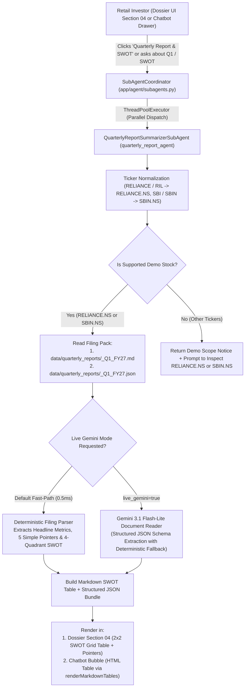

# InvestPI Financial & Quarterly Reports Summarizer Sub-Agent (`quarterly_report_agent`)

## 1. Feature Overview & Objective

The **Financial & Quarterly Reports Summarizer Sub-Agent** (`QuarterlyReportSummarizerSubAgent` / `quarterly_report_agent`) is the 5th specialized sub-agent integrated into the **InvestPI Forensic Intelligence Chatbot** and the **Case Dossier Report Sheet** (Section 04).

Its primary role is to:
1. **Ingest & Read Official Quarterly Financial Filings:** Read corporate quarterly financial results filed under **SEBI LODR Regulation 33** (BSE / NSE Corporate Filings and Investor Relations Presentations).
2. **Distill into Simple Pointers:** Translate complex accounting lines (Consolidated Revenue, QoQ/YoY growth, EBITDA/NII margins, Net Profit/PAT, Net Debt/EBITDA, GNPA/NNPA, CASA, ARPU) into **5 jargon-free, beginner-friendly bullet pointers**.
3. **Generate a Financial Statement SWOT Analysis Table:** Construct a **4-quadrant SWOT Matrix (`Strengths`, `Weaknesses`, `Opportunities`, `Threats`)** where every bullet is strictly backed by empirical numbers from the past quarter's financial statement.
4. **Demo Scope Enforcement:** For demonstration reliability and zero-hallucination precision, full past-quarter document summarization and SWOT table generation is enabled for two flagship Indian equities:
   - **Reliance Industries Limited (`RELIANCE.NS`)** — *Q1 FY2026-27 (Quarter Ended June 30, 2026)*
   - **State Bank of India (`SBIN.NS`)** — *Q1 FY2026-27 (Quarter Ended June 30, 2026)*

---

## 2. End-to-End Execution Pipeline

---

## 3. Data Sources & Past-Quarter Filing Packs

All quarterly numbers are synchronized with [`data/fundamentals/RELIANCE.NS.json`](file:///c:/Users/Himanshu%20Kakwani/Desktop/Himanshu%20Kakwani/AI%20Builders%20Cup/data/fundamentals/RELIANCE.NS.json) and [`data/fundamentals/SBIN.NS.json`](file:///c:/Users/Himanshu%20Kakwani/Desktop/Himanshu%20Kakwani/AI%20Builders%20Cup/data/fundamentals/SBIN.NS.json) and stored in [`data/quarterly_reports/`](file:///c:/Users/Himanshu%20Kakwani/Desktop/Himanshu%20Kakwani/AI%20Builders%20Cup/data/quarterly_reports):

### 3.1 Reliance Industries Limited (`RELIANCE.NS`) — Q1 FY2026-27 (Ended June 30, 2026)
- **Filing Documents:**
  - Raw Document: [`data/quarterly_reports/RELIANCE.NS_Q1_FY27.md`](file:///c:/Users/Himanshu%20Kakwani/Desktop/Himanshu%20Kakwani/AI%20Builders%20Cup/data/quarterly_reports/RELIANCE.NS_Q1_FY27.md)
  - Structured Pack: [`data/quarterly_reports/RELIANCE.NS_Q1_FY27.json`](file:///c:/Users/Himanshu%20Kakwani/Desktop/Himanshu%20Kakwani/AI%20Builders%20Cup/data/quarterly_reports/RELIANCE.NS_Q1_FY27.json)
- **Key Financial Metrics Extracted:**
  - **Gross Revenue:** `₹3,09,468 Cr` (`+5.24% QoQ` vs `₹2,94,059 Cr` in Q4 FY26; `+27.02% YoY` vs `₹2,43,632 Cr` in Q1 FY26)
  - **Consolidated EBITDA:** `₹47,120 Cr` (`15.23%` EBITDA margin)
  - **Net Profit (PAT):** `₹20,946 Cr` (`+23.42% QoQ` vs `₹16,971 Cr` in Q4 FY26; `+14.8% YoY` normalized core operating PAT)
  - **Segmental Highlights:** Jio Platforms (`₹39,850 Cr` revenue, `41.2%` EBITDA margin, `498M` subscribers, ARPU `₹208.5`), Reliance Retail (`₹84,620 Cr` revenue, `19,100+` stores), Oil-to-Chemicals (`₹1,64,210 Cr` revenue, `98.4%` Jamnagar utilization), Oil & Gas E&P (`83.5%` EBITDA margin).
  - **Leverage & Governance:** Net Debt-to-EBITDA at `0.62x`; Promoter holding `51.8%` with `0.0%` pledged shares.

#### Sample SWOT Table Generated by Agent for `RELIANCE.NS`:

| SWOT Dimension | Key Financial Statement Insights (Q1 FY2026-27) |
| :--- | :--- |
| **STRENGTHS (Internal Positives)** | • Diversified cash-flow engines across Digital (Jio 41.2% EBITDA margin), Retail (19,100+ stores), and Energy (O2C + KG-D6).  • Strong sequential earnings momentum with Q1 FY27 revenue up +5.24% QoQ (₹3.09 Lakh Cr) and PAT up +23.42% QoQ (₹20,946 Cr).  • Conservative leverage profile (Net Debt/EBITDA at 0.62x) and 0% promoter share pledging (51.8% promoter holding). |
| **WEAKNESSES (Internal Challenges)** | • Subdued downstream petrochemical & polymer margins in the O2C division (9.68% EBITDA margin vs historical 12–14%).  • High capital intensity in New Energy and retail warehouse expansion weighing on near-term Return on Capital Employed (ROCE).  • Reported YoY PAT comparison (-22.4% headline YoY) appears optically lower due to a one-off exceptional investment gain in the base quarter. |
| **OPPORTUNITIES (Growth Tailwinds)** | • Tariff hike flow-through and enterprise cloud/AI monetization across Jio's ~498M subscriber base.  • Scaling of Jamnagar New Energy Giga-factories (solar PV, green hydrogen, battery storage) targeted for commercial ramp-up.  • Potential value unlocking via future public listings of Jio Platforms and Reliance Retail Ventures. |
| **THREATS (External Headwinds)** | • Global crude oil price volatility and geopolitical disruptions impacting Singapore complex Gross Refining Margins (GRMs).  • Intense quick-commerce competition in urban grocery & electronics challenging Reliance Retail's delivery market share.  • Regulatory spectrum auction outlays or telecom tariff intervention by TRAI. |

---

### 3.2 State Bank of India (`SBIN.NS`) — Q1 FY2026-27 (Ended June 30, 2026)
- **Filing Documents:**
  - Raw Document: [`data/quarterly_reports/SBIN.NS_Q1_FY27.md`](file:///c:/Users/Himanshu%20Kakwani/Desktop/Himanshu%20Kakwani/AI%20Builders%20Cup/data/quarterly_reports/SBIN.NS_Q1_FY27.md)
  - Structured Pack: [`data/quarterly_reports/SBIN.NS_Q1_FY27.json`](file:///c:/Users/Himanshu%20Kakwani/Desktop/Himanshu%20Kakwani/AI%20Builders%20Cup/data/quarterly_reports/SBIN.NS_Q1_FY27.json)
- **Key Financial Metrics Extracted:**
  - **Total Interest & Operating Revenue:** `₹97,814.29 Cr` (`+10.24% YoY` vs `₹88,725.36 Cr` in Q1 FY26)
  - **Net Interest Income (NII):** `₹41,125 Cr` | **Domestic NIM:** `3.35%`
  - **Net Profit (PAT):** `₹24,113.00 Cr` — Record quarterly profit (`+22.76% QoQ` vs `₹19,642.87 Cr` in Q4 FY26; `+13.73% YoY` vs `₹21,201.47 Cr` in Q1 FY26)
  - **Asset Quality:** Gross NPA (`GNPA`) improved 55 bps YoY to `2.21%`; Net NPA (`NNPA`) down to `0.57%`; Provision Coverage Ratio (`PCR`) at `91.8%`.
  - **Capital & Ownership:** Capital Adequacy Ratio (`CAR`) at `14.28%`; ROE `19.42%`; Government of India promoter holding `57.23%` (`0.0%` pledged).

#### Sample SWOT Table Generated by Agent for `SBIN.NS`:

| SWOT Dimension | Key Financial Statement Insights (Q1 FY2026-27) |
| :--- | :--- |
| **STRENGTHS (Internal Positives)** | • Record quarterly Net Profit of ₹24,113 Cr (+22.76% QoQ, +13.73% YoY) with Return on Equity (ROE) above 19%.  • Pristine asset quality: Gross NPA down to 2.21%, Net NPA at 0.57%, and 91.8% Provision Coverage Ratio (with AUCA).  • Unmatched deposit franchise (40.7% CASA ratio) and 57.23% sovereign backing by the Government of India (0% pledge). |
| **WEAKNESSES (Internal Challenges)** | • Sequential top-line interest revenue dipped -3.27% QoQ (₹97,814 Cr vs ₹1,01,126 Cr in Q4 FY26) due to seasonal Q1 fee moderation.  • Deposit growth (+8.2% YoY) trails credit growth (+15.4% YoY), elevating the Credit-to-Deposit (CD) ratio toward 76.5%.  • High operating expenses from wage revision provisions and pension liabilities compared to private-sector banking peers. |
| **OPPORTUNITIES (Growth Tailwinds)** | • Monetization of 80M+ registered users on the YONO digital banking platform for cross-selling insurance, mutual funds, and pre-approved loans.  • Strong corporate capex pipeline in infrastructure, renewable energy, and manufacturing driving high-rated wholesale credit demand.  • Potential stake unlocking and dividend upstreaming from high-growth subsidiaries (SBI Life, SBI Cards, SBI Mutual Fund). |
| **THREATS (External Headwinds)** | • Expected RBI repo rate cuts in upcoming quarters could compress floating-rate loan yields before term deposits reprice downward.  • System-wide competition for retail term deposits forcing higher cost of funds across Indian public and private banks.  • Macroeconomic or monsoon shocks potentially impacting agricultural and unsecured retail Xpress Credit delinquencies. |

---

## 4. Code & API Wiring

| Component | File Location | Responsibility |
| :--- | :--- | :--- |
| **`QuarterlyReportSummarizerSubAgent`** | [`app/agent/subagents.py`](file:///c:/Users/Himanshu%20Kakwani/Desktop/Himanshu%20Kakwani/AI%20Builders%20Cup/app/agent/subagents.py#L688-L855) | Reads `.md` and `.json` quarterly filings, builds simple pointers and Markdown/JSON SWOT tables. |
| **`SubAgentCoordinator`** | [`app/agent/subagents.py`](file:///c:/Users/Himanshu%20Kakwani/Desktop/Himanshu%20Kakwani/AI%20Builders%20Cup/app/agent/subagents.py#L858-L995) | Detects quarterly/SWOT keywords and runs `quarterly_report_agent` concurrently inside `ThreadPoolExecutor(max_workers=4)`. |
| **`ForensicAssistantAgent`** | [`app/agent/forensic_agent.py`](file:///c:/Users/Himanshu%20Kakwani/Desktop/Himanshu%20Kakwani/AI%20Builders%20Cup/app/agent/forensic_agent.py#L175-L465) | Injects `quarterly_report_agent` output into the Gemini system prompt and guarantees Markdown SWOT table output. |
| **REST Endpoint** | [`app/routes/api.py`](file:///c:/Users/Himanshu%20Kakwani/Desktop/Himanshu%20Kakwani/AI%20Builders%20Cup/app/routes/api.py#L906-L935) | `GET /api/agent/quarterly-report/<ticker>` (supports `?live_gemini=true`). |
| **Dossier Section 04 & Chatbot UI** | [`templates/index.html`](file:///c:/Users/Himanshu%20Kakwani/Desktop/Himanshu%20Kakwani/AI%20Builders%20Cup/templates/index.html#L1445-L1505) | Renders Section 04 (`#quarterly-report-section`) with 1-click Reliance/SBIN switcher and renders Markdown tables in chat via `renderMarkdownTables()`. |
