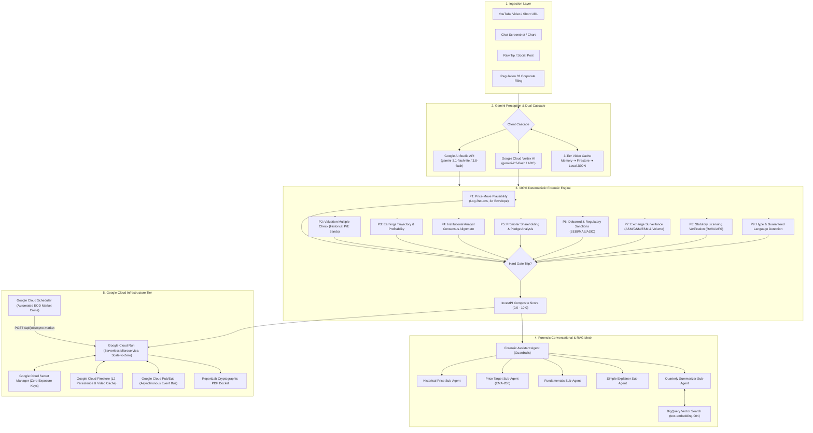

<p align="center">
  
</p>

# InvestPI — Securities Forensic Intelligence & Due-Diligence Shield
### *Autonomous Multimodal AI Agent Auditing Finfluencer Fraud, Illegal Stock Tips & Corporate Filings*

[](https://www.python.org/)
[](https://flask.palletsprojects.com/)
[](https://cloud.google.com/)
[](https://ai.google.dev/)
[](https://cloud.google.com/vertex-ai)
[](#the-9-parameter-deterministic-scoring-matrix)
[](#running-the-automated-test-suite)
[](LICENSE)

---

## 📌 Executive Overview

Retail investors across India, Singapore, and Australia lose billions annually to fraudulent social media stock tips, unregistered finfluencers promising "guaranteed multibagger returns", and pump-and-dump syndicates operating on YouTube, Telegram, WhatsApp, and Instagram. Regulators—such as the **Securities and Exchange Board of India (SEBI)**, **Monetary Authority of Singapore (MAS)**, and the **Australian Securities and Investments Commission (ASIC)**—are overwhelmed by millions of daily video and text posts and cannot manually cross-examine each tip against live financial books.

**InvestPI** solves this challenge as an enterprise-grade, autonomous securities forensic auditor. It combines **Google GenAI multimodal perception** with a **100% deterministic, zero-hallucination mathematical verification engine**, **Google Cloud BigQuery Vector RAG**, an **asynchronous Pub/Sub event bus**, **Google Cloud Firestore L2 persistence**, **Google Cloud Secret Manager zero-exposure security**, **Google Cloud Scheduler automated market-sync crons**, and a **5-subagent conversational intelligence network** to inspect claims, detect financial manipulation, and generate tamper-evident forensic dockets in real time.

```
                          ┌────────────────────────────────────────┐
                          │    MULTIMODAL INGESTION PIPELINE       │
                          │ YouTube Videos · Images · Text · PDFs  │
                          └───────────────────┬────────────────────┘
                                              │
                                              ▼
                          ┌────────────────────────────────────────┐
                          │   GEMINI MULTIMODAL PERCEPTION TIER    │
                          │   Gemini 2.5 Flash / 3.1 Flash Lite    │
                          │   Dual-Client Cascade: Vertex AI + API │
                          └───────────────────┬────────────────────┘
                                              │ Extracted Claims
                                              ▼
                          ┌────────────────────────────────────────┐
                          │  DETERMINISTIC 9-PARAMETER AUDIT ENGINE│
                          │   100% Mathematical · Zero Hallucination│
                          │   Volatilities, P/E Bands, ASM/GSM,    │
                          │   Debarred Lists, Promoters, Licenses  │
                          └───────────┬────────────────────────────┘
                                      │
            ┌─────────────────────────┴────────────────────────┐
            ▼                                                  ▼
┌───────────────────────────────┐              ┌───────────────────────────────┐
│   FORENSIC CONVERSATIONAL     │              │    BIGQUERY VECTOR SEARCH     │
│       MULTI-AGENT MESH        │              │    RAG FILING INTELLIGENCE    │
│  • Historic Price Sub-Agent   │              │  • text-embedding-004 vectors │
│  • Price Target (EMA-200)     │              │  • 10-Stock Enterprise Filings│
│  • Fundamentals Sub-Agent     │              │  • Regulation 33 Bullet Points│
│  • Simple Explainer Sub-Agent │              │  • 4-Quadrant SWOT Matrix     │
│  • Quarterly Filing Summarizer│              │  • Sub-Second SQL Cosine ANN  │
└───────────────┬───────────────┘              └───────────────┬───────────────┘
                │                                              │
                └──────────────────────┬───────────────────────┘
                                       ▼
                       ┌───────────────────────────────┐
                       │      FORENSIC OUTPUT TIER     │
                       │  Executive Desk UI · PDF Dockets│
                       │  Pub/Sub Bus · Firestore (L2) │
                       │  Secret Manager · Schedulers  │
                       └───────────────────────────────┘
```

---

## 🚀 Key Innovations & Capabilities

### 1. Multimodal Forensic Claim Extraction
- **YouTube Video Perception**: Ingests YouTube URLs, Shorts, and uploaded video streams using native multimodal ingestion, oEmbed extraction, and dual transcript capture (SupaData Managed API with `youtube_transcript_api` fallback).
- **Computer Vision & Chat Ingestion**: Audits chat screenshots (WhatsApp, Telegram, Discord, Instagram) and financial charts without separate OCR steps.
- **Financial Relevance Classifier**: Automatically filters out sports, recipes, casual conversation, and general queries with explicit domain rejection (`"Not a financial advice, kindly provide relevant input"`).
- **3-Tier Persistent Video Cache**: Multi-tiered caching (In-Memory LRU $\rightarrow$ Cloud Firestore $\rightarrow$ Local JSON) with an **anti-degraded cache guard** and configurable presentation delay (`VIDEO_CACHE_DELAY_SEC = 5.0s`).

### 2. Zero-Hallucination 9-Parameter Deterministic Scoring Engine
GenAI models are strictly quarantined to perception and structured claim extraction. The verdict and risk score (0.0 to 10.0) are computed **100% deterministically** using 5 years of daily market pricing, balance sheet filings, and official government registries. Any critical regulatory violation triggers an immediate **Hard Gate override to HIGH RISK**.

### 3. Multi-Agent Conversational Intelligence Mesh
Interrogate audit findings through a dedicated **Forensic Assistant Coordinator** and 5 modular sub-agents:
1. **Historical Price Sub-Agent (`historic_price_agent`)**: Computes 5-year OHLCV metrics, multi-horizon returns (1W, 1M, 3M, 6M, 1Y, 5Y), 52-week extremes, realized volatility, and moving averages (SMA-20, SMA-50, SMA-200).
2. **Price Target Sub-Agent (`price_target_agent`)**: Aggregates institutional analyst consensus targets; deterministically falls back to a 21-trading-day projection based on the 200-day Exponential Moving Average (`EMA-200`).
3. **Fundamentals Sub-Agent (`fundamentals_agent`)**: Analyzes P/E valuation envelopes, EPS, market capitalization, 5-year historical P/E bands, quarterly revenue/PAT trends, and promoter shareholding/pledging.
4. **Simple Explainer Sub-Agent (`explainer_agent`)**: Synthesizes complex quantitative findings into plain, transparent language tailored for everyday retail investors.
5. **Quarterly Report Summarizer Sub-Agent (`quarterly_report_agent`)**: Extracts key performance indicators, segment revenues, and generates a structured 4-quadrant **SWOT matrix** (Strengths, Weaknesses, Opportunities, Threats) from corporate filings.

### 4. BigQuery Vector Search & RAG Architecture
- **In-Database Vector Retrieval**: Partitions and indexes corporate quarterly statement chunks using **`text-embedding-004`** (768-dimensional vectors) in **Google Cloud BigQuery**.
- **Serverless Similarity Search**: Executes high-speed Approximate Nearest Neighbor (ANN) cosine similarity queries via `VECTOR_SEARCH()` without external vector databases.
- **Pre-Packaged 10-Stock Enterprise Universe**: Covers benchmark blue-chip and high-volume securities across key sectors (Energy, Banking, IT, FMCG, Metals, Retail, Automotive, Quick Commerce).
- **Zero-Cloud Offline Fallback**: Fully functional local retrieval engine for zero-configuration local runs and pitch demonstrations.

### 5. Enterprise Persistence: Hybrid Storage & Cloud Firestore
- **L1 In-Memory Bounded LRU Cache**: Sub-millisecond read access with strict size bounding (`max_items = 150`) preventing memory leaks on Cloud Run.
- **L2 Google Cloud Firestore Persistence**: Stores immutable audit logs, tamper-evident case dossiers, asynchronous state machines (`investpi_cases`), and video perception caches (`investpi_video_cache`) across Cloud Run instances and scale-to-zero restarts.
- **Graceful Fallback**: Automatically switches to local file-based storage and in-memory caches when running in development environments without cloud credentials.

### 6. Zero-Exposure Security: Google Cloud Secret Manager
- **Zero Hardcoded Secrets**: Sensitive API keys (`GEMINI_API_KEY`), cron authorization tokens (`CRON_SECRET`), and push webhook verification secrets (`PUBSUB_PUSH_TOKEN`) are never stored in source code, Dockerfiles, or git history.
- **Native Cloud Run Injection**: Secrets are mounted directly from **Google Cloud Secret Manager** at container startup (`--set-secrets="GEMINI_API_KEY=GEMINI_API_KEY:latest"`) and injected safely into environment memory.
- **Seamless Secret Rotation**: Allows zero-downtime key rotation via `gcloud secrets versions add` without recompiling container images.

### 7. Google Cloud Scheduler & Automated Market-Close Synchronization
- **Automated Settlement Crons**: Replaces manual cron scripts with serverless **Google Cloud Scheduler** jobs triggering post-market settlement sync across India, Singapore, and Australia.
- **Market State Engine**: Analyzes real-time local exchange trading hours, settlement windows, and weekend closures (`MARKET_OPEN_TRADING`, `SETTLEMENT_PENDING`, `SYNC_READY`, `WEEKEND_CLOSED`).
- **Cryptographic Cron Protection**: Secured via `X-Cron-Secret` headers matching `CRON_SECRET` from Secret Manager.
- **Cloud Scheduler Setup Registry**: Live status and ready-to-run `gcloud scheduler` commands available at `GET /api/markets/schedule`.

### 8. Asynchronous Event-Driven Pub/Sub Pipeline
- Decouples synchronous HTTP requests from heavy background ingestion using **Google Cloud Pub/Sub** topics:
  - `investpi-leads-inbound` (`LeadSubmittedEvent`)
  - `investpi-audits-completed` (`AuditCompletedEvent`)
  - `investpi-market-sync` (`StockSyncEvent`)
  - `investpi-subagent-tasks` (`SubAgentTaskEvent`)
- **CaseStore Lifecycle Management**: Tracks state transitions (`QUEUED` $\rightarrow$ `PROCESSING` $\rightarrow$ `COMPLETED` / `REJECTED_IRRELEVANT` / `FAILED`).
- **Real-Time Streaming**: Server-Sent Events (SSE) stream `/api/cases/<case_id>/stream` allows frontends to subscribe to live background audit progress.

### 9. Multi-Jurisdictional Cross-Border Regulatory Coverage
Pre-loaded registries and real-time sanctions search across three leading Asia-Pacific financial centers:
- 🇮🇳 **India**: SEBI Debarred Entities & Sanctions Database, SEBI Registered Research Analysts (RA) & Investment Advisers (IA), BSE/NSE ASM & GSM surveillance frameworks.
- 🇸🇬 **Singapore**: Monetary Authority of Singapore (MAS) Investor Alert List and Financial Institutions Directory (FID).
- 🇦🇺 **Australia**: ASIC MoneySmart Alert List and Australian Financial Services (AFS) Licensee Registry.

---

## 🏛️ System Architecture



---

## 🔒 Google Cloud Secret Manager Integration

To meet strict enterprise financial compliance and security standards, InvestPI implements **zero-plaintext secret management**:

```
                       Google Cloud Secret Manager
                     +-----------------------------+
                     | GEMINI_API_KEY:latest       |
                     | CRON_SECRET:latest          |
                     | PUBSUB_PUSH_TOKEN:latest    |
                     +--------------+--------------+
                                    |
       Direct Secret Mount via IAM  | (roles/secretmanager.secretAccessor)
                                    v
                     +-----------------------------+
                     | Google Cloud Run Container  |
                     | Injected as os.environ      |
                     | Zero exposure in Git/Logs   |
                     +-----------------------------+
```

### 1. Provisioning Secrets in GCP
```bash
# Create the secret container
gcloud secrets create GEMINI_API_KEY --replication-policy="automatic"

# Add your secret value
echo -n "AIzaSyYourActualGeminiApiKey" | gcloud secrets versions add GEMINI_API_KEY --data-file=-

# Repeat for Cron Secret
gcloud secrets create CRON_SECRET --replication-policy="automatic"
echo -n "SuperSecretCronAuthToken" | gcloud secrets versions add CRON_SECRET --data-file=-
```

### 2. Granting Cloud Run Access
```bash
# Fetch Project Number
PROJECT_NUM=$(gcloud projects describe $PROJECT_ID --format="value(projectNumber)")

# Grant secretAccessor role to the Cloud Run Compute Engine service account
gcloud secrets add-iam-policy-binding GEMINI_API_KEY \
  --member="serviceAccount:${PROJECT_NUM}-compute@developer.gserviceaccount.com" \
  --role="roles/secretmanager.secretAccessor"

gcloud secrets add-iam-policy-binding CRON_SECRET \
  --member="serviceAccount:${PROJECT_NUM}-compute@developer.gserviceaccount.com" \
  --role="roles/secretmanager.secretAccessor"
```

### 3. Mounting into Cloud Run Deployment
In your `gcloud run deploy` command, use the `--set-secrets` flag:
```bash
gcloud run deploy investpi \
  --image gcr.io/$PROJECT_ID/investpi-forensics:latest \
  --set-secrets="GEMINI_API_KEY=GEMINI_API_KEY:latest,CRON_SECRET=CRON_SECRET:latest"
```
Cloud Run automatically resolves the secrets at container startup and mounts them into `os.environ["GEMINI_API_KEY"]` and `os.environ["CRON_SECRET"]`.

---

## 💾 Google Cloud Firestore Architecture

InvestPI employs a high-performance **two-tier hybrid storage strategy** ([`app/data/storage.py`](file:///Users/chawadesharvari17gmail.com/Desktop/projects/InvestAI-AI_BuildersCup/app/data/storage.py)):

```
                 Incoming Audit Dossier or Async Task
                                  |
                                  v
                  +-------------------------------+
                  | ReportStorage Hybrid Facade   |
                  +---------------+---------------+
                                  |
        +-------------------------+-------------------------+
        | Write Memory                                      | Write Cloud
        v                                                   v
+-------------------------------+                   +-------------------------------+
| L1: Bounded LRU Memory Cache  |                   | L2: Google Cloud Firestore    |
| • Max 150 items               |                   | • Persistent across restarts  |
| • Sub-millisecond reads       |                   | • Multi-instance sync         |
| • Automatic oldest eviction   |                   | • Survives scale-to-zero      |
+-------------------------------+                   +-------------------------------+
```

### Firestore Collections Managed:
1. **`investpi_reports`**: Stores completed forensic dossiers, composite scores, P1-P9 breakdowns, extracted quotes, and Base64-encoded charts.
2. **`investpi_cases`**: Manages the state machine for asynchronous investigations (`QUEUED` $\rightarrow$ `PROCESSING` $\rightarrow$ `COMPLETED` / `REJECTED_IRRELEVANT` / `FAILED`).
3. **`investpi_video_cache`**: Multi-instance persistent cache for YouTube perception results. Ensures that once a video is analyzed by Gemini, subsequent queries across all container instances load instantly without re-invoking the model.

### Automatic Cloud Detection:
When running on Cloud Run (`K_SERVICE` or `K_REVISION` detected) or when `USE_FIREBASE=1` is set:
- Cloud Run automatically authenticates to Firestore using **Application Default Credentials (ADC)**.
- In local development, the application operates in local filesystem mode unless `FORCE_FIREBASE_LOCAL=1` is explicitly configured.

---

## ⏰ Google Cloud Scheduler & Multi-Market Crons

To ensure forensic audits operate on fresh post-settlement closing prices, InvestPI includes a dedicated market synchronization engine ([`app/data/market_sync.py`](file:///Users/chawadesharvari17gmail.com/Desktop/projects/InvestAI-AI_BuildersCup/app/data/market_sync.py)) and **Google Cloud Scheduler** integration.

```
+--------------------------------------------------------------------------------------------------+
|                                    Google Cloud Scheduler                                        |
+--------------------------------+--------------------------------+--------------------------------+
| 🇮🇳 India (NSE / BSE)            | 🇸🇬 Singapore (SGX)             | 🇦🇺 Australia (ASX)             |
| Market Close: 15:30 IST        | Market Close: 17:00 SGT        | Market Close: 16:00 AEST       |
| Settlement: 15:45 IST          | Settlement: 17:30 SGT          | Settlement: 16:30 AEST       |
| UTC Cron: 15 10 * * 1-5        | UTC Cron: 30 9 * * 1-5         | UTC Cron: 30 6 * * 1-5         |
+--------------------------------+--------------------------------+--------------------------------+
                                 |
                                 | HTTP POST with X-Cron-Secret Header
                                 v
                 +--------------------------------+
                 | /api/jobs/sync-market?market=X |
                 +--------------------------------+
                                 |
                                 v
                 • Checks Market State (SYNC_READY)
                 • Fetches EOD Daily Closing Candles
                 • Updates Local CSVs & Firestore Cache
```

### Ready-to-Run Cloud Scheduler Commands:
You can retrieve the live schedule status and dynamically formatted `gcloud` setup commands by querying `GET /api/markets/schedule`. To provision them in GCP:

```bash
SERVICE_URL="https://your-cloud-run-service-url.run.app"
CRON_SECRET="your_secure_cron_secret"

# 1. India (NSE/BSE) EOD Sync Job
gcloud scheduler jobs create http sync-market-in \
  --schedule="15 10 * * 1-5" \
  --time-zone="UTC" \
  --uri="${SERVICE_URL}/api/jobs/sync-market?market=IN" \
  --http-method=POST \
  --headers="X-Cron-Secret=${CRON_SECRET}" \
  --description="Automated end-of-day market sync for India (NSE/BSE)"

# 2. Singapore (SGX) EOD Sync Job
gcloud scheduler jobs create http sync-market-sg \
  --schedule="30 9 * * 1-5" \
  --time-zone="UTC" \
  --uri="${SERVICE_URL}/api/jobs/sync-market?market=SG" \
  --http-method=POST \
  --headers="X-Cron-Secret=${CRON_SECRET}" \
  --description="Automated end-of-day market sync for Singapore (SGX)"

# 3. Australia (ASX) EOD Sync Job
gcloud scheduler jobs create http sync-market-au \
  --schedule="30 6 * * 1-5" \
  --time-zone="UTC" \
  --uri="${SERVICE_URL}/api/jobs/sync-market?market=AU" \
  --http-method=POST \
  --headers="X-Cron-Secret=${CRON_SECRET}" \
  --description="Automated end-of-day market sync for Australia (ASX)"
```

### Market Status States Checked by Engine:
- **`MARKET_OPEN_TRADING`**: Markets are actively trading; sync is deferred until settlement.
- **`SETTLEMENT_PENDING`**: Trading has halted, but exchange settlement houses are reconciling final prints.
- **`SYNC_READY`**: Post-settlement window has opened; daily closing prices are safe to append.
- **`WEEKEND_CLOSED`**: Exchanges closed for the weekend; sync commands are safely bypassed.

*(Note: Adding `&force=true` or passing `force: true` allows manual out-of-window administrative sync for testing).*

---

## ⚖️ The 9-Parameter Deterministic Scoring Matrix

Every claim processed by InvestPI is evaluated across 9 empirical dimensions. Each parameter awards a score between $0.0$ and $10.0$ and applies strict mathematical thresholds:

| # | Forensic Parameter | Weight | Hard Gate? | Evaluated Condition & Threshold Logic |
| :---: | :--- | :---: | :---: | :--- |
| **P1** | **Price-Move Plausibility** | 15% | **YES** | Compares claimed target against 5-year historical logarithmic return distributions and realized volatility ($3\sigma$ standard deviation envelope over target horizon $H$). If claimed return requires $>4\sigma$ daily drift, hard gate trips to **HIGH RISK**. |
| **P2** | **Valuation Envelope** | 12% | **YES** | Tests if the target price implies a Price-to-Earnings ($P/E$) multiple exceeding $3.0\times$ the company's 5-year historical median $P/E$ or $100\times$ earnings without commensurate profit growth. |
| **P3** | **Earnings Trajectory** | 10% | NO | Checks trailing 12-month net profit and revenue trajectory. Penalizes heavily if the entity is loss-making or experiencing decelerating EBITDA while a "BUY" tip is promoted. |
| **P4** | **Analyst Consensus Alignment** | 10% | NO | Evaluates deviation between the claimed price target and the mean price target published by institutional equity research analysts. Significant positive divergence lowers score. |
| **P5** | **Promoter & Insider Stability** | 8% | NO | Flags excessive promoter pledging ($>25\%$ of promoter holdings pledged is flagged; $>50\%$ triggers severe warning) or declining promoter stake over preceding quarters. |
| **P6** | **Litigation & Regulatory Sanctions** | 15% | **YES** | Exact and fuzzy-matching against SEBI debarred entities, MAS Investor Alert List, and ASIC MoneySmart warning lists. Any matched sanction **immediately trips Hard Gate to HIGH RISK**. |
| **P7** | **Surveillance & Volume Anomalies** | 12% | **YES** | Verifies if the security is placed under Graded Surveillance Measure (GSM), Additional Surveillance Measure (ASM), or Enhanced Surveillance Measure (ESM), or shows manipulative volume spikes ($>5\times$ 20-day average). |
| **P8** | **Licensing & Registration** | 10% | NO | Verifies creator's claimed identity against SEBI RA/IA registries, MAS FID, or ASIC AFS database. Unregistered advice providers receive zero score and an unlicensed penalty flag. |
| **P9** | **Hype & Manipulation Language** | 8% | NO | Scans transcript and captions for deceptive keywords (e.g., *"100% guaranteed"*, *"multibagger rocket"*, *"upper circuit jackpot"*, *"पक्का मुनाफा"*, *"稳赚不赔"*). |

### Final Score & Verdict Classification
$$\text{Raw Score} = \sum_{i=1}^{9} \left( w_i \times S_i \right)$$

$$\text{Final Score} = \begin{cases} \min(\text{Raw Score}, 2.5) & \text{if any Hard Gate is TRIPPED} \\ \text{Raw Score} & \text{if all Hard Gates are PASSED} \end{cases}$$

- **`0.0 - 2.9` ➔ HIGH RISK (Red)**: Implausible claims, debarred entities, extreme volatility violations, or surveillance flags.
- **`3.0 - 6.4` ➔ CAUTION / MODERATE RISK (Amber)**: Unregistered promoters, elevated valuation multiples, or excessive promoter pledging.
- **`6.5 - 10.0` ➔ VERIFIED / LOW RISK (Green)**: Licensed entities, claims within normal volatility bounds, backed by healthy balance sheets.

---

## 🤖 Multi-Agent Conversational Due Diligence

When viewing an audit report, users can open the **Forensic Agent Chat Drawer** to interrogate findings. The coordinator enforces strict domain guardrails:

```
User Query ➔ [Guardrail Gate] ➔ In-Scope? 
                     ├── NO  ➔ "Question out of my domain, kindly ask something related to given findings"
                     └── YES ➔ [SubAgentCoordinator]
                                   ├── HistoricPriceSubAgent (5Y OHLCV, 52w High/Low, Realized Volatility)
                                   ├── PriceTargetSubAgent (Institutional Mean or 21-day EMA-200 Projection)
                                   ├── FundamentalsSubAgent (EPS, Trailing/Forward P/E, Margins, Pledging)
                                   ├── SimpleExplainerSubAgent (Jargon-free retail synthesis)
                                   └── QuarterlyReportSummarizerSubAgent (BigQuery Vector RAG + SWOT)
```

### Pre-Indexed 10-Stock Quarterly Intelligence Universe
InvestPI includes structured financial data, Regulation 33 earnings transcripts, and pre-computed BigQuery vector chunks for 10 high-impact securities:

1. **Reliance Industries Limited (`RELIANCE.NS`)** — Oil-to-Chemicals, Jio Infocomm, Retail expansion
2. **State Bank of India (`SBIN.NS`)** — Net Interest Margins, Asset Quality (GNPA/NNPA), Credit growth
3. **Tata Consultancy Services (`TCS.NS`)** — IT Services, BFSI vertical deal wins, GenAI deployments
4. **Infosys Limited (`INFY.NS`)** — Large deal TCV, Cloud transformation, Margin guidance
5. **HDFC Bank Limited (`HDFCBANK.NS`)** — Post-merger deposit accretion, Net Interest Income, Branch network
6. **ITC Limited (`ITC.NS`)** — Cigarette volumes, FMCG profitability, Hotels demerger
7. **Tata Steel Limited (`TATASTEEL.NS`)** — UK port talbot transition, Domestic margins, Blast furnace capex
8. **Trent Limited (`TRENT.NS`)** — Zudio fast-fashion store footprint, Westside SSSG, Supply chain efficiency
9. **TVS Motor Company (`TVSMOTOR.NS`)** — Two-wheeler exports, EV transition (iQube), Premiumization
10. **Zomato Limited (`ZOMATO.NS`)** — Quick commerce (Blinkit) dark store expansion, Hyperpure, Food delivery GOV

---

## 📂 Repository Structure

```
InvestAI-AI_BuildersCup/
├── app/
│   ├── agent/                    # Conversational Multi-Agent & RAG Subsystem
│   │   ├── bigquery_rag.py       # BigQuery Vector Search (ML.GENERATE_EMBEDDING, text-embedding-004)
│   │   ├── forensic_agent.py     # Master Forensic Agent Coordinator with domain guardrails
│   │   └── subagents.py          # 5 Sub-Agents (Price, Target, Fundamentals, Explainer, Summarizer)
│   ├── config.py                 # Central configuration loaded from environment variables
│   ├── data/                     # Data access layer & caching modules
│   │   ├── loader.py             # Universe parser, yfinance live price cache, registry resolver
│   │   ├── market_sync.py        # Background market data sync & scheduler engine
│   │   ├── sebi_registry.py      # Regulatory registry loader & fuzzy search
│   │   └── storage.py            # Hybrid storage: L1 Bounded LRU Cache + L2 Firebase Firestore
│   ├── engine/                   # 100% Deterministic Forensic Audit Engine
│   │   ├── orchestrator.py       # Audit coordinator executing P1 through P9
│   │   ├── scoring.py            # Weighted composite scoring & hard-gate override logic
│   │   └── parameters/           # Individual parameter evaluation modules
│   │       ├── p1_price_move.py      # Log-returns & 3σ volatility envelope
│   │       ├── p2_valuation.py       # Historical P/E bands & earnings multiples
│   │       ├── p3_earnings.py        # Revenue, net profit & margin trajectory
│   │       ├── p4_analyst.py         # Institutional consensus target alignment
│   │       ├── p5_promoter.py        # Promoter shareholding & pledge thresholds
│   │       ├── p6_regulatory.py      # SEBI / MAS / ASIC debarment orders
│   │       ├── p7_surveillance.py    # ASM / GSM / ESM & abnormal trading volume
│   │       ├── p8_licensing.py       # Official advisor registration verification
│   │       └── p9_hype_language.py   # Deceptive return & manipulation phrase detection
│   ├── gemini/
│   │   └── client.py             # Dual-client cascade (API + Vertex), video ingestion, 3-tier cache
│   ├── pubsub/                   # Decoupled Event-Driven Message Bus
│   │   ├── consumer.py           # Background worker & Cloud Run Push subscription handler
│   │   ├── events.py             # Typed event contracts (LeadSubmitted, AuditCompleted, etc.)
│   │   ├── publisher.py          # Cloud Pub/Sub topic publisher with local fallback
│   │   └── store.py              # In-memory & Firestore CaseStore state machine
│   ├── reporting/
│   │   ├── chart_generator.py    # Matplotlib 5-year empirical historical benchmark charts
│   │   └── pdf_generator.py      # ReportLab official cryptographic forensic PDF dockets
│   └── routes/
│       └── api.py                # Flask blueprints, REST API endpoints, Swagger specs & SSE streams
├── data/                         # Empirical datasets & offline caches
│   ├── alerts/                   # Debarred lists (SEBI, MAS Investor Alert, ASIC MoneySmart)
│   ├── fundamentals/             # Corporate financial statements & valuation ratios
│   ├── prices/                   # 5-Year daily OHLCV price histories (CSV)
│   ├── quarterly_reports/        # Regulation 33 reports (Markdown & Structured JSON)
│   ├── registries/               # Official advisor registries (SEBI RA/IA, MAS FID, ASIC AFS)
│   ├── video_cache/              # L3 local persistent video analysis JSON cache
│   ├── bigquery_quarterly_reports.jsonl # Seed dataset for BigQuery master table
│   ├── bigquery_seed_chunks.jsonl       # 768-dim vector chunks for BigQuery Vector Search
│   └── universe.yaml             # Tracked equities universe across IN, SG, and AU
├── diagrams/                     # Architectural SVGs, high-res presentation PNGs, and wireframes
│   ├── investpi_architecture.svg # Complete multi-tier system architecture diagram (Scalable Vector)
│   ├── investpi_architecture.png # Ultra-high-resolution presentation PNG (3920×2560)
│   ├── investpi_process_flow.svg # End-to-end data processing flowchart (Scalable Vector)
│   ├── investpi_process_flow.png # Ultra-high-resolution presentation PNG (3200×2240)
│   ├── investpi_wireframe_mock.svg # UI/UX wireframe blueprint (Scalable Vector)
│   └── investpi_wireframe_mock.png # Ultra-high-resolution presentation PNG (3200×2300)
├── docs/                         # Extensive technical documentation & analysis
│   ├── analysis/                 # Deep dives on BigQuery, Vertex, Pub/Sub, and sub-agents
│   ├── demo-readiness/           # 3-minute pitch script, video recording guide & judging playbook
│   ├── deployment/               # Cloud Run deployment guides, audit checklists, and cheat sheets
│   └── TECHNICAL_DOCUMENTATION.md# Definitive architectural and technical specification
├── markets/                      # Jurisdiction configurations (IN.yaml, SG.yaml, AU.yaml)
├── scripts/                      # Utility scripts (SEBI sync, dataset generation, asset generation)
├── templates/
│   └── index.html                # Single-page Executive Desk UI (Parchment card, 3D flip, Dossier)
├── test_assets/                  # Benchmark test assets for India, Singapore, and Australia
├── tests/                        # Full automated test suite (40 test cases)
├── Dockerfile                    # Production Cloud Run container specification
├── requirements.txt              # Production Python dependencies
└── run.py                        # Local development web platform launcher
```

---

## 🛠️ Quickstart & Local Setup

### 1. Prerequisites
- **Python 3.11** or **Python 3.13**
- Git & cURL
- *(Optional)* Google Cloud SDK (`gcloud`) if deploying or testing cloud integrations

### 2. Clone Repository & Setup Virtual Environment
```bash
git clone https://github.com/your-org/InvestAI-AI_BuildersCup.git
cd InvestAI-AI_BuildersCup
git checkout deploy-dev

python3 -m venv venv
source venv/bin/activate
pip install --upgrade pip
pip install -r requirements.txt
```

### 3. Environment Configuration
Copy `.env.example` to `.env` and configure your API credentials:
```bash
cp .env.example .env
```

Key environment variables:
```ini
# Google Gemini API Key (from Google AI Studio or Secret Manager)
GEMINI_API_KEY=your_gemini_api_key_here
GEMINI_MODEL=gemini-3.1-flash-lite

# Demo Mode (Automatically enabled if no API key is provided)
DEMO_MODE=0

# Google Cloud Platform & Vertex AI (Auto-detected on Cloud Run)
GCP_PROJECT_ID=your-gcp-project-id
USE_VERTEX_AI=0
VERTEX_LOCATION=us-central1

# Google BigQuery Vector Search
BIGQUERY_PROJECT_ID=your-gcp-project-id
BIGQUERY_DATASET=financial_intelligence

# Cron Secret for Cloud Scheduler
CRON_SECRET=your_secure_cron_token_here

# Cloud Firestore Persistence
USE_FIREBASE=1
FIREBASE_PROJECT_ID=your-gcp-project-id

# Video Cache Presentation UX Delay
VIDEO_CACHE_DELAY_SEC=5.0
```

### 4. Run Development Server
```bash
python run.py
```
Open your browser and navigate to **`http://127.0.0.1:8050`**.
- Interactive Web App: `http://127.0.0.1:8050/`
- Swagger / OpenAPI Docs: `http://127.0.0.1:8050/apidocs/`
- Health Probe: `http://127.0.0.1:8050/healthz`
- Market Schedule & Schedulers: `http://127.0.0.1:8050/api/markets/schedule`

---

## 🧪 Running the Automated Test Suite

InvestPI includes an extensive automated test suite covering deterministic scoring, sub-agent coordination, BigQuery vector fallback, market data synchronization, storage bounded LRU caching, and multimodal relevance classification.

Run the entire suite with `pytest`:
```bash
PYTHONPATH=. ./venv/bin/pytest -v
```

### Test Suite Execution Output
```
============================= test session starts ==============================
platform darwin -- Python 3.13.0, pytest-9.1.1, pluggy-1.6.0
rootdir: /path/to/InvestAI-AI_BuildersCup
collected 40 items

tests/test_agent.py .....                                                [ 12%]
tests/test_engine.py .........                                           [ 35%]
tests/test_market_sync.py .....                                          [ 47%]
tests/test_pubsub.py .........                                           [ 70%]
tests/test_relevance.py ......                                           [ 85%]
tests/test_storage.py ..                                                 [ 90%]
tests/test_test_assets.py ....                                           [100%]

============================= 40 passed in 13.89s ==============================
```

---

## 🌐 Complete REST API Specification

| Endpoint | Method | Description |
| :--- | :---: | :--- |
| **`/healthz`** | `GET` | Health check probe returning service status, timestamp, and environment. |
| **`/api/analyze`** | `POST` | Synchronously audits a lead (YouTube URL, screenshot upload, text tip, or PDF statement). |
| **`/api/analyze/async`** | `POST` | Dispatches an asynchronous audit task via Google Cloud Pub/Sub and returns a `case_id`. |
| **`/api/cases/<case_id>`** | `GET` | Polls the current state (`QUEUED`, `PROCESSING`, `COMPLETED`, `FAILED`) of an async case. |
| **`/api/cases/<case_id>/stream`** | `GET` | Server-Sent Events (SSE) stream for real-time progress updates. |
| **`/api/report/<report_id>.pdf`** | `GET` | Generates and downloads a tamper-evident, official ReportLab PDF forensic docket. |
| **`/api/chat`** | `POST` | Interrogates the active audit dossier using the Forensic Assistant Agent with strict guardrails. |
| **`/api/agent/subagents/<ticker>`** | `GET` | Synchronously executes all 5 sub-agents for a given ticker and returns a consolidated bundle. |
| **`/api/agent/subagents/async`** | `POST` | Asynchronously dispatches sub-agent tasks via Pub/Sub. |
| **`/api/agent/quarterly-report/<ticker>`** | `GET` | Returns Regulation 33 earnings pointers and a 4-quadrant SWOT matrix (BigQuery Vector RAG). |
| **`/api/markets`** | `GET` | Lists all supported regulatory jurisdictions (`IN`, `SG`, `AU`) and configurations. |
| **`/api/markets/schedule`** | `GET` | Live schedule status, local trading window state, and Cloud Scheduler setup commands. |
| **`/api/jobs/sync-market`** | `POST` | EOD market-close synchronization endpoint triggered by Google Cloud Scheduler (`X-Cron-Secret`). |
| **`/api/pubsub/push`** | `POST` | Cloud Run webhook receiver for Google Cloud Pub/Sub push subscriptions. |

---

## 🐳 Docker & Cloud Deployment

### 1. Build and Run Container Locally
```bash
docker build -t investpi:latest .
docker run -p 8080:8080 -e PORT=8080 -e GEMINI_API_KEY="your_key" investpi:latest
```

### 2. Deploy to Google Cloud Run with Secret Manager & Firestore
Deploy with scale-to-zero capability (`min-instances: 0` $\rightarrow$ $0 idle cost) using Google Cloud Build and native Secret Manager integration:

```bash
# 1. Set your GCP Project ID and Region
export PROJECT_ID="your-gcp-project-id"
export REGION="us-central1"
gcloud config set project $PROJECT_ID

# 2. Build container image using Cloud Build
gcloud builds submit --tag gcr.io/$PROJECT_ID/investpi-forensics:latest

# 3. Deploy to Cloud Run with Secret Manager mounting
gcloud run deploy investpi \
  --image gcr.io/$PROJECT_ID/investpi-forensics:latest \
  --platform managed \
  --region $REGION \
  --allow-unauthenticated \
  --memory 2Gi \
  --cpu 2 \
  --min-instances 0 \
  --max-instances 5 \
  --set-env-vars="USE_VERTEX_AI=1,VERTEX_PROJECT_ID=$PROJECT_ID,VERTEX_LOCATION=$REGION,USE_FIREBASE=1,FIREBASE_PROJECT_ID=$PROJECT_ID" \
  --set-secrets="GEMINI_API_KEY=GEMINI_API_KEY:latest,CRON_SECRET=CRON_SECRET:latest"
```

For complete deployment architectures, Terraform templates, and Pub/Sub setup, refer to:
- [DEPLOYMENT_GUIDE.md](file:///Users/chawadesharvari17gmail.com/Desktop/projects/InvestAI-AI_BuildersCup/docs/deployment/DEPLOYMENT_GUIDE.md)
- [DEPLOYMENT_CHEATSHEET.md](file:///Users/chawadesharvari17gmail.com/Desktop/projects/InvestAI-AI_BuildersCup/docs/deployment/DEPLOYMENT_CHEATSHEET.md)
- [TECHNICAL_DOCUMENTATION.md](file:///Users/chawadesharvari17gmail.com/Desktop/projects/InvestAI-AI_BuildersCup/docs/TECHNICAL_DOCUMENTATION.md)

---

## 🏆 Demo Scenarios & Judging Playbook

To reproduce live evaluations during hackathons and demonstrations, use the pre-packaged assets in `test_assets/`:

1. **Scenario 1 — High-Risk YouTube Tip (India / SEBI)**:
   - **Input**: YouTube URL featuring hyperbolic breakout targets for `RELIANCE.NS` or `SUZLON.NS` (*"Target 3500 in 14 days, 100% confirmed breakout rocket!"*).
   - **Outcome**: Deterministic Engine flags P1 (Historical Volatility Envelope breached), flags P9 (Manipulative Language), outputs **HIGH RISK (Score: 2.2/10)**, seals report with red stamp, and generates PDF docket.
2. **Scenario 2 — WhatsApp Screenshot Tip (Australia / ASIC)**:
   - **Input**: Upload `test_assets/australia/whatsapp_lithium_ltr_fmg_tip.png`.
   - **Outcome**: Gemini extracts Liontown Resources (`LTR.AX`) claim; engine checks ASIC registry, flags unlicensed finfluencer (P8) and valuation multiple (P2), and assigns **HIGH RISK**.
3. **Scenario 3 — Telegram Tip in Mandarin (Singapore / MAS)**:
   - **Input**: Upload `test_assets/singapore/telegram_dbs_singtel_tip.png`.
   - **Outcome**: Multilingual recognition extracts Singapore Airlines (`C6L.SI`) / DBS (`D05.SI`) targets; checks MAS Investor Alert List and FID directory.
4. **Scenario 4 — Corporate Filing Analysis & SWOT (BigQuery Vector RAG)**:
   - **Input**: Select `RELIANCE.NS` or `SBIN.NS` in the Financial Report Analysis tab.
   - **Outcome**: Executes BigQuery RAG semantic retrieval over Regulation 33 earnings statement; synthesizes key management takeaways and renders an interactive 4-quadrant **SWOT Matrix**.
5. **Scenario 5 — Out-of-Domain Guardrail Defense**:
   - **Input**: Ask the Forensic Chatbot: *"What is the capital of France?"* or *"Write a Python script for binary search"*.
   - **Outcome**: Guardrails intervene instantly: *"Question out of my domain, kindly ask something related to given findings"*.

---

## 📄 License & Compliance Notice

This project was built for the **Google Cloud & AI Builders Cup**.  
Distributed under the **MIT License**. See `LICENSE` for details.

*Disclaimer: InvestPI is an automated securities forensic investigation and compliance defense tool. It produces empirical due-diligence analyses and does not constitute registered investment advice or financial recommendations.*
