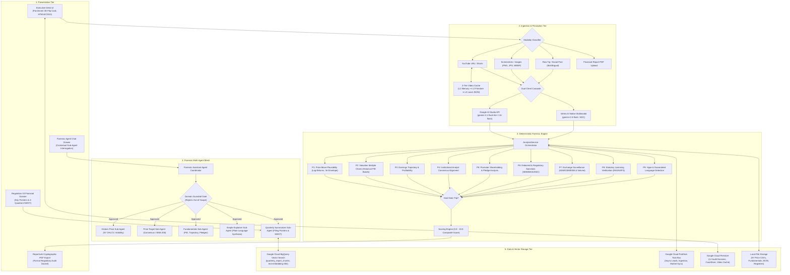
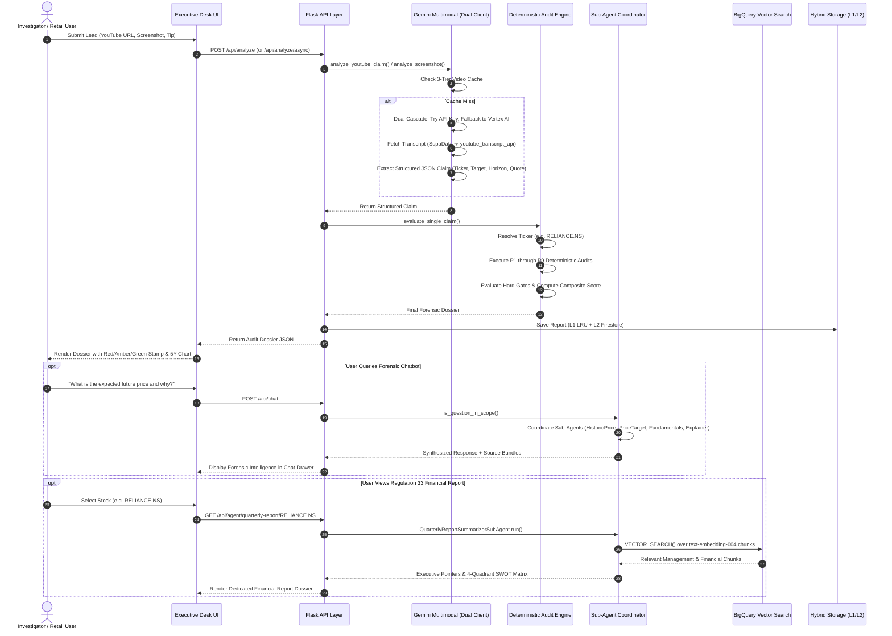

# InvestPI — Technical Architecture & Implementation Specification
### *Securities Forensic Intelligence, Multi-Agent Due-Diligence Mesh & BigQuery Vector RAG*

**Document Version:** 2.0-Production  
**Branch:** `deploy-dev`  
**Status:** Approved for Production Deployment & Evaluation  
**Target Platform:** Google Cloud Platform (Cloud Run, Vertex AI, BigQuery, Pub/Sub, Firestore)  
**Primary Language/Framework:** Python 3.11+ / Flask 3.0+ / Gunicorn WSGI  

---

## 📑 Table of Contents
1. [Executive Summary & Threat Model](#1-executive-summary--threat-model)
2. [End-to-End System Architecture](#2-end-to-end-system-architecture)
3. [Multimodal Ingestion & Perception Engine](#3-multimodal-ingestion--perception-engine)
4. [Deterministic 9-Parameter Forensic Audit Engine](#4-deterministic-9-parameter-forensic-audit-engine)
5. [Multi-Agent Conversational Due Diligence Sub-System](#5-multi-agent-conversational-due-diligence-sub-system)
6. [BigQuery Vector Search & RAG Architecture](#6-bigquery-vector-search--rag-architecture)
7. [Decoupled Asynchronous Pub/Sub Pipeline](#7-decoupled-asynchronous-pubsub-pipeline)
8. [Hybrid Storage & Multi-Tier Caching Architecture](#8-hybrid-storage--multi-tier-caching-architecture)
9. [Regulatory Registries & Market Data Synchronizer](#9-regulatory-registries--market-data-synchronizer)
10. [Forensic Reporting & PDF Generation Engine](#10-forensic-reporting--pdf-generation-engine)
11. [REST API Contract & Endpoints Reference](#11-rest-api-contract--endpoints-reference)
12. [Configuration & Environment Variables Dictionary](#12-configuration--environment-variables-dictionary)
13. [Verification & Testing Suite](#13-verification--testing-suite)
14. [Cloud Deployment, Security & Cost Analysis](#14-cloud-deployment-security--cost-analysis)

---

## 1. Executive Summary & Threat Model

### 1.1 Purpose & Scope
InvestPI is an autonomous, multimodal securities forensic intelligence platform engineered to audit social media stock recommendations, finfluencer tips, and corporate financial disclosures. It evaluates incoming leads across three key Asia-Pacific jurisdictions:
- **India**: Regulated by the Securities and Exchange Board of India (**SEBI**).
- **Singapore**: Regulated by the Monetary Authority of Singapore (**MAS**).
- **Australia**: Regulated by the Australian Securities and Investments Commission (**ASIC**).

### 1.2 Target Threat Vectors
1. **Pump-and-Dump Syndicates**: Coordinated campaigns on Telegram, WhatsApp, and YouTube inflating micro-cap or illiquid securities prior to operator exits.
2. **Unregistered Finfluencers**: Unlicensed content creators dispensing individualized financial advice without statutory registrations (SEBI Research Analyst/Investment Adviser, MAS Financial Adviser, ASIC AFS Licensee).
3. **Deceptive Return Guarantees**: Use of manipulative language (*"100% guaranteed jackpot"*, *"multibagger breakout"*, *"पक्का मुनाफा"*, *"稳赚不赔"*) violating statutory advertising codes.
4. **Options & Futures Baiting**: Promises of rapid, extreme percentage moves over unrealistic, short time horizons (e.g., $+40\%$ in 7 days).
5. **Corporate Disclosure Opacity**: Inability of retail investors to rapidly digest multi-page Regulation 33 earnings statements, segmental trends, and balance-sheet vulnerabilities.

### 1.3 Core Engineering Philosophy: Deterministic Grounding
Large Language Models (LLMs) are prone to hallucinations, mathematical approximations, and sycophancy when analyzing quantitative financial data. InvestPI establishes a strict architectural partition:
- **Generative AI (Google GenAI / Gemini 2.5 Flash / 3.1 Flash Lite)**: Restricted exclusively to **multimodal perception**, text/video/image information extraction, structured schema generation, and natural-language synthesis.
- **Deterministic Math Engine**: All risk calculations, volatility envelopes, valuation metrics, surveillance checks, and final scores are executed **100% mathematically in pure Python**. A GenAI model cannot override a numerical threshold or alter a forensic verdict.

---

## 2. End-to-End System Architecture

### 2.1 Multi-Tier Architecture Diagram



### 2.2 End-to-End Sequence Flow



---

## 3. Multimodal Ingestion & Perception Engine

Located in [`app/gemini/client.py`](file:///Users/chawadesharvari17gmail.com/Desktop/projects/InvestAI-AI_BuildersCup/app/gemini/client.py), the ingestion layer manages the perception and extraction of structured claims from raw, unstructured media.

### 3.1 Financial Relevance Pre-Filter
Before executing generative AI calls, incoming text is evaluated via `is_likely_financial_text()`:
- Inspects text against a multilingual corpus of financial keywords in English, Hindi (Devanagari: `खरीदारी`, `बिकवाली`, `मुनाफा`, `शेयर`), and Mandarin (`股票`, `买入`, `目标价`, `暴涨`, `分红`).
- Cross-references terms against the tracked universe tickers, company names, and aliases.
- Non-financial inputs immediately return a standardized refusal:
  ```json
  {
    "is_financial_advice": false,
    "message": "Not a financial advice, kindly provide relevant input"
  }
  ```

### 3.2 Dual-Client Cascade Architecture
To achieve 99.99% availability during quota exhaustion, rate limiting, or regional network blips, the `GeminiAuditor` maintains two independent client connections:
1. **Google AI Studio API Client (`genai.Client(api_key=...)`)**:
   - Model Priority: `gemini-3.1-flash-lite` $\rightarrow$ `gemini-3.8-flash` $\rightarrow$ `gemini-2.5-flash`.
   - Optimized for sub-second claim extraction and JSON schema enforcement.
2. **Google Cloud Vertex AI Client (`genai.Client(vertexai=True, project=..., location=...)`)**:
   - Model Priority: `gemini-2.5-flash` $\rightarrow$ `gemini-2.0-flash` $\rightarrow$ `gemini-1.5-flash`.
   - Leverages Application Default Credentials (ADC) on Google Cloud Run without exposing API keys.

The `_get_cascades()` method orders available clients and attempts model generation iteratively. If the primary client encounters an HTTP 429 (Rate Limit) or 503 (Overloaded), execution fails over seamlessly to the secondary tier.

### 3.3 YouTube Video Ingestion & 3-Tier Persistent Cache
Processing video requires transcription, metadata extraction, and timestamp alignment:
1. **oEmbed & HTML Extraction**: Retrieves official video title, creator channel, and thumbnail image bytes via `https://www.youtube.com/oembed`.
2. **Spoken Audio Transcript Acquisition**:
   - **Alternative 1 (Managed Transcript API)**: Queries SupaData API if `Config.SUPADATA_API_KEY` is present.
   - **Alternative 2 (Local Scraper Fallback)**: Uses `youtube_transcript_api` searching across languages `['hi', 'en', 'en-IN', 'en-GB', 'en-US']`.
3. **3-Tier Persistent Video Cache**:
   - **L1 (In-Memory)**: Python process cache for instant repeated lookups.
   - **L2 (Google Cloud Firestore)**: Collection `investpi_video_cache` shared across all Cloud Run instances.
   - **L3 (Local File System)**: JSON files stored in `data/video_cache/<video_id>.json`.
4. **Anti-Degraded Cache Guard**:
   - If a cached entry contains empty claims, corrupt JSON, or placeholder text, the cache entry is automatically purged and re-analyzed.
5. **Presentation Delay (`VIDEO_CACHE_DELAY_SEC`)**:
   - For live judging and hackathon presentations, a configurable sleep delay (default: `5.0s`) simulates live serverless video inspection when retrieving from cache.

---

## 4. Deterministic 9-Parameter Forensic Audit Engine

Located in [`app/engine/`](file:///Users/chawadesharvari17gmail.com/Desktop/projects/InvestAI-AI_BuildersCup/app/engine/), this subsystem performs mathematical audits on extracted claims.

```
                                    +-----------------------------+
                                    | Extracted Claim from Gemini |
                                    +--------------+--------------+
                                                   |
                                                   v
                    +-------------------------------------------------------------+
                    |           Ticker Resolution & Data Fetching                 |
                    | (Current Price, 5Y Price History CSV, Fundamentals JSON)    |
                    +------------------------------+------------------------------+
                                                   |
        +------------------+-----------------------+-----------------------+------------------+
        |                  |                       |                       |                  |
        v                  v                       v                       v                  v
+---------------+  +---------------+       +---------------+       +---------------+  +---------------+
| P1: Volatility|  | P2: Valuation |  ...  | P6: Sanctions |       | P7: Surveill. |  | P9: Hype Lang |
| (Hard Gate)   |  | (Hard Gate)   |       | (Hard Gate)   |       | (Hard Gate)   |  | (Weight: 8%)  |
+-------+-------+  +-------+-------+       +-------+-------+       +-------+-------+  +-------+-------+
        |                  |                       |                       |                  |
        +------------------+-----------------------+-----------------------+------------------+
                                                   |
                                                   v
                                   +-------------------------------+
                                   | Hard Gate Check: Any Tripped? |
                                   +---------------+---------------+
                                                   |
                           +-----------------------+-----------------------+
                           | YES                                           | NO
                           v                                               v
              +-------------------------+                     +-------------------------+
              | Score Clamped <= 2.5    |                     | Weighted Composite Sum  |
              | Verdict: HIGH RISK      |                     | Verdict: LOW/MED/HIGH   |
              +-------------------------+                     +-------------------------+
```

### 4.1 Detailed Parameter Formulations

#### Parameter 1: Price-Move Plausibility (Weight: 15% · Hard Gate: YES)
- **File**: [`p1_price_move.py`](file:///Users/chawadesharvari17gmail.com/Desktop/projects/InvestAI-AI_BuildersCup/app/engine/parameters/p1_price_move.py)
- **Objective**: Evaluates whether the claimed percentage move $R_{\text{claim}}$ over time horizon $H$ (in trading days) is statistically probable given the security's 5-year empirical daily logarithmic returns:
  $$r_t = \ln\left(\frac{P_t}{P_{t-1}}\right)$$
- **Volatility Envelope**:
  $$\sigma_H = \sigma_{\text{daily}} \times \sqrt{H}$$
  $$\text{Expected Move Envelope} = \pm 3 \times \sigma_H$$
- **Hard Gate Trigger**:
  $$\text{Required Daily Drift} = \left(1 + \frac{R_{\text{claim}}}{100}\right)^{\frac{1}{H}} - 1$$
  If $\text{Required Daily Drift} > 4.0 \times \sigma_{\text{daily}}$ or $R_{\text{claim}} > 100\%$ within $H \le 14$ days, the Hard Gate trips to **HIGH RISK** ($S_1 \le 2.0$).

#### Parameter 2: Valuation Envelope (Weight: 12% · Hard Gate: YES)
- **File**: [`p2_valuation.py`](file:///Users/chawadesharvari17gmail.com/Desktop/projects/InvestAI-AI_BuildersCup/app/engine/parameters/p2_valuation.py)
- **Objective**: Checks whether the target price pushes the company's valuation into unsustainable territory:
  $$\text{Implied Target } P/E = \text{Current } P/E \times \left(\frac{P_{\text{target}}}{P_{\text{current}}}\right)$$
- **Hard Gate Trigger**: If $\text{Implied Target } P/E > 3.0 \times \text{Median}_{5Y}(P/E)$ and $\text{Implied } P/E > 80.0$, the Hard Gate trips to **HIGH RISK** ($S_2 \le 2.0$).

#### Parameter 3: Earnings Trajectory (Weight: 10% · Hard Gate: NO)
- **File**: [`p3_earnings.py`](file:///Users/chawadesharvari17gmail.com/Desktop/projects/InvestAI-AI_BuildersCup/app/engine/parameters/p3_earnings.py)
- **Objective**: Evaluates fundamental earnings health over trailing quarters:
  - Trailing 12-Month Net Profit Margin.
  - Sequential revenue growth rate.
- **Scoring**: If net profit is negative (loss-making entity) while a "BUY" tip is promoted, the score is capped at $2.0/10.0$. Consistent double-digit profit growth awards $8.0 - 10.0/10.0$.

#### Parameter 4: Analyst Consensus Alignment (Weight: 10% · Hard Gate: NO)
- **File**: [`p4_analyst.py`](file:///Users/chawadesharvari17gmail.com/Desktop/projects/InvestAI-AI_BuildersCup/app/engine/parameters/p4_analyst.py)
- **Objective**: Measures deviation between the influencer's target and institutional equity research consensus:
  $$\Delta_{\text{analyst}} = \frac{P_{\text{claim}} - P_{\text{analyst\_mean}}}{P_{\text{analyst\_mean}}} \times 100\%$$
- **Scoring**: If $\Delta_{\text{analyst}} > +35\%$, score drops below $3.0/10.0$. Alignment within $\pm 10\%$ awards $10.0/10.0$.

#### Parameter 5: Promoter & Insider Stability (Weight: 8% · Hard Gate: NO)
- **File**: [`p5_promoter.py`](file:///Users/chawadesharvari17gmail.com/Desktop/projects/InvestAI-AI_BuildersCup/app/engine/parameters/p5_promoter.py)
- **Objective**: Inspects promoter skin-in-the-game and encumbrances:
  - Promoter Holding Percentage ($H_{\text{promoter}}$).
  - Pledged Shares as % of Promoter Holding ($P_{\text{pledge}}$).
- **Penalties**: If $P_{\text{pledge}} > 25\%$, score is penalized by 3 points. If $P_{\text{pledge}} > 50\%$ (high insolvency risk), score is capped at $2.0/10.0$.

#### Parameter 6: Litigation & Regulatory Sanctions (Weight: 15% · Hard Gate: YES)
- **File**: [`p6_regulatory.py`](file:///Users/chawadesharvari17gmail.com/Desktop/projects/InvestAI-AI_BuildersCup/app/engine/parameters/p6_regulatory.py)
- **Objective**: Cross-examines entity and promoters against regulatory enforcement registries:
  - India: SEBI Debarred Entities & Interim Orders.
  - Singapore: MAS Investor Alert List.
  - Australia: ASIC MoneySmart Alert List.
- **Matching Algorithm**: Combines exact string matching and RapidFuzz token set ratio ($\text{threshold} \ge 88\%$). Any match **trips the Hard Gate immediately** to $S_6 = 0.0$ and sets final verdict to **HIGH RISK**.

#### Parameter 7: Surveillance & Volume Anomalies (Weight: 12% · Hard Gate: YES)
- **File**: [`p7_surveillance.py`](file:///Users/chawadesharvari17gmail.com/Desktop/projects/InvestAI-AI_BuildersCup/app/engine/parameters/p7_surveillance.py)
- **Objective**: Checks for statutory surveillance list inclusions:
  - Additional Surveillance Measure (**ASM** Stage I to IV).
  - Graded Surveillance Measure (**GSM** Stage I to IV).
  - Enhanced Surveillance Measure (**ESM** for micro-caps).
- **Volume Spike**: Tests if current trading volume exceeds $5.0 \times$ the 20-day moving average volume without corporate news. Inclusion on ASM/GSM **trips the Hard Gate**.

#### Parameter 8: Licensing & Registration Verification (Weight: 10% · Hard Gate: NO)
- **File**: [`p8_licensing.py`](file:///Users/chawadesharvari17gmail.com/Desktop/projects/InvestAI-AI_BuildersCup/app/engine/parameters/p8_licensing.py)
- **Objective**: Audits the author/creator of the recommendation against official advisor registries:
  - SEBI Registered Research Analysts (RA) & Investment Advisers (IA).
  - MAS Financial Advisers Directory (FID).
  - ASIC Australian Financial Services (AFS) Licensee Directory.
- **Scoring**: If creator is unregistered or omits registration details, $S_8 = 1.0/10.0$ with an "UNLICENSED ADVISER" warning flag.

#### Parameter 9: Hype & Manipulation Language (Weight: 8% · Hard Gate: NO)
- **File**: [`p9_hype_language.py`](file:///Users/chawadesharvari17gmail.com/Desktop/projects/InvestAI-AI_BuildersCup/app/engine/parameters/p9_hype_language.py)
- **Objective**: Evaluates natural language in transcripts, titles, and captions for manipulative phrases:
  - Guarantees: *"100% guarantee"*, *"sure shot"*, *"risk-free profit"*, *"पक्का फायदा"*, *"保本保收益"*.
  - Urgency triggers: *"buy before circuit"*, *"blast tomorrow"*, *"don't miss multibagger"*.
- **Scoring**: Score decreases proportionally to the density of flagged tokens.

### 4.2 Composite Scoring & Verdict Logic
Located in [`app/engine/scoring.py`](file:///Users/chawadesharvari17gmail.com/Desktop/projects/InvestAI-AI_BuildersCup/app/engine/scoring.py):
$$\text{Raw Score} = \sum_{i=1}^{9} \left( w_i \times S_i \right)$$
$$\text{Final Score} = \begin{cases} \min(\text{Raw Score}, 2.5) & \text{if any Hard Gate is TRIPPED} \\ \text{Raw Score} & \text{if all Hard Gates are PASSED} \end{cases}$$

| Final Score Range | Verdict Category | Stamp Color | UI Badge Class |
| :---: | :---: | :---: | :---: |
| **`0.0 - 2.9`** | **HIGH RISK** | Red (`#a93a2d`) | `badge-red` |
| **`3.0 - 6.4`** | **CAUTION / MODERATE RISK** | Amber (`#c86828`) | `badge-amber` |
| **`6.5 - 10.0`** | **VERIFIED / LOW RISK** | Green (`#257849`) | `badge-green` |

---

## 5. Multi-Agent Conversational Due Diligence Sub-System

Located in [`app/agent/`](file:///Users/chawadesharvari17gmail.com/Desktop/projects/InvestAI-AI_BuildersCup/app/agent/), this module coordinates multi-agent conversations grounded exclusively in the active audit dossier.

```
                              User Question
                                    |
                                    v
                     +------------------------------+
                     | Domain Guardrail Gate        |
                     | (Regex & Keyword Evaluation) |
                     +--------------+---------------+
                                    |
                    +---------------+---------------+
                    | Out of Scope?                 | In Scope
                    v                               v
    +-------------------------------+   +------------------------------------+
    | Refusal Message Returned:     |   | SubAgentCoordinator                |
    | "Question out of my domain..."|   | (Concurrent Multi-Agent Execution) |
    +-------------------------------+   +-----------------+------------------+
                                                          |
                 +-------------------+--------------------+-------------------+
                 |                   |                    |                   |
                 v                   v                    v                   v
        +-----------------+  +-----------------+  +---------------+  +-----------------+
        | HistoricalPrice |  | PriceTarget     |  | Fundamentals  |  | SimpleExplainer |
        | SubAgent        |  | SubAgent        |  | SubAgent      |  | SubAgent        |
        | (5Y Returns)    |  | (EMA-200 Target)|  | (Valuations)  |  | (Retail Synth)  |
        +-----------------+  +-----------------+  +---------------+  +-----------------+
                 |                   |                    |                   |
                 +-------------------+--------------------+-------------------+
                                             |
                                             v
                              +------------------------------+
                              | Consolidated Response Bundle |
                              | (Synthesized Reply + Sources)|
                              +------------------------------+
```

### 5.1 Guardrail Gateway (`forensic_agent.py`)
To prevent chatbot misuse, prompt injections, or off-topic conversation, `ForensicAssistantAgent.is_question_in_scope()` applies deterministic intent screening:
- **Rejection Triggers**: Programming questions (Python, JavaScript, SQL), sports, recipes, entertainment, geopolitics, general conversation, or crypto (unless crypto is the specific subject security).
- **Approved Triggers**: References to the audited stock, price targets, risk scores, P1-P9 parameters, valuation multiples, promoter holding, regulatory licenses, or moving averages.
- **Rejection Output**:
  ```
  "Question out of my domain, kindly ask something related to given findings"
  ```

### 5.2 The 5 Specialized Sub-Agents (`subagents.py`)

#### 1. Historical Price Sub-Agent (`HistoricalPriceSubAgent`)
- **Agent ID**: `historic_price_agent`
- **Output**: 5-year OHLCV metrics, multi-horizon returns (1-Week, 1-Month, 3-Month, 6-Month, 1-Year, 5-Year CAGR), 52-week High/Low, annualized volatility, and moving averages (SMA-20, SMA-50, SMA-200).

#### 2. Price Target Sub-Agent (`PriceTargetSubAgent`)
- **Agent ID**: `price_target_agent`
- **Dual-Method Forecasting**:
  1. *Primary Method*: Institutional Analyst Consensus Target Mean (`target_mean`).
  2. *Deterministic Fallback*: If institutional consensus is unavailable, projects a 21-trading-day target using the 200-day Exponential Moving Average (`EMA-200`):
     $$\text{Target}_{\text{EMA200}} = \text{EMA}_{200} \times \left(1 + \frac{\text{Drift}_{30d}}{100}\right)$$
  - Returns expected return percentage, methodology used, and comparison against claimed target.

#### 3. Fundamentals Sub-Agent (`FundamentalsSubAgent`)
- **Agent ID**: `fundamentals_agent`
- **Output**: Trailing & Forward P/E multiples, Price-to-Book (P/B), Enterprise Value (EV/EBITDA), Market Capitalization in localized units (₹ Crores, S$ Billions, A$ Billions), quarterly revenue & net profit trends, and promoter shareholding/pledging status.

#### 4. Simple Explainer Sub-Agent (`SimpleExplainerSubAgent`)
- **Agent ID**: `explainer_agent`
- **Output**: Jargon-free retail translation. Synthesizes complex quantitative findings (e.g., $3\sigma$ standard deviations, EV/EBITDA multiples, ASM Stage III flags) into 3 concise, clear bullet points for non-professional retail investors.

#### 5. Quarterly Report Summarizer Sub-Agent (`QuarterlyReportSummarizerSubAgent`)
- **Agent ID**: `quarterly_report_agent`
- **Integration**: Works directly with `BigQueryFinancialRAG` to analyze Regulation 33 earnings statements. Generates 4-quadrant **SWOT Analysis** matrices (Strengths, Weaknesses, Opportunities, Threats) and key operational takeaways.

---

## 6. BigQuery Vector Search & RAG Architecture

Located in [`app/agent/bigquery_rag.py`](file:///Users/chawadesharvari17gmail.com/Desktop/projects/InvestAI-AI_BuildersCup/app/agent/bigquery_rag.py), this module delivers enterprise-scale semantic retrieval over corporate filings.

```
                          Quarterly Financial Filings (Regulation 33)
                                               |
                                               v
                          +------------------------------------------+
                          | Chunking Pipeline                        |
                          | (800-token chunks with 100-token overlap)|
                          +--------------------+---------------------+
                                               |
                                               v
                          +------------------------------------------+
                          | Vertex AI text-embedding-004             |
                          | (768-dimensional Vector Embeddings)      |
                          +--------------------+---------------------+
                                               |
                                               v
                          +------------------------------------------+
                          | Google Cloud BigQuery Table              |
                          | financial_intelligence.                  |
                          | quarterly_report_chunks                  |
                          | PARTITION BY DATE(ingested_at)           |
                          | CLUSTER BY ticker, quarter               |
                          | IVF Vector Index (COSINE distance)       |
                          +--------------------+---------------------+
                                               |
                 Query Text -------------------+
                                               v
                          +------------------------------------------+
                          | BigQuery SQL: VECTOR_SEARCH()            |
                          | (Approximate Nearest Neighbor ANN Query) |
                          +--------------------+---------------------+
                                               |
                                               v
                          +------------------------------------------+
                          | Top-K Chunks Synthesized by Gemini Pro   |
                          | ➔ 4-Quadrant SWOT Matrix & Key Pointers  |
                          +------------------------------------------+
```

### 6.1 Database Schema & DDL
```sql
-- 1. Create Financial Intelligence Schema
CREATE SCHEMA IF NOT EXISTS `{{PROJECT_ID}}.financial_intelligence`
OPTIONS (location = 'US');

-- 2. Create BigQuery ML text-embedding-004 Remote Model
CREATE OR REPLACE MODEL `{{PROJECT_ID}}.financial_intelligence.embedding_model`
REMOTE WITH CONNECTION `{{PROJECT_ID}}.us.vertex-connection`
OPTIONS (ENDPOINT = 'text-embedding-004');

-- 3. Create Partitioned & Clustered Chunks Table with Vector Column
CREATE TABLE IF NOT EXISTS `{{PROJECT_ID}}.financial_intelligence.quarterly_report_chunks` (
    chunk_id STRING NOT NULL,
    ticker STRING NOT NULL,
    company_name STRING NOT NULL,
    quarter STRING NOT NULL,
    section_name STRING,
    content STRING NOT NULL,
    embedding ARRAY<FLOAT64>,
    metadata JSON,
    ingested_at TIMESTAMP DEFAULT CURRENT_TIMESTAMP()
)
PARTITION BY DATE(ingested_at)
CLUSTER BY ticker, quarter;

-- 4. Create Inverted File (IVF) Vector Index for Cosine Distance
CREATE VECTOR INDEX IF NOT EXISTS quarterly_chunks_vector_idx
ON `{{PROJECT_ID}}.financial_intelligence.quarterly_report_chunks`(embedding)
OPTIONS(distance_type = 'COSINE', index_type = 'IVF');
```

### 6.2 Vector Search SQL Execution
```sql
SELECT 
    base.chunk_id,
    base.ticker,
    base.company_name,
    base.quarter,
    base.section_name,
    base.content,
    distance
FROM VECTOR_SEARCH(
    TABLE `{{PROJECT_ID}}.financial_intelligence.quarterly_report_chunks`,
    'embedding',
    (
        SELECT ml_generate_embedding_result AS embedding
        FROM ML.GENERATE_EMBEDDING(
            MODEL `{{PROJECT_ID}}.financial_intelligence.embedding_model`,
            (SELECT @query_text AS content)
        )
    ),
    top_k => @top_k,
    distance_type => 'COSINE'
)
WHERE base.ticker = @target_ticker
ORDER BY distance ASC;
```

### 6.3 Pre-Packaged Seed Dataset & Offline Fallback
- Seed datasets: `data/bigquery_seed_chunks.jsonl` (vector chunks) and `data/bigquery_quarterly_reports.jsonl` (master structured records).
- The class `BigQueryFinancialRAG` implements an automatic offline fallback: if Google Cloud BigQuery is unreachable or credentials are not supplied, it executes in-memory BM25/keyword retrieval over local markdown files in `data/quarterly_reports/`, ensuring tests and demonstrations pass anywhere.

---

## 7. Decoupled Asynchronous Pub/Sub Pipeline

Located in [`app/pubsub/`](file:///Users/chawadesharvari17gmail.com/Desktop/projects/InvestAI-AI_BuildersCup/app/pubsub/), this module implements an asynchronous message bus using **Google Cloud Pub/Sub**.

```
HTTP POST /api/analyze/async
             |
             v
   +--------------------+
   | Create CaseStore   |
   | (State: QUEUED)    |
   +---------+----------+
             |
             v
   +--------------------+
   | Publish Event:     |
   | LeadSubmittedEvent |
   +---------+----------+
             |
             v
   ============================== [Google Cloud Pub/Sub Topic] ==============================
                                  investpi-leads-inbound
   ============================================+============================================
                                               |
                                               v (Push Subscription)
                                  +---------------------------+
                                  | POST /api/pubsub/push     |
                                  | (Token Authentication)    |
                                  +------------+--------------+
                                               |
                                               v
                                  +---------------------------+
                                  | Execute Background Audit  |
                                  | (State: PROCESSING)       |
                                  +------------+--------------+
                                               |
                                               v
                                  +---------------------------+
                                  | Publish Completed Event:  |
                                  | AuditCompletedEvent       |
                                  | (State: COMPLETED)        |
                                  +------------+--------------+
                                               |
                                               v
   ============================== [Google Cloud Pub/Sub Topic] ==============================
                                  investpi-audits-completed
   ==========================================================================================
                                               |
                                               v
                          Frontends streaming /api/cases/<case_id>/stream
                          receive real-time SSE push updates!
```

### 7.1 Event Schemas & Contracts ([`events.py`](file:///Users/chawadesharvari17gmail.com/Desktop/projects/InvestAI-AI_BuildersCup/app/pubsub/events.py))
1. **`LeadSubmittedEvent`**: Ingests new leads (`case_id`, `modality`, `payload`, `region`, `mime_type`, `meta`).
2. **`AuditCompletedEvent`**: Emits completed audits (`case_id`, `status`, `completed_at`, `result`, `error`).
3. **`StockSyncEvent`**: Triggers async market data refreshes (`ticker`, `market`, `force_refresh`).
4. **`SubAgentTaskEvent`**: Dispatches background sub-agent execution (`task_id`, `ticker`, `market`, `query`, `claimed_target`).

### 7.2 CaseStore State Machine ([`store.py`](file:///Users/chawadesharvari17gmail.com/Desktop/projects/InvestAI-AI_BuildersCup/app/pubsub/store.py))
- **Status Lifecycle**: `QUEUED` $\rightarrow$ `PROCESSING` $\rightarrow$ `COMPLETED` / `REJECTED_IRRELEVANT` / `FAILED`.
- **Storage**: Backed by `ReportStorage` (in-memory LRU with optional Firebase Firestore synchronization).
- **Server-Sent Events (SSE)**: Clients connect to `/api/cases/<case_id>/stream` to receive real-time updates as background workers progress.

---

## 8. Hybrid Storage & Multi-Tier Caching Architecture

Located in [`app/data/storage.py`](file:///Users/chawadesharvari17gmail.com/Desktop/projects/InvestAI-AI_BuildersCup/app/data/storage.py), the hybrid storage tier solves container ephemeral filesystem constraints.

```
                      Write Operation: save_report()
                                    |
                    +---------------+---------------+
                    |                               |
                    v                               v
    +-------------------------------+   +-------------------------------+
    | L1: In-Memory Bounded LRU     |   | L2: Google Cloud Firestore    |
    | (Max 150 items, sub-ms read,  |   | (Collection: investpi_reports,|
    |  prevents container OOM)      |   |  survives scale-to-zero)      |
    +-------------------------------+   +-------------------------------+
```

### 8.1 L1: Bounded LRU Memory Cache
- Implemented via `collections.OrderedDict` with `max_items=150`.
- Automatically evicts the oldest entries (`popitem(last=False)`) when limits are reached, eliminating memory leaks during long-running Cloud Run operations.

### 8.2 L2: Google Cloud Firestore Document Persistence
- **Runtime Activation**: Enabled automatically when running on Google Cloud Run (`Config.IS_CLOUD == True` or `USE_FIREBASE=1`).
- **Authentication**: Seamlessly connects using Application Default Credentials (ADC) without requiring local JSON service-account key files inside containers.
- **Collections Schema**:
  1. `investpi_reports`: Stores finalized audit dossiers, composite scores, P1-P9 results, extracted quotes, and Base64-encoded historical charts. Keyed by `report_id`.
  2. `investpi_cases`: Tracks asynchronous background investigations and state transitions (`QUEUED`, `PROCESSING`, `COMPLETED`, `FAILED`, `REJECTED_IRRELEVANT`). Keyed by `case_id`.
  3. `investpi_video_cache`: Multi-instance persistent cache for YouTube perception analyses. Prevents redundant Gemini calls when identical video URLs are analyzed across different Cloud Run instances. Keyed by 11-character YouTube `video_id`.
  4. `market_prices` / `fundamentals`: Cached snapshots of live valuation multiples, EPS figures, and daily closing candle series updated by the market synchronizer.
- **Fail-Safe Fallback**: If Firestore is unreachable or credentials are not supplied, the storage layer automatically falls back to the L1 bounded cache and local disk without crashing.

### 8.3 Google Cloud Secret Manager Architecture
To maintain enterprise-grade security and prevent credentials leakage, InvestPI prohibits hardcoded secrets in source files, Dockerfiles, or build arguments:
- **Secrets Managed**:
  - `GEMINI_API_KEY`: Primary Google AI Studio Developer API key.
  - `CRON_SECRET`: Shared secret token for Cloud Scheduler EOD sync authorization.
  - `PUBSUB_PUSH_TOKEN`: Verification token for Cloud Run Pub/Sub push endpoints.
  - `SUPADATA_API_KEY`: Optional key for managed YouTube transcript ingestion.
- **Mount Mechanism**: Injected directly into Cloud Run container memory using native GCP secret integration:
  ```bash
  --set-secrets="GEMINI_API_KEY=GEMINI_API_KEY:latest,CRON_SECRET=CRON_SECRET:latest"
  ```
- **Access Control**: Governed by the `roles/secretmanager.secretAccessor` IAM role bound to the Cloud Run Compute Engine service account.
- **Zero-Downtime Rotation**: Updating secret versions via `gcloud secrets versions add` applies to subsequent container instances automatically without requiring image rebuilds.

---

## 9. Regulatory Registries, Schedulers & Market Synchronization

### 9.1 Jurisdictional Configurations
Market profiles are defined in YAML format in [`markets/`](file:///Users/chawadesharvari17gmail.com/Desktop/projects/InvestAI-AI_BuildersCup/markets/):
- **India (`IN.yaml`)**: Primary regulator SEBI; currency INR (`₹`); exchanges NSE, BSE; surveillance lists ASM, GSM, ESM.
- **Singapore (`SG.yaml`)**: Primary regulator MAS; currency SGD (`S$`); exchange SGX.
- **Australia (`AU.yaml`)**: Primary regulator ASIC; currency AUD (`A$`); exchange ASX.

### 9.2 Real-Time & Historical Market Pricing
Located in [`app/data/loader.py`](file:///Users/chawadesharvari17gmail.com/Desktop/projects/InvestAI-AI_BuildersCup/app/data/loader.py):
- **Live Price Cache**: Fetches intraday quotes via `yfinance` with a 10-minute in-memory TTL.
- **5-Year Price Envelopes**: Pre-cached daily OHLCV CSVs located in `data/prices/` for instantaneous statistical audits.
- **Offline Reliability**: If network access is restricted, the loader falls back to the latest close recorded in local price CSVs or balance-sheet files.

### 9.3 Google Cloud Scheduler & Automated EOD Crons
To ensure forensic scoring reflects official post-settlement closing prices, InvestPI implements an automated market synchronization engine in [`app/data/market_sync.py`](file:///Users/chawadesharvari17gmail.com/Desktop/projects/InvestAI-AI_BuildersCup/app/data/market_sync.py):
- **Exchange Timezone Reconciliation**:
  - 🇮🇳 **India (NSE/BSE)**: Market close 15:30 IST, settlement window 15:45 IST ➔ Recommended UTC Cron: `15 10 * * 1-5`.
  - 🇸🇬 **Singapore (SGX)**: Market close 17:00 SGT, settlement window 17:30 SGT ➔ Recommended UTC Cron: `30 9 * * 1-5`.
  - 🇦🇺 **Australia (ASX)**: Market close 16:00 AEST, settlement window 16:30 AEST ➔ Recommended UTC Cron: `30 6 * * 1-5`.
- **Market State Validation Engine**:
  - `MARKET_OPEN_TRADING`: Trading is active; sync is deferred until settlement.
  - `SETTLEMENT_PENDING`: Exchanges have closed, but clearing houses are finalizing trade prints.
  - `SYNC_READY`: Clearing settled; daily closing prices are safe to append.
  - `WEEKEND_CLOSED`: Markets closed; cron triggers safely short-circuit.
- **Security & Authorization**: Every sync call requires cryptographic verification via `X-Cron-Secret` headers matching `Config.CRON_SECRET`.
- **Automated CLI Provisioning**:
  ```bash
  gcloud scheduler jobs create http sync-market-in \
    --schedule="15 10 * * 1-5" \
    --time-zone="UTC" \
    --uri="https://your-service.run.app/api/jobs/sync-market?market=IN" \
    --http-method=POST \
    --headers="X-Cron-Secret=YOUR_CRON_SECRET"
  ```
- **Schedule Endpoint**: `GET /api/markets/schedule` returns live schedule status and copy-pasteable `gcloud scheduler` commands.

---

## 10. Forensic Reporting & PDF Generation Engine

Located in [`app/reporting/`](file:///Users/chawadesharvari17gmail.com/Desktop/projects/InvestAI-AI_BuildersCup/app/reporting/):

### 10.1 Vector Chart Overlay (`chart_generator.py`)
- Generates high-resolution Matplotlib figures plotting 5 years of daily closing prices.
- Overlays the claimed target price as a dashed horizontal benchmark line.
- Computes and visually renders the 52-week High/Low price channel and moving averages.
- Exports clean Base64-encoded PNG strings for immediate UI embedding and PDF inclusion.

### 10.2 Cryptographic PDF Dossier (`pdf_generator.py`)
- Built using ReportLab's Platypus flowable document engine.
- Renders official regulatory mastheads, unique file identifiers (`#NSE-001`, `#SGX-001`, `#ASX-001`), official red/amber/green verdict stamps, tabular 9-parameter score breakdown, and legal disclaimers.
- Available for instant download via `GET /api/report/<report_id>.pdf`.

---

## 11. REST API Contract & Endpoints Reference

All endpoints are registered in [`app/routes/api.py`](file:///Users/chawadesharvari17gmail.com/Desktop/projects/InvestAI-AI_BuildersCup/app/routes/api.py). Interactive documentation is accessible at `/apidocs/` via Swagger UI.

### 11.1 Health & Diagnostic Probes
```http
GET /healthz
```
- **Response**: `200 OK`
  ```json
  {
    "status": "healthy",
    "service": "InvestPI",
    "version": "2.0-Production",
    "environment": "cloud",
    "timestamp": 1729200000.0,
    "gemini_configured": true,
    "firestore_connected": true
  }
  ```

### 11.2 Synchronous Investigation
```http
POST /api/analyze
Content-Type: application/json (or multipart/form-data)
```
- **Payload (JSON)**:
  ```json
  {
    "youtube_url": "https://www.youtube.com/watch?v=DivTA2Lz08s",
    "text": "Buy Reliance at 2850, target 3500 in 14 days guaranteed rocket!",
    "region": "IN"
  }
  ```
- **Response**: `200 OK`
  Returns full dossier containing composite score, verdict, P1-P9 breakdowns, extracted quotes, and chart Base64 image.

### 11.3 Asynchronous Ingestion & Streaming
```http
POST /api/analyze/async
Content-Type: application/json
```
- **Response**: `202 Accepted`
  ```json
  {
    "case_id": "case-94b2f1e6",
    "status": "QUEUED",
    "status_url": "/api/cases/case-94b2f1e6",
    "stream_url": "/api/cases/case-94b2f1e6/stream"
  }
  ```

```http
GET /api/cases/<case_id>/stream
Accept: text/event-stream
```
- **Response**: Server-Sent Events stream emitting live task state updates.

### 11.4 Forensic Agent Chatbot
```http
POST /api/chat
Content-Type: application/json
```
- **Payload**:
  ```json
  {
    "message": "Why is this stock flagged as high risk?",
    "report_id": "rep-abc12345",
    "history": []
  }
  ```
- **Response**: `200 OK`
  ```json
  {
    "reply": "The security RELIANCE.NS is flagged as HIGH RISK because Parameter 1 (Price-Move Plausibility) failed...",
    "in_scope": true,
    "ticker": "RELIANCE.NS",
    "subagents_invoked": ["historic_price_agent", "explainer_agent"],
    "sources": ["5-Year Daily Price Envelopes", "SEBI Regulations"]
  }
  ```

### 11.5 Synchronous Sub-Agent Execution
```http
GET /api/agent/subagents/<ticker>?query=predict+future+price
```
- **Response**: `200 OK`
  Returns consolidated JSON bundle from Historical Price, Price Target (Consensus / EMA-200), Fundamentals, and Explainer sub-agents.

### 11.6 Quarterly Financial Report Summarizer (BigQuery RAG)
```http
GET /api/agent/quarterly-report/<ticker>?live_gemini=false
```
- **Response**: `200 OK`
  Returns executive bullet pointers, segmental revenues, and a structured 4-quadrant SWOT matrix.

---

## 12. Configuration & Environment Variables Dictionary

Configured in [`app/config.py`](file:///Users/chawadesharvari17gmail.com/Desktop/projects/InvestAI-AI_BuildersCup/app/config.py):

| Variable Name | Default Value | Description |
| :--- | :--- | :--- |
| `GEMINI_API_KEY` | `""` | Google AI Studio Developer API Key. |
| `GEMINI_MODEL` | `gemini-3.1-flash-lite` | Primary Generative AI model name for extraction and chats. |
| `DEMO_MODE` | `1` (if no key) | Automatically falls back to offline mock dataset when API key is missing. |
| `GCP_PROJECT_ID` | `""` | Google Cloud Project ID hosting Cloud Run and Pub/Sub. |
| `USE_VERTEX_AI` | `1` on Cloud Run | Toggles Google Cloud Vertex AI client using Application Default Credentials. |
| `VERTEX_LOCATION` | `us-central1` | GCP region for Vertex AI endpoints and Gemini models. |
| `BIGQUERY_PROJECT_ID` | `""` | GCP Project ID containing the BigQuery Vector Search dataset. |
| `BIGQUERY_DATASET` | `financial_intelligence`| BigQuery dataset storing quarterly chunks and tables. |
| `PUBSUB_TOPIC_LEADS` | `investpi-leads-inbound`| Pub/Sub topic for inbound audit requests. |
| `PUBSUB_TOPIC_AUDITS`| `investpi-audits-completed`| Pub/Sub topic for completed investigation events. |
| `PUBSUB_PUSH_TOKEN` | `""` | Shared secret token validating incoming Pub/Sub push webhooks. |
| `USE_FIREBASE` | `1` on Cloud Run | Toggles Google Cloud Firestore persistence. |
| `SUPADATA_API_KEY` | `""` | Optional API key for Managed SupaData YouTube transcript extraction. |
| `VIDEO_CACHE_DELAY_SEC`| `5.0` | Presentation UX delay (in seconds) for demonstration pacing. |

---

## 13. Verification & Testing Suite

Located in [`tests/`](file:///Users/chawadesharvari17gmail.com/Desktop/projects/InvestAI-AI_BuildersCup/tests/), the test suite contains 40 automated tests:
1. `test_agent.py`: Verifies domain guardrail rejection, sub-agent coordination, and BigQuery vector fallback.
2. `test_engine.py`: Tests mathematical bounds, 5-year volatility envelopes, valuation checks, and hard-gate triggers across P1-P9.
3. `test_market_sync.py`: Validates yfinance live quote retrieval, intraday TTL caching, and offline fallback.
4. `test_pubsub.py`: Verifies event serialization, CaseStore lifecycle transitions, and push webhook parsing.
5. `test_relevance.py`: Checks financial relevance filtering in English, Hindi, and Mandarin.
6. `test_storage.py`: Tests L1 bounded LRU cache eviction and Firestore integration.
7. `test_test_assets.py`: End-to-end integration tests using packaged assets for India, Singapore, and Australia.

Run tests using:
```bash
PYTHONPATH=. ./venv/bin/pytest -v
```

---

## 14. Cloud Deployment, Security & Cost Analysis

### 14.1 Production Container Specification ([`Dockerfile`](file:///Users/chawadesharvari17gmail.com/Desktop/projects/InvestAI-AI_BuildersCup/Dockerfile))
- Base Image: `python:3.11-slim`
- Typography Packages: `fonts-dejavu-core` for clean ReportLab vector rendering.
- WSGI Web Server: `gunicorn --bind :$PORT --workers 2 --threads 4 --timeout 120 run:app`.

### 14.2 Cloud Run Deployment Command
```bash
gcloud run deploy investpi \
  --image gcr.io/$PROJECT_ID/investpi-forensics:latest \
  --platform managed \
  --region us-central1 \
  --allow-unauthenticated \
  --memory 2Gi \
  --cpu 2 \
  --min-instances 0 \
  --max-instances 5 \
  --set-env-vars="GEMINI_API_KEY=$GEMINI_API_KEY,USE_VERTEX_AI=1,VERTEX_PROJECT_ID=$PROJECT_ID,USE_FIREBASE=1"
```

### 14.3 Serverless Cost Optimization
- **Scale-to-Zero (`min-instances: 0`)**: Consumes **$0.00/month** when idle.
- **BigQuery Vector Search**: Serverless pay-per-query model eliminates the fixed monthly cost of dedicated vector databases (e.g. Pinecone/Weaviate at $70+/month).
- **Gemini Flash Lite**: Delivers high token efficiency and ultra-low inference costs ($0.075 per 1M input tokens).
- **Estimated Operating Cost**: Under ordinary testing and evaluation traffic, total GCP expenditure remains **below $1.00 USD per month**.
